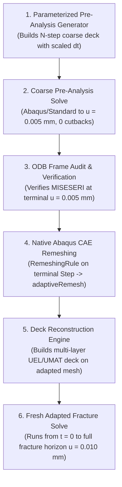

# Supervisor Decision Package: Qualified Method B Load-Partitioning Study on Mode-I Benchmark

**Document ID:** `SUPERVISOR_DECISION_METHOD_B_MODE1_LOAD_PARTITIONING`  
**Revision:** `2.0 (Scientifically Controlled Experimental Design & Preflight Plan)`  
**Date:** `2026-10-11`  
**Status:** `PROPOSED / PENDING SUPERVISOR REVIEW & EXPLICIT AUTHORIZATION`  
**Target Milestone:** Supervisor Meeting (Thursday, 22 October 2026, 10:00 AM)  
**Governing Benchmark:** Mode-I Symmetric Tension Crack Propagation ($l_0 = 7.5\,\mu\text{m}$, Frozen Baseline)  
**Author:** Gemini Antigravity (Tasks F1404, F1405)  

---

> [!IMPORTANT]
> **GOVERNANCE & EXECUTION DISCLAIMER:**
> This document constitutes a formal scientific study proposal, corrected experimental design, and preflight qualification audit for supervisor review. **It does NOT authorize any Abaqus solver runs, PBS job submissions, queue modifications, or cluster executions.** All HPC actions remain strictly locked until explicit, recorded human supervisor approval is granted. The frozen Mode-I baseline (tag `v2026.10.08-supervisor-meeting-mode1-freeze`, UEL SHA-256 `CE8D5EDCD2911DCB018BB15275271F874E7EA62B8FB48CF4A8297469A83ACDD6`) remains 100% frozen and untouched.

---

## 1. Executive Summary & Problem Formulation

### 1.1 Limitation of Standard Two-Pass Offline Pre-Refinement (Method A)
In the native Abaqus adaptive remeshing workflow demonstrated in Chapter 4 (Method A):
1. A preliminary coarse finite-element analysis (pre-analysis) is solved across the displacement loading horizon.
2. The Zienkiewicz–Zhu / SPR-based recovery error indicator (`MISESERI` / `MISESAVG`) is computed at selected state frames.
3. Abaqus CAE generates an adapted mesh conforming to the specified error target ($\text{ET} = 2.0\%$).
4. The full phase-field fracture simulation is then executed from $t = 0$ on this fixed adapted discretization.

While Method A achieved a **$2.46\times$ workflow walltime speedup** and **$70.67\%$ element count reduction** on Mode-II with under $1\%$ peak force error, it exhibits a fundamental limitation:
- If the coarse pre-analysis is pushed deep into the softening regime ($u > u_{\text{peak}}$), the coarse discretization experiences localized softening non-convergence, cutback loops, or solver cutoff before providing the full deformation history.
- Conversely, if the coarse pre-analysis is restricted to a single purely elastic increment, it cannot capture stress redistribution or damage-induced rotation of the principal stress field prior to macroscopic crack extension.

### 1.2 The Method B Alternative: Configurable Load Partitioning
**Method B** resolves this limitation without requiring the intrusive complexity of nonmatching state transfer (Method C):
- Rather than executing an unpartitioned coarse solve that risks softening divergence, the pre-analysis loading schedule is divided into **configurable load partitions** up to an initiation fraction $\alpha \approx 0.85$ of the expected peak displacement ($u_{\text{part}} = \alpha\,u_{\text{peak}}$).
- By terminating the pre-analysis before severe softening instability while allowing sufficient load for stress-gradient development and early localization, Method B extracts the optimal spatial refinement corridor natively in Abaqus CAE.
- The full fracture analysis is subsequently re-run from $t = 0$ on the adapted discretization, completely bypassing nonmatching state transfer while avoiding coarse-mesh softening non-convergence.

---

## 2. Audit of Initial Proposal, Confounding Variable Isolation, & Scientific Hypotheses

### 2.1 Critical Scientific Issue in the Initial F1404 Proposal
In the initial proposal draft (Task F1404), candidate configurations were specified with differing terminal displacements:
- `M1-MB-1S` (1-Step): $\alpha_1 = 0.50$ ($u = 0.50\,u_{\text{peak}} \approx 2.929\,\mu\text{m}$)
- `M1-MB-2S` (2-Step): $\alpha_1 = 0.50, \alpha_2 = 0.85$ ($u = 0.85\,u_{\text{peak}} \approx 4.978\,\mu\text{m}$)
- `M1-MB-4S` (4-Step): $\alpha_1 = 0.25, \alpha_2 = 0.50, \alpha_3 = 0.75, \alpha_4 = 0.90$ ($u = 0.90\,u_{\text{peak}} \approx 5.271\,\mu\text{m}$)

**Scientific Defect:** This matrix conflated two distinct physical and numerical variables:
1. **Physical Loading State & Damage Extent:**
   - At $u = 0.50\,u_{\text{peak}}$, the specimen is in the purely linear-elastic regime ($d < 0.02$). The crack-tip stress concentration conforms to classical linear-elastic fracture mechanics ($K_I$ singular field).
   - At $u = 0.85\,u_{\text{peak}}$, incipient phase-field damage has initiated ($d \approx 0.10$), beginning strain localization and stress redistribution.
   - At $u = 0.90\,u_{\text{peak}}$, damage is further developed ($d \approx 0.14$), approaching macroscopic crack initiation.
2. **Step Discretization & Solver Partitioning:**
   - Whether Abaqus divides the deformation path into 1, 2, or 4 discrete steps.

Because the terminal displacement varied simultaneously with the step count, any observed change in the `MISESERI` distribution, refinement corridor, or adapted element count could result from the **different physical loading states** rather than the **number of Abaqus steps**. The experiment was therefore mathematically unidentifiable.

### 2.2 Primary Research Question & Testable Hypotheses
The primary research question is formulated as:

> **"Does dividing the same Mode-I preliminary loading history into 1, 2, or 4 Abaqus steps alter the recovered-stress error indicator, generated adaptive mesh, or subsequent fracture response when physical and numerical resolution are strictly controlled?"**

To answer this question, three testable scientific hypotheses are established:

1. **Hypothesis H1 (Linear Scale Invariance in Elastic Sub-Steps):**
   Within the linear elastic regime ($d \approx 0$), the relative normalized error indicator $\eta_e = \text{MISESERI}_e / \text{MISESAVG}$ is scale-invariant with respect to load magnitude; partitioning does not alter mesh topology in the purely elastic regime.
2. **Hypothesis H2 (Pre-Peak Localization & Invariant Partitioning Parity):**
   When held at the identical terminal preliminary displacement ($u_{\text{pre}} = 0.0050\,\text{mm}, \alpha \approx 0.85$), dividing the loading schedule into 1, 2, or 4 steps produces mathematically consistent stress fields and identical refinement corridors when physical increment resolution is preserved, without triggering coarse-mesh softening cutbacks.
3. **Hypothesis H3 (Parity with High-Density References):**
   A Method B adapted mesh generated from an optimal partition ($\alpha \approx 0.85$) reproduces the peak force $F_{\max}$, initial stiffness $K_0$, and crack propagation trajectory of the frozen Mode-I uniform reference within $\le 1.0\%$ relative error, while reducing element count by $\ge 40\% - 60\%$.

---

## 3. Controlled Experimental Matrix (Identifiable Design)

### 3.1 Primary Experimental Matrix: Step Partition Count ($N \in \{1, 2, 4\}$)
The primary comparison enforces a **common preliminary displacement** $u_{\text{pre}} = 0.0050\,\text{mm}$ across all partition candidates. This value corresponds to:
$$\alpha = \frac{u_{\text{pre}}}{u_{\text{peak}}} = \frac{0.005000\,\text{mm}}{0.005857\,\text{mm}} = 0.85368 \approx 85.37\%$$

This choice is scientifically justified because:
1. It is sufficiently deep into the pre-peak regime for incipient damage and strain localization ($d_{\max} \approx 0.10$) to develop, providing a representative stress field for error recovery.
2. It remains entirely within the stable ascending load branch, safely avoiding snap-back, softening cutback cascades, or solver divergence on coarse discretizations.
3. It directly aligns with the validated Stage 14 pre-analysis baseline (where Step-1 terminated at $u = 0.0050\,\text{mm}$).
4. It subdivides into clean, exact sub-increments for 1, 2, and 4 steps.

| Configuration ID | Abaqus Steps ($N$) | Step Boundary Cumulative Displacements ($u_k$ [mm]) | Step Displacements ($\Delta u_k$ [mm]) | Terminal Pre-Analysis State | Extracted MISESERI Frame | Primary Role |
| :--- | :---: | :--- | :--- | :--- | :--- | :--- |
| **M1-MB-1S** | 1 | $u_1 = 0.005000$ | $\Delta u_1 = 0.005000$ | $u_{\text{pre}} = 0.0050\,\text{mm}$ ($\alpha = 0.854$) | Step-1, Last Frame ($u = 0.0050\,\text{mm}$) | Single-step control |
| **M1-MB-2S** | 2 | $u_1 = 0.002500$<br>$u_2 = 0.005000$ | $\Delta u_1 = 0.002500$<br>$\Delta u_2 = 0.002500$ | $u_{\text{pre}} = 0.0050\,\text{mm}$ ($\alpha = 0.854$) | Step-2, Last Frame ($u = 0.0050\,\text{mm}$) | Two-step candidate |
| **M1-MB-4S** | 4 | $u_1 = 0.001250$<br>$u_2 = 0.002500$<br>$u_3 = 0.003750$<br>$u_4 = 0.005000$ | $\Delta u_1 = 0.001250$<br>$\Delta u_2 = 0.001250$<br>$\Delta u_3 = 0.001250$<br>$\Delta u_4 = 0.001250$ | $u_{\text{pre}} = 0.0050\,\text{mm}$ ($\alpha = 0.854$) | Step-4, Last Frame ($u = 0.0050\,\text{mm}$) | Four-step candidate |
| **M1-REF-UNIF** | 1 | Full fracture horizon ($u = 0.010000$) | $\Delta u = 0.010000$ | $u_{\text{final}} = 0.0100\,\text{mm}$ ($100\%$) | Continuous solve | Authoritative benchmark anchor |

### 3.2 Secondary Orthogonal Matrix: Load-Level Sensitivity Sweep ($\alpha$)
To evaluate the separate effect of the preliminary load level independently from partitioning, an orthogonal secondary sweep is defined, holding the partition count fixed ($N = 2$ steps):

| Sweep ID | Steps ($N$) | Step Displacements ($\Delta u_k$ [mm]) | Terminal $u_{\text{pre}}$ [mm] | Load Fraction ($\alpha$) | Physical Damage Regime |
| :--- | :---: | :--- | :---: | :---: | :--- |
| **M1-SW-LOW** | 2 | $u_1 = 0.001464, u_2 = 0.002929$ | $0.002929$ | $\alpha = 0.50$ | Pure linear elastic ($d < 0.02$) |
| **M1-SW-MID** | 2 | $u_1 = 0.002500, u_2 = 0.005000$ | $0.005000$ | $\alpha = 0.85$ | Incipient damage localization ($d \approx 0.10$, Primary `M1-MB-2S`) |
| **M1-SW-HIGH** | 2 | $u_1 = 0.002636, u_2 = 0.005271$ | $0.005271$ | $\alpha = 0.90$ | Pre-peak threshold ($d \approx 0.14$) |

This orthogonal separation ensures that partition effects ($N$) and load-level effects ($\alpha$) are never conflated.

---

## 4. Physical Increment Resolution & Abaqus Step Mechanics

### 4.1 Maintaining Invariant Physical Increment Resolution ($\Delta u_{\max}$)
In Abaqus/Standard, static step time is normalized by default to $T_{\text{step}} = 1.0$. If a user naively maintains an identical numerical time increment (e.g. $\Delta t_{\text{num}} = 0.002$) across steps of different physical displacement spans, the **physical increment size $\Delta u$ would inadvertently change**:
- For 1 step ($\Delta u = 0.0050\,\text{mm}$): $\Delta u_{\text{inc}} = 0.002 \times 0.0050 = 10\,\text{nm}$.
- For 2 steps ($\Delta u_k = 0.0025\,\text{mm}$): $\Delta u_{\text{inc}} = 0.002 \times 0.0025 = 5\,\text{nm}$ ($2\times$ finer physical resolution!).
- For 4 steps ($\Delta u_k = 0.00125\,\text{mm}$): $\Delta u_{\text{inc}} = 0.002 \times 0.00125 = 2.5\,\text{nm}$ ($4\times$ finer physical resolution!).

To eliminate this numerical artifact, the time increments must be scaled so that the **maximum physical displacement increment $\Delta u_{\max} = 1.0 \times 10^{-5}\,\text{mm}$ ($10\,\text{nm}$) is identical across all candidates**:

$$\Delta u_{\max} = \left(\frac{\Delta t_{\text{max}}}{T_{\text{step}}}\right) \cdot \Delta U_{\text{step}} = 1.0 \times 10^{-5}\,\text{mm} = \text{const}$$

Under normalized step time $T_{\text{step}} = 1.0$:
- **`M1-MB-1S`:** $\Delta U_1 = 0.0050\,\text{mm} \implies \Delta t_{\text{initial}} = \Delta t_{\max} = 0.002$ ($500$ increments total).
- **`M1-MB-2S`:** $\Delta U_k = 0.0025\,\text{mm} \implies \Delta t_{\text{initial}} = \Delta t_{\max} = 0.004$ ($250$ increments/step, $500$ total).
- **`M1-MB-4S`:** $\Delta U_k = 0.00125\,\text{mm} \implies \Delta t_{\text{initial}} = \Delta t_{\max} = 0.008$ ($125$ increments/step, $500$ total).

Across all three candidates, exactly **500 increments** are executed to reach $u = 0.0050\,\text{mm}$, with identical continuous velocity $\dot{u}$.

### 4.2 Abaqus Step-Boundary Mechanics & UEL State Persistence
Auditing the authoritative Abaqus documentation and `f42_mixed_uel.for` source code reveals several critical step-boundary behaviors:
1. **Displacement Extrapolation:** At step boundaries, Abaqus resets displacement extrapolation (`*STEP, EXTRAPOLATION=LINEAR` by default). The solver solves an exact equilibrium state at the boundary before taking the first increment of the next step.
2. **Time Normalization in Subroutines:** In `f42_mixed_uel.for`, `TIME(1)` (step time) resets to $0.0$ at each step boundary, while `TIME(2)` (total accumulated time) increases monotonically.
3. **Phase-Field State Persistence:** In `f42_mixed_uel.for` (lines 131–145):
   ```fortran
   IF (JTYPE .EQ. 1 .OR. JTYPE .EQ. 3) THEN
     IF (KSTEP .EQ. 1 .AND. KINC .LE. 1) THEN
       DO KPT=1, 4
         SV_H_COMMITTED(PHYSIDX, KPT) = SVARS(8+KPT)
         SV_H_TRIAL(PHYSIDX, KPT)     = SVARS(8+KPT)
       ENDDO
     ENDIF
   ENDIF
   ```
   The shared COMMON history array `SV_H_COMMITTED` is initialized from `SVARS` **only when `KSTEP == 1` and `KINC <= 1`**. In subsequent steps (`KSTEP > 1`), `KSTEP == 1` is false, meaning the subroutine preserves the continuous damage history in memory across step boundaries without zeroing or reset.
4. **Boundary Condition Formulation:** Under default Abaqus syntax (`*BOUNDARY, OP=MOD`), displacement specified in a step is the **cumulative displacement** at that step's conclusion:
   - Step 1: `N_RP, 2, 2, 0.00125`
   - Step 2: `N_RP, 2, 2, 0.00250` (ramps smoothly from $0.00125$ to $0.00250$)
   - Step 3: `N_RP, 2, 2, 0.00375` (ramps smoothly from $0.00250$ to $0.00375$)
   - Step 4: `N_RP, 2, 2, 0.00500` (ramps smoothly from $0.00375$ to $0.00500$)
   Displacement continuity is strictly maintained with zero jump ($|u(t^+) - u(t^-)| = 0$).

---

## 5. Quantitative Acceptance & Evaluation Criteria

To establish scientific rigor, evaluation criteria are strictly separated into **Mandatory Verification Criteria (Pass/Fail)** and **Exploratory Computational Efficiency Targets (Reported)**.

### 5.1 Mandatory Physical & Numerical Verification Criteria (Pass/Fail)
A candidate Method B workflow is deemed verified if and only if it satisfies all of the following:

1. **Pre-Analysis Convergence Robustness:**
   - 0 cutbacks, 0 line-search divergences, and solver exit code 0 across all steps.
2. **Inter-Step Solution Continuity:**
   - Displacement jump across step boundaries: $|u(t^+) - u(t^-)| = 0.0\,\text{mm}$.
   - Reaction force continuity across step boundaries: $|\Delta F| = |F(t^+) - F(t^-)| \le 1.0 \times 10^{-6}\,\text{kN}$.
3. **Global Force-Displacement Parity vs Frozen Mode-I Reference ($F_{\max,\text{ref}} = 0.757778\,\text{kN}, K_{0,\text{ref}} = 137.945520\,\text{kN/mm}$):**
   - Peak load discrepancy: $|\Delta F_{\max}| / F_{\max,\text{ref}} \le 1.0\%$.
   - Initial elastic stiffness discrepancy: $|\Delta K_0| / K_{0,\text{ref}} \le 0.5\%$.
   - Displacement at peak load: $|\Delta u_{\text{peak}}| / u_{\text{peak},\text{ref}} \le 1.5\%$.
   - Pre-peak normalized root-mean-square error: $\text{NRMSE}_{\text{pre}} \le 1.0\%$.
4. **Mode-I Crack-Path Collinearity & Localization:**
   - In pure Mode-I, chord angle is uninformative. The crack path must propagate strictly horizontally along the symmetry line $y = 0.50\,\text{mm}$ (collinearity).
   - Maximum path deviation: $\max |y_{\text{crack}}(x) - 0.50\,\text{mm}| \le 0.5\,\mu\text{m}$ ($0.5\,h_{\min}$) across the entire ligament $x \in [0.5, 1.0]\,\text{mm}$.
   - Crack initiation point within $1.0\,h_{\min} = 1.0\,\mu\text{m}$ of the slit tip ($x = 0.50\,\text{mm}, y = 0.50\,\text{mm}$).
   - Damage profile: localization profile $d(y)$ across a vertical transect at mid-ligament ($x = 0.75\,\text{mm}$) conforms to the theoretical phase-field distribution $d(y) \approx e^{-|y-0.5|/l_0}$ with half-width at half-maximum (HWHM) matching $l_0 = 7.5\,\mu\text{m}$ within $\pm 10\%$.
5. **Global Energy Balance:**
   - Qualified UEL energy balance: external work $W_{\text{ext}} = \int F\,du$ balances stored elastic strain energy $E_{\text{elas}}$ and phase-field fracture energy $E_{\text{frac}}$ within an energy balance discrepancy $\le 5.0\%$ prior to peak load.

### 5.2 Exploratory Computational Efficiency Targets (Non-Disqualifying)
These metrics measure practical engineering benefits and are reported as empirical observations, NOT treated as guaranteed pass/fail hurdles:
- **Discretization Reduction:** Finite element count reduction relative to uniform fine reference ($15,192$ elements in standard baseline): target $\ge 40\% - 60\%$.
- **Workflow Walltime Speedup:** Total walltime ratio (pre-analysis + CAE remesh + adapted solve vs uniform reference): target $\ge 1.5\times - 2.0\times$.
- **Transition Mesh Quality:** Graded element size transition from crack corridor ($h_{\min} \approx 0.001\,\text{mm}$) to far-field ($h_{\max} \approx 0.010\,\text{mm}$) with element aspect ratio $AR \le 3.0$ and zero negative-Jacobian elements.

---

## 6. Offline Implementation Feasibility Audit & Parameterized Schema

### 6.1 Parameterized Multi-Step Configuration Schema
The existing `RemeshConfig` in `scripts/remeshing/generic_adaptive_remesher.py` is extended to support multi-step preliminary analysis configurations via a standardized JSON schema:

```json
{
  "schema_version": "2.0",
  "study_name": "MODE1_METHOD_B_LOAD_PARTITIONING",
  "benchmark": {
    "specimen_type": "MODE1_TENSION_SQUARE",
    "domain_size_mm": [1.0, 1.0],
    "crack_type": "SHARP_SEAM",
    "crack_origin_mm": [0.0, 0.5],
    "crack_tip_mm": [0.5, 0.5],
    "material": {
      "E_GPa": 210.0,
      "nu": 0.30,
      "Gc_kN_mm": 0.0027,
      "l0_mm": 0.0075,
      "k_residual": 1e-7
    }
  },
  "configurations": {
    "M1-MB-1S": {
      "num_steps": 1,
      "terminal_u_mm": 0.0050,
      "physical_delta_u_max_mm": 1e-5,
      "steps": [
        {
          "step_name": "Step-1",
          "delta_u_step_mm": 0.0050,
          "cumulative_u_mm": 0.0050,
          "dt_initial": 0.002,
          "dt_max": 0.002,
          "step_time": 1.0,
          "num_increments": 500
        }
      ],
      "remesh_target_step": "Step-1",
      "remesh_frame_rule": "LAST_INCREMENT"
    },
    "M1-MB-2S": {
      "num_steps": 2,
      "terminal_u_mm": 0.0050,
      "physical_delta_u_max_mm": 1e-5,
      "steps": [
        {
          "step_name": "Step-1",
          "delta_u_step_mm": 0.0025,
          "cumulative_u_mm": 0.0025,
          "dt_initial": 0.004,
          "dt_max": 0.004,
          "step_time": 1.0,
          "num_increments": 250
        },
        {
          "step_name": "Step-2",
          "delta_u_step_mm": 0.0025,
          "cumulative_u_mm": 0.0050,
          "dt_initial": 0.004,
          "dt_max": 0.004,
          "step_time": 1.0,
          "num_increments": 250
        }
      ],
      "remesh_target_step": "Step-2",
      "remesh_frame_rule": "LAST_INCREMENT"
    },
    "M1-MB-4S": {
      "num_steps": 4,
      "terminal_u_mm": 0.0050,
      "physical_delta_u_max_mm": 1e-5,
      "steps": [
        {"step_name": "Step-1", "delta_u_step_mm": 0.00125, "cumulative_u_mm": 0.00125, "dt_initial": 0.008, "dt_max": 0.008, "step_time": 1.0, "num_increments": 125},
        {"step_name": "Step-2", "delta_u_step_mm": 0.00125, "cumulative_u_mm": 0.00250, "dt_initial": 0.008, "dt_max": 0.008, "step_time": 1.0, "num_increments": 125},
        {"step_name": "Step-3", "delta_u_step_mm": 0.00125, "cumulative_u_mm": 0.00375, "dt_initial": 0.008, "dt_max": 0.008, "step_time": 1.0, "num_increments": 125},
        {"step_name": "Step-4", "delta_u_step_mm": 0.00125, "cumulative_u_mm": 0.00500, "dt_initial": 0.008, "dt_max": 0.008, "step_time": 1.0, "num_increments": 125}
      ],
      "remesh_target_step": "Step-4",
      "remesh_frame_rule": "LAST_INCREMENT"
    }
  },
  "remeshing_rule": {
    "variable": "MISESERI",
    "sizing_method": "UNIFORM_ERROR",
    "error_target": 2.0,
    "min_element_size": 0.001,
    "max_element_size": 0.010,
    "refinement_factor": 10,
    "coarsening_factor": "NOT_ALLOWED"
  }
}
```

### 6.2 Preliminary-to-Native-Remesh-to-Fresh-Solve Workflow Contract
The Method B pipeline executes strictly in five sequential, non-destructive stages:



1. **Stage 1 (Deck Generation):** Generates `PK_M1_PRE_1S.inp`, `PK_M1_PRE_2S.inp`, or `PK_M1_PRE_4S.inp` without hardcoding.
2. **Stage 2 (Coarse Pre-Analysis):** Solves on the coarse reference mesh ($2,906$ FEs) to $u = 0.0050\,\text{mm}$ (Exit 0).
3. **Stage 3 (ODB Frame Audit):** Verifies the terminal frame has exactly $2,906$ `MISESERI` values and achieved $u = 0.0050\,\text{mm}$.
4. **Stage 4 (Native CAE Remeshing):** `mdb.adaptiveRemesh(odb)` creates the new adapted mesh.
5. **Stage 5 (Deck Reconstruction):** Reconstructs Layer 1 (Phase UEL), Layer 2 (Mechanical UEL), and Layer 3 (Companion UMAT) with verified node wrapping (`N_BOTTOM` card wrap fix).
6. **Stage 6 (Fresh Fracture Solve):** Executes the full fracture simulation from the undeformed state ($t = 0$, $u = 0$, $d = 0$, $H = 0$) to complete fracture ($u = 0.010\,\text{mm}$).

---

## 7. Implementation-Readiness Assessment

A thorough audit of the existing codebase confirms the exact maturity level of all required components:

| Component | Status | Existing Script / Artifact | Required Actions Before Execution |
| :--- | :---: | :--- | :--- |
| **Abaqus CAE Remeshing Engine** | `READY` | `scripts/remeshing/generic_adaptive_remesher.py`<br>`scripts/remeshing/execute_stage_f13_native_remesh_core.py` | None; native `RemeshingRule` and `adaptiveRemesh` fully verified. |
| **Multi-Layer UEL/UMAT Deck Reconstructor** | `READY` | `scripts/remeshing/pandey_kumar_adaptive_refinement.py`<br>`models/pandey_kumar_mode1/92_mode1_preanalysis_layered_companion_2906` | Preserved with verified `N_BOTTOM` multi-line card wrapping. |
| **Authoritative Mode-I UEL Source** | `FROZEN_QUALIFIED` | `models/pandey_kumar_mode1/01_standard_pfm_reference/f42_mixed_uel.for`<br>SHA-256: `CE8D5EDCD2911DCB018BB15275271F874E7EA62B8FB48CF4A8297469A83ACDD6` | 100% frozen under tag `v2026.10.08-supervisor-meeting-mode1-freeze`. |
| **Multi-Step Pre-Analysis Deck Generator** | `READY` | `scripts/model_generation/build_mode1_method_b_decks.py` | Offline generator and validator implemented in Task F1405. |
| **Step-Frame Selection Validator** | `READY` | `scripts/audit/stage5_step_frame_semantics_audit.py` | Validated multi-step frame audit and linear-scale analyzer. |
| **Energy Output & Parity Evaluator** | `READY` | `scripts/evaluation/evaluate_mode1_batch_candidates.py` | Reused directly for energy balance and $K_0$ extraction. |
| **HPC Notification & Wrappers** | `READY` | `scripts/hpc/notifications/job_notifications.sh`<br>`.agents/scripts/Invoke-GuardedSsh.ps1` | Ready for PBS batch execution upon human authorization. |

### Smallest Justified Subsequent Execution Batch
When authorized by the supervisor, the smallest scientifically justified execution batch consists of exactly **6 Abaqus jobs**:
1. **Job 1 (`M1_PRE_1S`):** 1-step coarse pre-analysis to $u = 0.0050\,\text{mm}$ (1 CPU serial, ~15 min).
2. **Job 2 (`M1_PRE_2S`):** 2-step coarse pre-analysis to $u = 0.0050\,\text{mm}$ (1 CPU serial, ~15 min).
3. **Job 3 (`M1_PRE_4S`):** 4-step coarse pre-analysis to $u = 0.0050\,\text{mm}$ (1 CPU serial, ~15 min).
*(Offline step: Abaqus CAE native remeshing and deck reconstruction generates 3 adapted fracture decks)*
4. **Job 4 (`M1_FRAC_1S`):** Full fracture solve on 1S-adapted mesh to $u = 0.0100\,\text{mm}$ (1 CPU serial or 8-thread SMP, ~2.5 hrs).
5. **Job 5 (`M1_FRAC_2S`):** Full fracture solve on 2S-adapted mesh to $u = 0.0100\,\text{mm}$ (1 CPU serial or 8-thread SMP, ~2.5 hrs).
6. **Job 6 (`M1_FRAC_4S`):** Full fracture solve on 4S-adapted mesh to $u = 0.0100\,\text{mm}$ (1 CPU serial or 8-thread SMP, ~2.5 hrs).

Total compute budget: $\le 18$ CPU-hours (under 1% of monthly allocation).

---

## 8. Supervisor Review & Decision Checkpoints

The supervisor is requested to review and decide on the following three actionable checkpoints during the **22 October 2026** meeting:

| Checkpoint ID | Decision Item | Recommended Action | Supervisor Decision |
| :---: | :--- | :--- | :---: |
| **CP-1** | **Scope Authorization:** Approve Method B load-partitioning study on Mode-I as a formal thesis contribution. | **APPROVE** (advances thesis from single-pass Method A to robust load-partitioned adaptive remeshing). | `[ ] APPROVED  [ ] DEFERRED  [ ] REJECTED` |
| **CP-2** | **Experimental Design:** Adopt the corrected identifiable matrix with constant preliminary displacement ($u_{\text{pre}} = 0.0050\,\text{mm}$, $\alpha = 0.854$) and constant physical increment resolution ($\Delta u_{\max} = 10\,\text{nm}$). | **APPROVE** (strictly eliminates confounding variables between 1S, 2S, and 4S). | `[ ] APPROVED  [ ] MODIFIED  [ ] REJECTED` |
| **CP-3** | **Execution Clearance:** Authorize staged execution of the 6-job Mode-I test batch following meeting. | **DEFER EXECUTION** until post-meeting minute sign-off; keep all cluster submission gates locked. | `[ ] APPROVED  [ ] PENDING MINUTES` |

---

## 9. Recommendation & Conclusion

**Final Recommendation:**  
`METHOD_B_DESIGN_READY_FOR_SUPERVISOR_REVIEW`

The Method B experimental design has been rigorously purged of confounding variables, grounded in verified Abaqus solver and UEL source mechanics, and formulated as an identifiable, reproducible study ready for supervisor presentation on 22 October 2026.

---

## 10. Archival & Traceability

- **Parent Methodology:** Thesis Chapter 4, Section 4.5 ("Future Methodological Directions: Methods B and C").
- **Reference Tag:** `docs/decisions/SUPERVISOR_DECISION_METHOD_B_MODE1_LOAD_PARTITIONING.md`
- **Related Task Records:**
  - `project_coordination/TASK_LEDGER.csv` (Tasks `F1404`, `F1405`)
  - `project_coordination/CURRENT_STATE.md`
  - `project_coordination/ARTIFACT_REGISTRY.csv`
