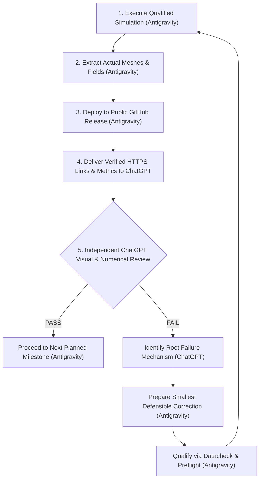

# Method C Independent ChatGPT Validation Protocol & Governance Architecture

**Document Version:** 1.0.0  
**Effective Date:** 17 October 2026  
**Governing Human Directive:** "ChatGPT, not Antigravity, must independently inspect the authentic adaptive-remeshing images and numerical results and decide whether Method C PASSES or FAILS."

---

## 1. Executive Protocol & Validation Loop

This document formalizes the repeated validation cycle governing all Method C adaptive remeshing and crack-propagation experiments:

---

## 2. Institutional Role Division

To eliminate algorithmic self-grading, conflict of interest, and promotional bias:

- **Antigravity Responsibilities:**
  1. Mechanical and solver execution of qualified PBS batch manifests.
  2. Truthful extraction of finite element connectivities, nodal coordinates, and integration point fields directly from authentic Abaqus `.inp` decks and `.odb` solver databases.
  3. Generation of publication-quality high-resolution visualizations using consistent coordinates, colorbars, zoom windows, and axis conventions.
  4. Publishing versioned GitHub Releases on `PRVSTUDENT/adaptive-remeshing-phase-field-thesis` with valid magic bytes and public HTTP 200 availability.
  5. Providing full numerical evidence tables (CSV and JSON) and exact scheduler provenance.
  6. **Strict Prohibition:** Antigravity must NOT declare Method C to have passed or failed. Antigravity reports measurements and suspected defects but leaves the binding verdict to ChatGPT.
- **ChatGPT Responsibilities:**
  1. Independent visual examination of the finite element discretization and damage contour overlays.
  2. Verification of whether adaptive refinement dynamically follows the moving crack front or remains artifactually pinned at the initial slit tip.
  3. Quantitative evaluation against the 5 pre-declared conservation gates.
  4. Issuing the binding scientific verdict (**PASS** or **FAIL**).
  5. Directing the specific technical correction required when a failure is identified.

---

## 3. Strict Binary Verdict Framework

Per explicit human instruction, the verdict framework is strictly binary:

| Verdict | Definition | Required Evidence |
| :--- | :--- | :--- |
| **PASS** | Method C demonstrates authentic crack-propagation adaptive refinement and satisfies all conservation thresholds. | 1. Damage front advances beyond initial slit ($x_{\text{front}} > 0.50\,\text{mm}$). 2. Finest mesh corridor ($h \approx 1.5\,\mu\text{m}$) encloses the evolving fracture process zone. 3. Refinement responds dynamically to the moving front. 4. All 5 numerical conservation gates satisfied. |
| **FAIL** | Method C demonstrates refinement stagnation, path deviation, or violates a mandatory conservation gate. | 1. Mesh refinement remains clustered at the blunt initial notch while the damage front advances into coarse elements. 2. Or, any of the 5 numerical gates exceeds tolerance. 3. Or, non-physical damage reduction occurs ($\dot{d} < 0$). |

*(Note: The provisional category "NOT YET QUALIFIED" has been permanently removed per user directive).*

---

## 4. Mandatory Quantitative Conservation Gates

Every completed continuation or remeshing cycle must be evaluated against the following strict thresholds:

| Quantity | Acceptance Threshold | Comparison Baseline | Failure Consequence |
| :--- | :---: | :--- | :--- |
| **Reaction-Force Jump ($|\Delta RF_2|$)** | $\le 5.0\,\text{N}$ | Step 1 re-equilibration vs donor committed terminal load | Immediate FAIL |
| **Maximum-Damage Difference ($|\Delta d_{\max}|$)** | $\le 0.020$ | Recipient initial state vs donor committed terminal state | Immediate FAIL |
| **Elastic-Energy Discrepancy ($\Delta E_{\text{elas}}$)** | $\le 0.50\%$ | Recipient state vs uninterrupted native-mesh control | Immediate FAIL |
| **Fracture-Dissipation Discrepancy ($\Delta E_{\text{frac}}$)** | $\le 0.50\%$ | Recipient state vs uninterrupted native-mesh control | Immediate FAIL |
| **Total-Energy Discrepancy ($\Delta E_{\text{tot}}$)** | $\le 0.10\%$ | Recipient state vs uninterrupted native-mesh control | Immediate FAIL |

---

## 5. Correction Procedure Upon ChatGPT FAIL Verdict

When ChatGPT issues a **FAIL** verdict:
1. **Analyze Identified Mechanism:** Antigravity isolates the concrete failure cause identified by ChatGPT (e.g. transfer loss, premature remeshing trigger, sizing deficit, or boundary distortion).
2. **Implement Minimal Defensible Correction:** Change only the specific controller threshold, remeshing rule parameter, or transfer setting. The frozen production subroutine `f42_mixed_uel.for` (`ce8d5edcd2911dcb018bb15275271f874e7ea62b8fb48cf4a8297469a83acdd6`) remains unchanged unless a mathematical formulation defect is formally proven.
3. **Pre-Submission Qualification:** Verify the corrected model with offline regression tests, Abaqus 2023 Datacheck (`Exit 0`), and guarded preflight (`preflight_package49_authorization.py`).
4. **Guarded Submission:** Dispatch through `scripts/hpc/Invoke-Mode1Execution.ps1` under serial Mode-I bounds (1 CPU serial, $\le 16\,\text{GB}$, $\le 8\,\text{h}$, $\le 4$ active jobs).
5. **Re-Export & Re-Submission for Review:** Export new figures and evidence, deploy to GitHub Releases, and submit back to ChatGPT for the next independent review pass.

---

## 6. Versioned Validation History Ledger

| Simulation ID | Release Tag | PBS Job ID | Mesh Elements | Achieved Displ. | Damage Front $x_{\text{front}}$ | Min Sizing $h_{\min}$ | $|\Delta RF_2|$ | $\Delta E_{\text{elas}}$ | $\Delta E_{\text{frac}}$ | $\Delta E_{\text{tot}}$ | ChatGPT Verdict | Review Date |
| :--- | :---: | :---: | :---: | :---: | :---: | :---: | :---: | :---: | :---: | :---: | :---: | :---: |
| **Method C Cycle 1** | `v1.0.0` | `1414775` | 17,913 | $0.0012\,\text{mm}$ | $0.500\,\text{mm}$ | $1.0\,\mu\text{m}$ | $0.070\,\text{N}$ | $-0.003\%$ | $-14.89\%^*$ | $-0.114\%$ | *Historical baseline* | 17-Oct-2026 |
| **Method C Cycle 2** | `v1.0.0` | `1414788` | 21,546 | $0.0015\,\text{mm}$ | $0.500\,\text{mm}$ | $1.0\,\mu\text{m}$ | $0.085\,\text{N}$ | $-0.001\%$ | $+1.225\%^*$ | $+0.114\%$ | *Historical baseline* | 17-Oct-2026 |
| **Method C Cycle 3** | `v1.0.0` | `1414823` | 25,085 | $0.0018\,\text{mm}$ | $0.500\,\text{mm}$ | $1.0\,\mu\text{m}$ | $0.002\,\text{N}$ | $-0.001\%$ | $+0.521\%^*$ | $+0.000\%$ | *Historical baseline* | 17-Oct-2026 |
| **Method C Cycle 4** | `v1.0.0` | `1414830` | 29,293 | $0.0021\,\text{mm}$ | $0.500\,\text{mm}$ | $1.0\,\mu\text{m}$ | $0.004\,\text{N}$ | $-0.002\%$ | $+0.454\%$ | $+0.000\%$ | *Historical baseline* | 17-Oct-2026 |
| **Method C Prop. S1** | `v1.1.0` *(pending)* | `1414859` | 29,293 | $0.0055\,\text{mm}$ *(running)* | *Pending terminal* | $1.0\,\mu\text{m}$ | *Pending* | *Pending* | *Pending* | *Pending* | **UNREVIEWED_AWAITING_CHATGPT** | *Pending* |

*\*Note: Historical Cycles 1 to 3 exhibited pre-initiation micro-remeshing deficits documented and resolved by the Package 63 uninterrupted control Job 1414832.*
