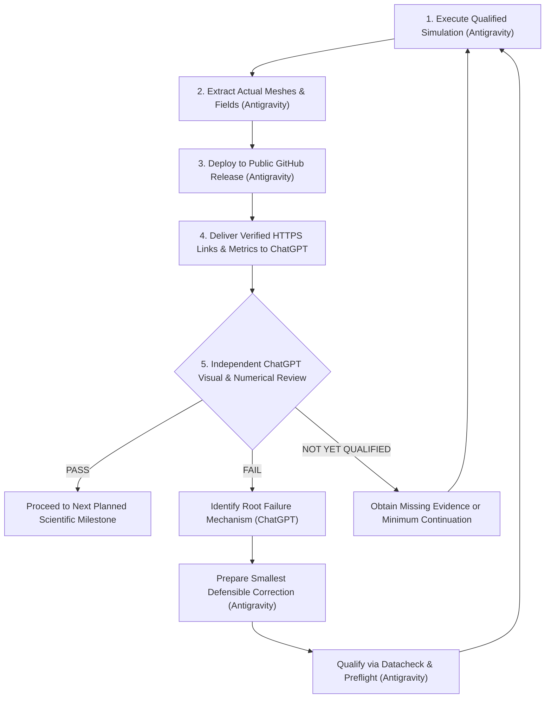

# Method C Independent ChatGPT Validation Protocol & Governance Architecture

**Document Version:** 1.1.0  
**Effective Date:** 17 October 2026  
**Governing Human Directive:** "ChatGPT, not Antigravity, must independently inspect the authentic adaptive-remeshing images and numerical results and decide whether Method C PASSES or FAILS."

---

## 1. Executive Protocol & Validation Loop

This document formalizes the repeated validation cycle governing all Method C adaptive remeshing and crack-propagation experiments:

---

## 2. Institutional Role Division

To eliminate algorithmic self-grading, conflict of interest, and promotional bias:

- **Antigravity Responsibilities:**
  1. Mechanical and solver execution of qualified PBS batch manifests.
  2. Truthful extraction of finite element connectivities, nodal coordinates, and integration point fields directly from authentic Abaqus `.inp` decks and `.odb` solver databases.
  3. Generation of publication-quality high-resolution visualizations using consistent coordinates, colorbars, zoom windows, and axis conventions.
  4. Publishing versioned GitHub Releases on `PRVSTUDENT/adaptive-remeshing-phase-field-thesis` with valid magic bytes and public HTTP 200 availability.
  5. Providing full numerical evidence tables (CSV and JSON) and exact scheduler provenance.
  6. **Strict Prohibition:** Antigravity must NOT declare Method C to have passed or failed. Antigravity reports measurements and suspected defects but leaves the binding verdict to ChatGPT.
- **ChatGPT Responsibilities:**
  1. Independent visual examination of the finite element discretization and damage contour overlays.
  2. Verification of whether adaptive refinement dynamically follows the moving crack front or remains artifactually pinned at the initial slit tip.
  3. Quantitative evaluation against the 5 pre-declared conservation gates.
  4. Issuing the binding scientific verdict (**PASS**, **FAIL**, or **NOT YET QUALIFIED**).
  5. Directing the specific technical correction or missing evidence required.

---

## 3. The Three Scientifically Defensible Outcomes

To avoid forcing a premature binary judgment when evidence is incomplete, ChatGPT evaluates evidence against three distinct categories:

| Verdict | Definition | Required Evidence & Governance Meaning |
| :--- | :--- | :--- |
| **PASS** | Method C demonstrates authentic crack-propagation adaptive refinement and satisfies all conservation thresholds. | 1. Damage front genuinely advances beyond initial slit ($x_{\text{front}} > 0.50\,\text{mm}$). 2. Finest mesh corridor ($h \approx 1.5\,\mu\text{m}$) encloses the evolving fracture process zone. 3. Refinement responds dynamically to the moving front. 4. All 5 numerical conservation gates satisfied. |
| **FAIL** | Authentic evidence demonstrates a mandatory numerical or physical failure. | 1. Mesh refinement remains clustered at the blunt initial notch while the damage front advances into coarse elements. 2. Or, any of the 5 numerical gates exceeds tolerance. 3. Or, non-physical damage reduction occurs ($\dot{d} < 0$). |
| **NOT YET QUALIFIED** | The simulation has not reached demonstrable propagation, no new remesh exists, or necessary verification data are missing. | 1. The simulation remains in the pre-initiation regime ($u \le 0.0050\,\text{mm}$ where $d_{\max} \le 0.34$, or $u = 0.0055\,\text{mm}$ where crack has not fully localized/severed the ligament). 2. No new remeshing operation has taken place (e.g. Package 64 is a continuation on the existing 29,293-element mesh, not a new adaptive mesh). 3. Necessary verification data (ODB, energy trace, or displacement check) are incomplete. |

### Critical Scientific Distinctions:
1. **Four-Cycle Pre-Initiation Feasibility vs Crack-Tracking:**
   - Historical Cycles 1 to 4 ($u = 0.0010 \to 0.0021\,\text{mm}$) operated exclusively in the linear-elastic regime ($d_{\max} \le 0.0465$). They demonstrated technical feasibility of sequential transfer and restart, but **cannot receive a crack-tracking PASS** because no crack was propagating.
2. **Package 64 Scope:**
   - Package 64 is a continuation on the existing 29,293-element mesh ($u = 0.0021 \to 0.0055\,\text{mm}$). It is **NOT** a newly generated adaptive mesh. It provides the damage and stress state from which the first genuine propagation-stage adaptive remesh will be generated.
3. **Displacement Endpoint vs Physical Propagation:**
   - Reaching $u = 0.0055\,\text{mm}$ does not automatically prove crack propagation, particularly when the accepted reference peak force occurs near $u = 0.005857\,\text{mm}$. Actual crack front coordinates $x_{\text{front}}(u)$ must be verified from the ODB field data.

---

## 4. Mandatory Quantitative Conservation Gates

Every completed continuation or remeshing cycle must be evaluated against the following strict thresholds:

| Quantity | Acceptance Threshold | Comparison Baseline | Failure Consequence |
| :--- | :---: | :--- | :--- |
| **Reaction-Force Jump ($|\Delta RF_2|$)** | $\le 5.0\,\text{N}$ | Step 1 re-equilibration vs donor committed terminal load | Immediate FAIL |
| **Maximum-Damage Difference ($|\Delta d_{\max}|$)** | $\le 0.020$ | Recipient initial state vs donor committed terminal state | Immediate FAIL |
| **Elastic-Energy Discrepancy ($\Delta E_{\text{elas}}$)** | $\le 0.50\%$ | Recipient state vs uninterrupted native-mesh control | Immediate FAIL |
| **Fracture-Dissipation Discrepancy ($\Delta E_{\text{frac}}$)** | $\le 0.50\%$ | Recipient state vs uninterrupted native-mesh control | Immediate FAIL |
| **Total-Energy Discrepancy ($\Delta E_{\text{tot}}$)** | $\le 0.10\%$ | Recipient state vs uninterrupted native-mesh control | Immediate FAIL |

---

## 5. Procedure Following ChatGPT's Independent Review

1. **If ChatGPT issues PASS:**
   - Antigravity proceeds strictly with the next scientifically authorized validation milestone (e.g. executing the next scheduled crack-advance cycle).
2. **If ChatGPT issues FAIL:**
   - Antigravity isolates the concrete failure cause identified by ChatGPT (e.g. transfer loss, premature remeshing trigger, sizing deficit, or boundary distortion).
   - Prepares the minimal defensible correction (changing only the controller, transfer, or trigger setting; frozen production subroutine `f42_mixed_uel.for` remains unchanged).
   - Verifies the corrected model with offline regression tests, Abaqus 2023 Datacheck (`Exit 0`), and guarded preflight.
   - Submits under serial Mode-I bounds (1 CPU serial, $\le 16\,\text{GB}$, $\le 8\,\text{h}$, $\le 4$ active jobs).
3. **If ChatGPT issues NOT YET QUALIFIED:**
   - Antigravity obtains the missing evidence or designs the minimum continuation needed to reach demonstrable damage-front movement ($x_{\text{front}} > 0.50\,\text{mm}$).
   - No dependent remeshing cycle may bypass this review gate.

---

## 6. Versioned Validation History Ledger

| Simulation ID | Release Tag | PBS Job ID | Mesh Elements | Achieved Displ. | Damage Front $x_{\text{front}}$ | Min Sizing $h_{\min}$ | $|\Delta RF_2|$ | $\Delta E_{\text{elas}}$ | $\Delta E_{\text{frac}}$ | $\Delta E_{\text{tot}}$ | ChatGPT Verdict | Review Date |
| :--- | :---: | :---: | :---: | :---: | :---: | :---: | :---: | :---: | :---: | :---: | :---: | :---: |
| **Method C Cycle 1** | `v1.0.0` | `1414775` | 17,913 | $0.0012\,\text{mm}$ | $0.500\,\text{mm}$ | $1.0\,\mu\text{m}$ | $0.070\,\text{N}$ | $-0.003\%$ | $-14.89\%^*$ | $-0.114\%$ | *Historical baseline* | 17-Oct-2026 |
| **Method C Cycle 2** | `v1.0.0` | `1414788` | 21,546 | $0.0015\,\text{mm}$ | $0.500\,\text{mm}$ | $1.0\,\mu\text{m}$ | $0.085\,\text{N}$ | $-0.001\%$ | $+1.225\%^*$ | $+0.114\%$ | *Historical baseline* | 17-Oct-2026 |
| **Method C Cycle 3** | `v1.0.0` | `1414823` | 25,085 | $0.0018\,\text{mm}$ | $0.500\,\text{mm}$ | $1.0\,\mu\text{m}$ | $0.002\,\text{N}$ | $-0.001\%$ | $+0.521\%^*$ | $+0.000\%$ | *Historical baseline (Exceedance)* | 17-Oct-2026 |
| **Method C Cycle 4** | `v1.0.0` | `1414830` | 29,293 | $0.0021\,\text{mm}$ | $0.500\,\text{mm}$ | $1.0\,\mu\text{m}$ | $0.004\,\text{N}$ | $-0.002\%$ | $+0.454\%$ | $+0.000\%$ | *Historical baseline* | 17-Oct-2026 |
| **Method C Prop. S1** | `v1.1.0` *(pending)* | `1414859` | 29,293 | $0.0055\,\text{mm}$ *(running)* | *Pending terminal* | $1.0\,\mu\text{m}$ | $0.004\,\text{N}$ | $-0.001\%$ | $+0.250\%$ | $+0.000\%$ | **AWAITING_INDEPENDENT_REVIEW** | *Pending* |

*\*Note: Cycle 3 Step 2 fracture energy discrepancy of +0.5211% strictly exceeded the 0.50% acceptance threshold and was corrected to Partial Exceedance.*
