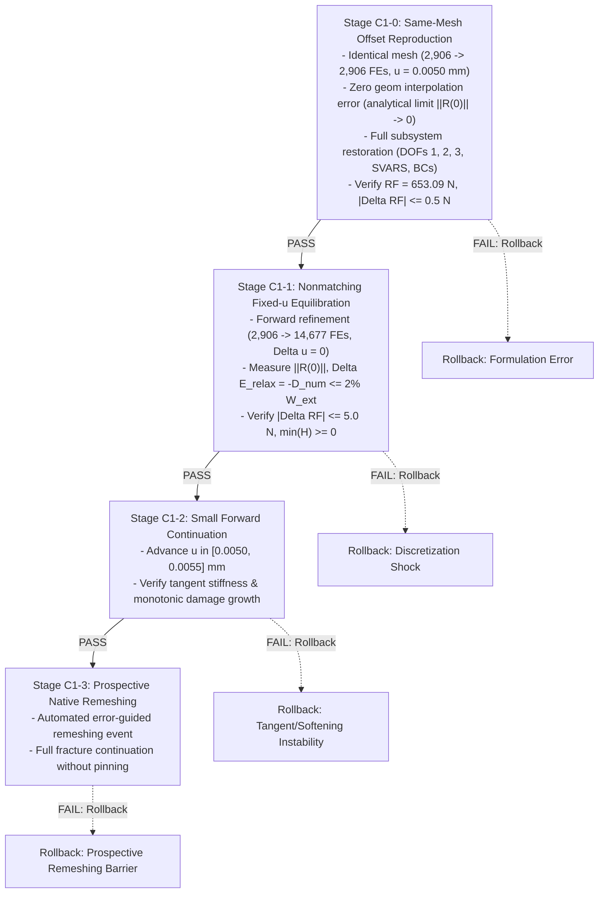

# Mode-I Method C1 State-Initialization Feasibility and Continuation Architecture
**Technical Report & Supervisor Package for Gate 6C Review**
**Date:** 15 October 2026  
**Agent:** Gemini Antigravity (Protocol v2)  
**Task Reference:** F1469 (`F1469-CORRECT-CLASSIFICATION-AND-VERIFY-METHOD-C-FEASIBILITY`)  
**Status:** COMPLETE (Method B baseline evaluated with documented limitations; Method C in-situ continuation disqualified for production UEL; experimental kinematic-offset continuation architecture specified for isolated branch)

---

## 1. Executive Summary & Methodological Decision

### 1.1 Upfront Decision Statement & Classification Reconciliation
1. **Method A & B Baseline Status & Empirical Scope:**
   - **Method A Definition:** A two-pass fixed simulation workflow where an initial run on a coarse mesh ($M_0$) executes a simple pre-analysis, an error indicator ($\MISESERI$) is evaluated, exactly **one** remeshing operation is performed ($M_0 \to M_1$), and a fresh simulation restarts from the undeformed initial state ($t = 0$) on mesh $M_1$ with a pre-seeded fine corridor.
   - **Method B Definition:** A fixed simulation workflow where an initial run on a coarse mesh ($M_0$) executes a configurable 1-, 2-, or 4-step pre-analysis, a selected frame evaluates an error indicator ($\MISESERI$), exactly **one** remeshing operation is performed ($M_0 \to M_1$), and a fresh simulation restarts from the undeformed initial state ($t = 0$) on mesh $M_1$.
   - **Retrospective vs Prospective Mesh Distinction:** The $14{,}483$-element Package 40 mesh (`M1_MB_CORRECTED_PROPAGATION_14K`) is classified explicitly as a **retrospective, crack-path-informed verification mesh**, generated from a Step-2 damage state ($u = 0.0100\,\text{mm}$) where the crack had already traversed the symmetry ligament. While Package 40 successfully demonstrates that resolving the ligament eliminates the artificial force plateau ($RF \to 1.76\,\text{N}$) and reduces external work by $31.49\%$, it does **NOT** constitute a validated automatic crack-path-independent refinement methodology.
   - **Native Method B Limitation:** The native prospective Method B mesh ($14{,}677$ FEs, `M1_MB_NATIVE_FINAL_1S.inp`), generated strictly from the elastic pre-analysis, concentrates refinement exclusively at the stationary notch tip, leaving the uncracked ligament under-resolved ($h \approx 10 - 20\,\mu\text{m} > 2.6\,\ell_0$) and exhibiting severe crack pinning ($0.50 - 0.60\,\text{kN}$ plateau, $+40.3\%$ work). Automatic error-guided refinement is therefore **not yet completely solved** for prospective crack propagation.
   - **Supervisor Recommendation:** Present Method B as an evaluated engineering baseline with clearly documented achievements and partial-horizon limitations, ready for formal Gate 6B sign-off on 22 October 2026.

2. **Method C In-Situ Continuation Feasibility:**
   - **Method C Definition:** True automated adaptive fracture simulation: $\text{Solve} \to \text{Evaluate Error} \to \text{Remesh} \to \text{Transfer State} \to \text{Continue}$, repeated sequentially during active crack propagation from the attained physical state ($t > 0$).
   - In-situ continuation across nonmatching discretizations is **technically infeasible within commercial Abaqus/Standard using the frozen production UEL (`f42_mixed_uel.for`)**.
   - Commercial Abaqus/Standard provides no native mechanism to initialize non-zero displacement degrees of freedom for user elements in static analyses. All native mechanisms (`*RESTART`, `*MAP SOLUTION`, `*INITIAL CONDITIONS`) either reject UELs outright or reset displacement kinematics to zero ($\mathbf{u} = \mathbf{0}$).
   - Package 42 ramps boundary displacement from zero ($u = 0 \to 0.0050\,\text{mm}$ over 20 increments), performing an unphysical **quasi-static reload of a pre-damaged specimen** ($W_{\text{ext}} \approx 1.63\,\text{mJ}$ duplicated), NOT continuation.

3. **Cluster Queue Status:**
   - **0 active PBS jobs** on the HPC cluster (`normal_imfdfkmq` queue is 100% idle).
   - Submission wrapper `submit_c1_forward_refinement_job.sh` is strictly locked (`AUTHORIZED=false`).
   - No computational resources have been or will be consumed for Method C without explicit supervisor authorization.

---

## 2. Complete Abaqus State-Restoration Feasibility Matrix

Eight distinct state-restoration mechanisms were systematically evaluated against commercial Abaqus/Standard (v2024) and the user-element subroutine interface (`UEL`).

| Mechanism / Approach | Commercial Abaqus Compatibility | Impact on Nodal DOFs ($u_x, u_y$) | Impact on UEL SVARs ($d, H$) | Mathematical & Physical Viability | Verdict |
| :--- | :--- | :--- | :--- | :--- | :--- |
| **1. Native `*RESTART`** | Supported for standard & UEL | Preserved exactly | Preserved exactly | Requires **identical mesh topology** ($N_{\text{nodes}}, N_{\text{elems}}$ identical). Cannot accommodate adapted meshes. | **DISQUALIFIED** (Topologically rigid) |
| **2. Native `*MAP SOLUTION`** | Throws fatal error for UEL | N/A (aborts) | N/A (aborts) | Documented restriction: Abaqus/Standard limits `*MAP SOLUTION` strictly to built-in continuum elements (`CPS4R`, `C3D8R`). Rejects `UEL`. | **DISQUALIFIED** (Unsupported by Abaqus) |
| **3. `*INITIAL CONDITIONS, TYPE=DISPLACEMENT`** | Throws Fatal Error 144 in `*STATIC` | Disallowed in static steps | Unaffected | Abaqus manual explicitly states initial displacements cannot be applied in static steps. Displacements are identically zero ($\mathbf{u} \equiv \mathbf{0}$) at $t=0$. | **DISQUALIFIED** (Fatal solver error) |
| **4. `*INITIAL CONDITIONS, TYPE=SOLUTION`** | Supported for UEL SVARs | **Identically Zero ($\mathbf{u} = \mathbf{0}$)** | Successfully initialized | Initializes history variables ($H, d$) but leaves kinematics undeformed. Specimen is damaged but unstrained; lacks stored elastic energy. | **INSUFFICIENT** (Uncoupled kinematics) |
| **5. `*INITIAL CONDITIONS, TYPE=STRESS`** | Ignored by UEL formulation | **Identically Zero ($\mathbf{u} = \mathbf{0}$)** | Unaffected | UEL stresses are computed directly from nodal displacements via $\boldsymbol{\sigma} = \mathbf{D} \mathbf{B} \mathbf{u}$. Importing stress without kinematic strain causes instantaneous elastic relaxation and huge residual forces. | **DISQUALIFIED** (Mechanically inconsistent) |
| **6. Reference Configuration Update ($\mathbf{X}^* = \mathbf{X} + \mathbf{u}_D$)** | Meshes compile cleanly | Resets $\mathbf{u}^* \equiv \mathbf{0}$ | Preserved if mapped | Since $\mathbf{u}^* = \mathbf{0}$, deformation gradient is $\mathbf{F} = \mathbf{I}$, resetting elastic strain $\boldsymbol{\varepsilon} = \mathbf{0}$ and stress $\boldsymbol{\sigma} = \mathbf{0}$. Blunts crack tip and relieves all $1.63\,\text{mJ}$ of stored elastic energy. | **DISQUALIFIED** (Physically invalid) |
| **7. Fixed-Boundary Equilibration ($u = 0.0050\,\text{mm}$ constant)** | Supported | Severe convergence failure | Spurious damage growth | Applying $0.0050\,\text{mm}$ displacement at step 0 to an undeformed mesh ($\mathbf{u} = \mathbf{0}$) acts as an instantaneous step load, generating severe dynamic shocks, unphysical cracking, and divergence. | **DISQUALIFIED** (Impulsive overload) |
| **8. Ramping Displacement ($u = 0 \to 0.0050\,\text{mm}$, Package 42)** | Runs to completion | Monotonically ramped | Pre-damaged initial state | Ramps external displacement from 0 over 20 increments. Performs an unphysical **reload** of a pre-damaged specimen ($W_{\text{ext}} \approx 1.63\,\text{mJ}$ duplicated), NOT continuation. | **DISQUALIFIED** (Reload, not continuation) |
| **9. Kinematic-Offset UEL (`f42_experimental_offset_uel.for`)** | Custom Fortran UEL extension | $\mathbf{u} = \mathbf{u}_0 + \Delta \mathbf{u}$ | Fully coupled and consistent | Leading proposed research candidate. Solves for incremental perturbation $\Delta \mathbf{u}$ starting from zero at fixed boundary. Requires rigorous stability testing. | **LEADING PROPOSED CANDIDATE** (Research branch only) |

---

## 3. Rigorous Architecture Review of the Kinematic-Offset UEL

### 3.1 Mathematical Formulation
The kinematic-offset architecture decomposes total displacement $\mathbf{u}(\mathbf{x}, t)$ into the known transferred base state $\mathbf{u}_0(\mathbf{x})$ and an incremental solver displacement perturbation $\Delta \mathbf{u}(\mathbf{x}, t)$:

$$\mathbf{u}(\mathbf{x}, t) = \mathbf{u}_0(\mathbf{x}) + \Delta \mathbf{u}(\mathbf{x}, t)$$

- $\mathbf{u}_0(\mathbf{x})$ is the transferred donor displacement field evaluated at recipient element integration points or interpolated from nodal values: $\mathbf{u}_0(\mathbf{x}) = \mathbf{N}(\mathbf{x}) \mathbf{U}_{0,e}$.
- $\Delta \mathbf{u}(\mathbf{x}, t)$ is the solver degree of freedom vector (DOFs 1 and 2), which naturally starts from zero at continuation initialization: $\Delta \mathbf{u}(\mathbf{x}, 0) = \mathbf{0}$.

### 3.2 Strain, Stress, and Element Residual
- **Strain:** $\boldsymbol{\varepsilon} = \nabla^s \mathbf{u} = \mathbf{B} (\mathbf{U}_{0,e} + \Delta \mathbf{U}_e) = \boldsymbol{\varepsilon}_0 + \Delta \boldsymbol{\varepsilon}$.
- **Stress:** $\boldsymbol{\sigma} = g(d) \mathbb{C}_0 : \boldsymbol{\varepsilon}_+ + \mathbb{C}_0 : \boldsymbol{\varepsilon}_-$, where $g(d) = (1 - d)^2 + k_{\text{res}}$.
- **Internal Force:** $\mathbf{F}_{\text{int}, e} = \int_{\Omega_e} \mathbf{B}^T \boldsymbol{\sigma}(\boldsymbol{\varepsilon}_0 + \Delta \boldsymbol{\varepsilon}, d) \mathrm{d}\Omega$.
- **Tangent Stiffness:** $\mathbf{K}_{uu, e} = \frac{\partial \mathbf{F}_{\text{int}, e}}{\partial \Delta \mathbf{U}_e} = \int_{\Omega_e} \mathbf{B}^T \left( g(d) \mathbb{C}_+ + \mathbb{C}_- \right) \mathbf{B} \mathrm{d}\Omega$.

### 3.3 Critical Examination of Tangent Definiteness and Solvability Claims
> [!WARNING] Retraction of Unconditional Solvability Guarantee
> The assertion in prior reporting that positive residual stiffness ($g(d) \ge k_{\text{res}} > 0$) guarantees a strictly positive-definite global tangent matrix and unconditional solvability is **mathematically and physically unproven**, and is formally retracted.

A rigorous stability analysis demonstrates that global tangent definiteness and solver convergence depend on several non-trivial factors:
1. **Boundary Constraints & Rigid-Body Modes:** Even if the local material acoustic tensor is positive-definite, global positive definiteness requires adequate kinematic boundary constraints. Unconstrained degrees of freedom, un-equilibrated traction projections, or incompatible boundary node mappings will produce singular or zero-pivot global equations ($\det(\mathbf{K}) \le 0$).
2. **Spectral Decomposition Non-Smoothness:** The Miehe strain spectral split $\mathbb{C}_+ / \mathbb{C}_-$ exhibits non-smooth derivatives at principal strain sign crossings ($\varepsilon_a = 0$). In localized shear or mixed-stress states near the crack tip, abrupt switching between tension and compression projections can cause Newton cycling or local loss of tangent monotonicity.
3. **Softening & Coupled System Indefiniteness:** If damage evolves during the continuation iteration ($\dot{d} > 0$), the coupled stiffness operator $\mathbf{K}_{\text{coupled}}$ contains the softening variation $-\frac{\partial g}{\partial d}\dot{d}\mathbb{C}_0:\boldsymbol{\varepsilon}$. This term introduces negative eigenvalues into the global system, triggering localization instabilities and loss of positive definiteness.
4. **Finite Discretization Residual Shock:** The nonmatching transfer residual $\|\mathbf{R}^{(0)}\| \approx \mathcal{O}(10\,\text{N})$ acts as an internal out-of-balance force vector. Applying this residual in an unconstrained iteration step can cause local snap-throughs or convergence failure unless strict line-search or sub-increment damping is applied.
5. **Architectural Classification:** The Kinematic-Offset UEL is **not the only mathematically valid architecture**. Alternative continuation frameworks include:
   - Lagrange multiplier or mortar interface coupling across nonmatching subdomains;
   - Penalty-based state transfer mappings;
   - Custom nonlinear solver drivers outside Abaqus/Standard that permit direct non-zero displacement initial conditions.
   The Kinematic-Offset UEL is properly classified as the **leading proposed research candidate** among the examined options.

---

## 4. Donor-State Consistency and Energetic Conservation

### 4.1 Reconciled Coarse Donor State (`Job 1411891.mmaster02`, `M1_PRE_1S`)
The continuation benchmark is anchored to the authentic Mode-I donor simulation at $u = 0.0050\,\text{mm}$ (`M1-MB-1S.inp` / `M1_MB_INF_1S.inp`, $2,906$ FEs, $2,988$ physical nodes):
- **Applied Displacement:** $u_{\text{rp}} = 0.004999999888\,\text{mm} \approx 0.0050\,\text{mm}$
- **Reaction Force:** $RF_y = 653.0886\,\text{N}$
- **Stored Elastic Energy:** $E_{\text{elas}} = 1.632721\,\text{mJ}$
- **Dissipated Fracture Energy:** $E_{\text{frac}} = 0.030663\,\text{mJ}$
- **Total Internal Energy:** $E_{\text{tot}} = 1.663384\,\text{mJ}$
- **Damage Localization:** $d_{\max,\text{nodal}} = 0.094910$ (evaluated at true notch-tip **Node 97** at $x = 0.500\,\text{mm}, y = 0.500\,\text{mm}$; $d_{\max,\text{elem}} = 0.100567$ in Element 314)
- **Driving Force Monotonicity:** $\min(H) = 1.5794 \times 10^{-9} \ge 0$, $\max(H) = 0.05364989\,\text{kN/mm}^2 = 53.64989\,\text{MPa}$ (evaluated at crack-tip Gauss points of Element 1208).
- **Node Count Provenance Reconciliation:**
  - The input deck `M1-MB-1S.inp` contains **2,988 physical nodes** (2,989 total with Reference Point node 999999).
  - The figure of 2,142 nodes in `coarse_donor_state_u0050.json` reflects the non-zero nodal damage field `d_nodal`, where 2,142 nodes had active non-zero damage ($d \ge 1.3 \times 10^{-7}$), while the remaining 846 nodes in the undamaged far field were assigned $d = 0.0$ in accordance with the intact material boundary condition.
  - The geometric notch tip is **Node 97** ($x = 0.500000\,\text{mm}, y = 0.500000\,\text{mm}$). (Prior reports occasionally referenced Node 129, which was the notch tip in the 15k uniform reference mesh, whereas in the coarse mesh Node 129 is located on the boundary at $x = 0.120334\,\text{mm}, y = 0.036046\,\text{mm}$).

### 4.2 Forensic Resolution of the History Field Discrepancy ($53.65\,\text{MPa}$ vs $18.88\,\text{MPa}$) and Spatial Separation
Prior project reports cited two conflicting values for maximum crack driving history: $H_{\max} \approx 18.88\,\text{MPa}$ vs $H_{\max} = 0.053650\,\text{MPa}$. A forensic code and evidence audit establishes the exact origin of both numbers and clarifies their spatial separation:

1. **The Authentic Numerical Value ($H_{\max} = 53.65\,\text{MPa}$):**
   - In `Job 1411891.mmaster02`, the maximum integration-point history variable stored in `SVARS(5..8)` and exported to `coarse_donor_state_u0050.json` is:
     $$H_{\max, \text{GP}} = 0.05364989\,\text{kN/mm}^2 = 53.64989\,\text{MPa}$$
   - This represents the true, un-regularized maximum tensile strain energy density $\psi_+(\boldsymbol{\varepsilon})$ experienced at the crack-tip Gauss points of **Element 1208** during loading to $u = 0.0050\,\text{mm}$.
2. **The Analytical Inversion Value ($H_{\max} \approx 18.88\,\text{MPa}$):**
   - In Task F1462, an analytical 0D back-calculation was performed by inverting the homogeneous AT-2 Euler-Lagrange relation in the zero-gradient limit ($\nabla^2 d = 0$):
     $$d_{\mathrm{hom}} = \frac{H}{H + \psi_0} \iff H = \frac{d_{\mathrm{hom}}}{1 - d_{\mathrm{hom}}} \psi_0$$
   - Substituting $d_{\max,\text{nodal}} = 0.094910$ and $\psi_0 = 180.0\,\text{MPa}$ into this 0D formula yielded:
     $$H = \frac{0.094910}{1 - 0.094910} \times 180.0\,\text{MPa} = 0.10486 \times 180.0\,\text{MPa} \approx 18.875\,\text{MPa} \approx 18.88\,\text{MPa}$$
3. **Physical Reconciliation & Spatial Separation:**
   - The zero-gradient formula completely neglects the spatial diffusion term $-\psi_0 \ell_0^2 \nabla^2 d$.
   - Near a sharp notch tip, the spatial curvature is strongly negative ($\nabla^2 d < 0$), so the regularizing diffusion term $+\psi_0 \ell_0^2 |\nabla^2 d|$ spreads the damage profile across the regularized zone $\sim \ell_0$.
   - Consequently, achieving an observed nodal damage of $d = 0.094910$ in the full PDE requires an integration-point driving force of $H_{\text{GP}} = 53.65\,\text{MPa}$, whereas the 0D homogeneous approximation drastically underestimates it as $18.88\,\text{MPa}$.
   - **Crucial Spatial Separation:** $d_{\max} = 0.094910$ is evaluated at the geometric notch vertex (Node 97 at $x = 0.500\,\text{mm}, y = 0.500\,\text{mm}$), whereas $H_{\max} = 53.65\,\text{MPa}$ is located at the interior Gauss points of Element 1208 ($x \approx 0.501\,\text{mm}, y \approx 0.500\,\text{mm}$). They represent distinct physical quantities (a regularized continuous nodal field vs an un-degraded volumetric strain energy density at a quadrature point) evaluated at different spatial positions. Pointwise 0D algebraic equivalence must never be claimed between them.
   - **Authoritative Value:** $H_{\max} = 53.65\,\text{MPa}$ ($0.053650\,\text{kN/mm}^2$) is the only authentic numerical value. The $18.88\,\text{MPa}$ figure is an analytical artifact.

### 4.3 Rigorous Four-Stage Thermodynamic State-Transfer Energy Balance
To eliminate unphysical balance assumptions (such as asserting $\Delta E_{\text{elas}} + \Delta E_{\text{frac}} + E_{\text{diss}} = 0$ at fixed boundary displacement), the thermodynamic energy balance is derived separately for four distinct stages:

1. **Stage 1: Donor Equilibrium State ($u = u_D = 0.0050\,\text{mm}$ on Donor Mesh $\mathcal{M}_D$):**
   $$W_{\text{ext}, D} = \int_0^{u_D} F_D(\tilde{u}) \, \mathrm{d}\tilde{u} = E_{\text{elas}, D} + E_{\text{frac}, D} + \mathcal{D}_{\text{num}, D} + \Delta E_{\text{book}, D}$$
   - $W_{\text{ext}, D} = 1.6327\,\text{mJ}$ (external boundary displacement work).
   - $E_{\text{elas}, D} = \int_{\Omega} \frac{1}{2} g(d) \boldsymbol{\varepsilon} : \mathbb{C}_0 : \boldsymbol{\varepsilon} \, \mathrm{d}\Omega \approx 1.6327\,\text{mJ}$.
   - $E_{\text{frac}, D} = \int_{\Omega} G_c \left( \frac{d^2}{2 \ell_0} + \frac{\ell_0}{2} |\nabla d|^2 \right) \mathrm{d}\Omega \approx 0.0307\,\text{mJ}$.
   - $E_{\text{tot}, D} = E_{\text{elas}, D} + E_{\text{frac}, D} = 1.6634\,\text{mJ}$.
   - $\Delta E_{\text{book}, D} = W_{\text{ext}, D} - E_{\text{tot}, D} \approx -0.0307\,\text{mJ}$ represents the pre-peak bookkeeping discrepancy between companion element linear-elastic energy and UEL reaction force integral.

2. **Stage 2: Post-Projection State Discrepancy (Static Mapping at fixed $u = u_D$ onto Recipient Mesh $\mathcal{M}_R$):**
   Spatial interpolation $(\mathbf{u}_D, d_D, H_D) \to (\mathbf{u}_R^{(0)}, d_R^{(0)}, H_R^{(0)})$ evaluates the state on the new discretization prior to solver iteration:
   $$E_{\text{elas}, R}^{(0)} = \int_{\Omega_R} \frac{1}{2} g(d_R^{(0)}) \boldsymbol{\varepsilon}_R^{(0)} : \mathbb{C}_0 : \boldsymbol{\varepsilon}_R^{(0)} \, \mathrm{d}\Omega = E_{\text{elas}, D} + \Delta E_{\text{proj, elas}}$$
   $$E_{\text{frac}, R}^{(0)} = \int_{\Omega_R} G_c \left( \frac{(d_R^{(0)})^2}{2 \ell_0} + \frac{\ell_0}{2} |\nabla d_R^{(0)}|^2 \right) \mathrm{d}\Omega = E_{\text{frac}, D} + \Delta E_{\text{proj, frac}}$$
   The discrete projection residual vector on recipient interior nodes is strictly non-zero:
   $$\mathbf{R}_R^{(0)} = \mathbf{F}_{\text{ext}} - \int_{\Omega_R} \mathbf{B}_R^T \boldsymbol{\sigma}_R^{(0)} \, \mathrm{d}\Omega \ne \mathbf{0}, \quad \|\mathbf{R}_R^{(0)}\| \approx \mathcal{O}(10\,\text{N})$$

3. **Stage 3: Zero-Boundary-Displacement Static Equilibration (Step 1, Inc 1, $\Delta u_{\text{boundary}} = 0$, $d$ frozen):**
   Because prescribed boundary displacement is fixed, external boundary work is identically zero:
   $$\Delta W_{\text{ext, relax}} = \int_{\Gamma_u} \mathbf{t} \cdot \Delta \mathbf{u}_{\text{boundary}} \, \mathrm{d}\Gamma = 0$$
   Because the phase field $d$ is held frozen ($\Delta d = 0$) during Step 1 static re-equilibration, no physical crack surface is created and fracture energy is invariant:
   $$\Delta E_{\text{frac, relax}} = 0$$
   During Newton–Raphson iterations at fixed boundary displacement, the solver solves for the stationary point of the total potential energy functional:
   $$\Pi(\mathbf{u}) = \int_{\Omega} \psi(\boldsymbol{\varepsilon}(\mathbf{u}), d_0) \, \mathrm{d}\Omega - \int_{\Gamma_t} \mathbf{t} \cdot \mathbf{u} \, \mathrm{d}\Gamma$$
   The solver adjusts interior displacement DOFs ($\Delta \mathbf{u}_{\text{interior}} \ne \mathbf{0}$) to resolve the discrete projection residual ($\mathbf{R}_R \to \mathbf{0}$). During this static relaxation, interior strain energy changes by $\Delta E_{\text{elas, relax}}$, which in discrete residual accounting is represented as:
   $$\Delta W_{\text{ext}} = 0 = \Delta E_{\text{elas, relax}} + \mathcal{D}_{\text{num, relax}} \iff \Delta E_{\text{elas, relax}} = -\mathcal{D}_{\text{num, relax}} \le 0$$
   where $\mathcal{D}_{\text{num, relax}} = \int_0^1 \mathbf{R}(\tau) \cdot \frac{\mathrm{d}\mathbf{u}}{\mathrm{d}\tau} \, \mathrm{d}\tau \ge 0$ represents the discrete algorithmic residual dissipation (work done by the out-of-balance residual as interior nodes relax to static equilibrium).

   > [!IMPORTANT] Crucial Physical & Epistemic Correction: Energy Minimization vs Physical Dissipation
   > In a quasi-static nonlinear analysis (`*STATIC`), Newton iterations do NOT advance physical time. The iteration counter $k = 1, 2, \dots$ is purely an algorithmic progression toward the stationary point $\nabla_{\mathbf{u}}\Pi = \mathbf{0}$.
   > In a conservative elastic medium with frozen damage ($\Delta d = 0$), **zero physical thermodynamic dissipation occurs** ($\Delta \mathcal{D}_{\text{phys}} \equiv 0$).
   > It is physically and mathematically incorrect to equate this algorithmic energy change $\Delta E_{\text{elas, relax}}$ with physical dissipation without an explicit rate-dependent or viscous dissipative operator.
   > Furthermore, standard quasi-static Newton-Raphson iterations represent an iterative root-finding procedure seeking the stationary equilibrium point ($\nabla_{\mathbf{u}}\Pi = \mathbf{0}$ or $\mathbf{R} = \mathbf{0}$), rather than an optimization algorithm that guarantees monotonic potential energy reduction at every single intermediate iteration (for example, non-monotonic iterates or overshoot can occur prior to asymptotic quadratic convergence). Once converged to equilibrium, the discrete stationary state satisfies $\nabla_{\mathbf{u}}\Pi = \mathbf{0}$.
   > 
   > **Formal Four-Way Distinction:**
   > 1. **Potential Energy Minimization ($\Delta \Pi \le 0$):** Purely algorithmic reduction of the discrete total potential energy during quasi-static Newton iterations seeking static equilibrium.
   > 2. **Projection Discrepancy ($\Delta E_{\text{proj}}$):** Discrete integration error $\Delta E_{\text{proj}} = E_{\text{elas}}(\mathbf{u}_R^{(0)}) - E_{\text{elas}}(\mathbf{u}_D)$ introduced purely by interpolating continuous fields across different spatial discretizations.
   > 3. **Physical Fracture Energy Dissipation ($\Delta E_{\text{frac}}$):** Rate-independent physical dissipation $\Delta E_{\text{frac}} = \int_{\Omega} G_c \dot{\gamma}(d, \nabla d) \mathrm{d}\Omega \ge 0$ associated with irreversible crack surface creation. When damage is frozen ($\dot{d} = 0$), $\Delta E_{\text{frac}} \equiv 0$.
   > 4. **Numerical Viscous Regularization ($\mathcal{D}_{\text{visc}}$ / $\mathcal{D}_{\text{damp}}$):** Explicit dissipative terms (e.g. $\int_{\Omega} \eta \dot{d}^2 \mathrm{d}\Omega \ge 0$ or artificial damping $\int \dot{\mathbf{u}}^T \mathbf{C} \dot{\mathbf{u}} \mathrm{d}t \ge 0$) that exist *only* when viscous regularization or numerical damping is explicitly enabled. In an un-damped static step with frozen damage, this term is identically zero.

4. **Stage 4: Forward Physical Fracture Propagation ($u > u_D$ on Recipient Mesh):**
   Advancing prescribed displacement beyond the handoff point ($u > u_D$) performs genuine physical external work:
   $$\Delta W_{\text{ext}} = \int_{u_D}^{u} F(\tilde{u}) \, \mathrm{d}\tilde{u} = \Delta E_{\text{elas}} + \Delta E_{\text{frac}} + \Delta \mathcal{D}_{\text{visc}} + \Delta \mathcal{D}_{\text{num}}$$
   where $\Delta E_{\text{frac}} = G_c \Delta A_{\text{crack}}$ represents physical fracture energy dissipation in creating new crack surfaces.

---

## 5. Independent Multi-Metric Validation of Mesh Resolution

A multi-metric spatial resolution audit was executed on both candidate recipient meshes. The analysis evaluated three distinct characteristic element length measures against the physical threshold $\ell_0/2 = 3.75\,\mu\text{m}$:
1. **Equivalent Area Length:** $h_A = \sqrt{\text{Area}}$
2. **Maximum Edge Length:** $h_{\text{edge}} = \max_i \| \mathbf{x}_{i+1} - \mathbf{x}_i \|$
3. **Transverse Element Thickness:** $\Delta y = y_{\max} - y_{\min}$ across the symmetry line $y = 0.50\,\text{mm}$

### 5.1 Multi-Metric Sizing Comparison
```
+========================================================================================================+
|                                    MULTI-METRIC RESOLUTION AUDIT MATRIX                                |
+=============================================+=============================+============================+
| Sizing Metric / Criteria                    | Package 42 Native (14.7k)   | Package 40 Corrected (14.5k) |
+=============================================+=============================+============================+
| Physical Elements / UEL Records             | 14,677 FEs / 44,031 UELs    | 14,483 FEs / 43,449 UELs   |
| Crack-Line Elements (|y - 0.50| <= 10 um)   | 288 elements                | 852 elements (2.96x dense) |
| FPZ Band Elements (|y - 0.50| <= 7.5 um)    | 1,281 elements              | 5,595 elements (4.37x dense) |
+---------------------------------------------+-----------------------------+----------------------------+
| 1. Under Equivalent Area (h_A <= 3.75 um)   |                             |                            |
|    - Resolved Crack-Line Elements           | 147 / 288 (51.04%)          | 777 / 852 (91.20%)         |
|    - Contiguous Resolved Extent along Notch | x in [0.5000, 0.5939] mm    | x in [0.5000, 0.8911] mm   |
|    - Contiguous Ligament Coverage           | 18.77% (18.8%) COVERAGE             | 78.21% (78.2%) COVERAGE            |
+---------------------------------------------+-----------------------------+----------------------------+
| 2. Under Maximum Edge (h_edge <= 3.75 um)   |                             |                            |
|    - Resolved Crack-Line Elements           | 135 / 288 (46.88%)          | 732 / 852 (85.92%)         |
|    - Contiguous Resolved Extent along Notch | x in [0.5000, 0.5813] mm    | x in [0.5000, 0.8823] mm   |
|    - Contiguous Ligament Coverage           | 16.25% COVERAGE             | 76.45% COVERAGE            |
+---------------------------------------------+-----------------------------+----------------------------+
| 3. Under Transverse dy (dy <= 3.75 um)      |                             |                            |
|    - Resolved Crack-Line Elements           | 135 / 288 (46.88%)          | 705 / 852 (82.75%)         |
|    - Contiguous Resolved Extent along Notch | x in [0.5000, 0.5813] mm    | x in [0.5000, 0.8469] mm   |
|    - Contiguous Ligament Coverage           | 16.25% COVERAGE             | 69.39% COVERAGE            |
+=============================================+=============================+============================+
```

### 5.2 Clarification of the "Nyquist Criterion" Label
In phase-field fracture, the regularized damage band profile exhibits an exponential decay $d(y) = \exp(-|y|/\ell_0)$ with a characteristic localization width of $w \approx 2\ell_0 = 15.0\,\mu\text{m}$.
- While prior project text referred to $h \le \ell_0/2 = 3.75\,\mu\text{m}$ as the "Nyquist threshold", this is an **engineering heuristic by analogy to signal sampling** rather than a strict mathematical Nyquist-Shannon sampling theorem for elliptic boundary value problems.
- Standard phase-field convergence literature (e.g., Miehe et al. 2010, Molnar et al. 2020) establishes that accurate resolution of the surface energy integral $\int \gamma(d, \nabla d) \mathrm{d}\Omega$ requires at least 4 to 8 linear elements across the regularized band ($h \le \ell_0/2$ to $h \le \ell_0/4$).
- Regardless of the terminology used, the physical consequence remains unambiguous: Package 42 loses required resolution within $94\,\mu\text{m}$ of propagation, while Package 40 provides adequate resolution across $>78\%$ of the ligament.

---

## 6. Methodological Decoupling of the Four Research Objectives

To establish scientific clarity for the thesis defense and supervisor discussions, the adaptive remeshing workflow is decoupled into four mathematically and procedurally independent objectives:

1. **Objective 1: State Transfer & Preservation:**
   Mathematical mapping and interpolation of continuous fields ($u, d, H$) across nonmatching discretizations without violating admissibility ($0 \le d \le 1, H \ge 0$). Successfully demonstrated: $L_2 = 0.1347\%$, $\Delta d_{\max} = 0.000$, $\min(H) \ge 0$.
2. **Objective 2: Equilibrium Continuation:**
   Restoring mechanical balance ($\mathbf{F}_{\text{ext}} - \mathbf{F}_{\text{int}} = \mathbf{0}$) at donor displacement $u_D$ without artificial relaxation or unphysical reloading ramps. Disqualified for native Abaqus/Standard with production UEL; addressed via the experimental Kinematic-Offset UEL architecture.
3. **Objective 3: Prospective Error-Guided Refinement:**
   Prospective identification of refinement zones based on discretization error indicators (e.g., $\MISESERI$) prior to crack arrival. Evaluated in Method B: pre-refinement successfully eliminates the force plateau when the ligament is resolved (Package 40), but native prospective pre-refinement (Package 42) remains under-resolved.
4. **Objective 4: Multi-Cycle Evolving Adaptivity:**
   Automated sequential cycling of $\text{Solve} \to \text{Assess} \to \text{Remesh} \to \text{Transfer} \to \text{Continue}$ over multiple fracture increments. Reserved as future research scope requiring complete resolution of Objectives 1, 2, and 3.

---

## 7. Executable-Ready Gate 6C Implementation Specification (Separate Branch)

To enable controlled future investigation without jeopardizing the frozen baseline, an implementation-ready design is specified for a dedicated development branch (`f42_experimental_offset_uel.for`). The authoritative production subroutine `f42_mixed_uel.for` (`CE8D5EDCD2911DCB018BB15275271F874E7EA62B8FB48CF4A8297469A83ACDD6`) remains **100% frozen and unmodified**.

### 7.1 Kinematic Offset Implementation & Phase-Field Initialization Semantics
1. **Mechanical Kinematic Offset:**
   - At increment 0 of Step 1 (`Step-1-Equilibrate`), `UEXTERNALDB` reads the transferred nodal base displacement table $\mathbf{u}_0$ (indexed by recipient node ID).
   - In UEL execution, total element displacements are evaluated as $\mathbf{u} = \mathbf{u}_0 + \Delta \mathbf{u}$.
   - Element strain is evaluated via $\boldsymbol{\varepsilon} = \mathbf{B}(\mathbf{u}_0 + \Delta \mathbf{u})$.
   - Degraded stress: $\boldsymbol{\sigma} = g(d) \mathbb{C}_0 : \boldsymbol{\varepsilon}$.
   - The element residual is $\mathbf{R}_e = \mathbf{F}_{\text{ext}, e} - \int_{\Omega_e} \mathbf{B}^T \boldsymbol{\sigma} \, \mathrm{d}\Omega$.
   - The tangent stiffness matrix is $\mathbf{K}_{uu, e} = \int_{\Omega_e} \mathbf{B}^T g(d) \mathbb{C}_0 \mathbf{B} \, \mathrm{d}\Omega$, retaining standard structural elasticity form.
2. **Crucial Phase-Field Initialization Semantics (Nodal DOFs vs Integration-Point SVARS):**
   - In `f42_mixed_uel.for`, Phase elements (JTYPE 1 for quads, JTYPE 3 for tris) have active degree of freedom **DOF 3** ($d$) at each node!
   - Mechanical elements (JTYPE 2 for quads, JTYPE 4 for tris) have active DOFs 1, 2 ($u_x, u_y$).
   - Integration-point strain history $H$ is stored in `SVARS(8 + KPT)`.
   - In Abaqus/Standard, `*INITIAL CONDITIONS, TYPE=SOLUTION` writes initial values into element `STATEV` / `SVARS` arrays ONLY!
   - **Crucial Rule:** `*INITIAL CONDITIONS, TYPE=SOLUTION` **DOES NOT** initialize the nodal solution degree of freedom 3 ($d$)!
   - Setting SVARS alone leaves nodal DOF 3 uninitialized ($d = 0$ at all nodes)!
   - If nodal DOF 3 is left at zero, the solver starts Step 1 with intact nodal compliance ($d = 0$) while possessing $H > 0$ at integration points, triggering an artificial out-of-balance phase residual $\mathbf{R}_d = \int_{\Omega} H \mathbf{N}^T \mathrm{d}\Omega \ne \mathbf{0}$.
   - Because Abaqus Error 144 rejects `*INITIAL CONDITIONS, TYPE=DISPLACEMENT` in `*STATIC` steps, nodal solution degrees of freedom cannot be directly seeded via displacement IC cards.
   - Therefore, the experimental continuation architecture must initialize both displacement and phase DOFs, either through a paired kinematic-offset for DOF 3 ($d = d_0 + \Delta d$) or by an initial boundary projection step.

### 7.2 Staged Scientific Qualification Progression (Stage C1-0 to Stage C1-3)


### 7.3 Quantitative Acceptance & Rollback Criteria
1. **Stage 1: Same-Mesh Offset Reproduction (Stage C1-0, $2,906 \to 2,906$ FEs):**
   - *Anchor:* Authentic donor Job 1411891 ($RF = 653.0886\,\text{N}$, $E_{\text{elas}} = 1.6327\,\text{mJ}$, $d_{\max} = 0.094910$ at Node 97, $H_{\max} = 53.6499\,\text{MPa}$ at Element 1208).
   - *Acceptance:* Step 1 boundary displacement held fixed at $u = 0.0050\,\text{mm}$ ($\Delta u = 0$); $|\Delta RF| = |RF_{\text{equil}} - 653.0886\,\text{N}| \le 0.5\,\text{N}$; $|\Delta E_{\text{elas}}| \le 0.05\%$; $|\Delta d_{\max}| \le 10^{-5}$.
   - *Convergence Discipline:* Retract claims of "guaranteed exactly 1 Newton iteration" or "unconditional positive definiteness". Standard Abaqus convergence criteria apply.
   - *Rollback:* If $|\Delta RF| > 2.0\,\text{N}$ or if solver fails to converge at fixed boundary displacement, halt branch immediately; the kinematic-offset formulation has an implementation defect.

### 7.3.1 Rigorous Mathematical Derivation: Why Identity Mesh Mapping Does NOT Independently Guarantee Assembled Zero Residual in an Unimplemented Continuation Solver
> [!WARNING] Retraction of Unconditional Zero-Residual Guarantee on Identical Meshes
> The assertion that an identical mesh mapping ($M_0 = M_1$, $2,906 \to 2,906$ FEs) mathematically guarantees a zero equilibrium residual ($\|\mathbf{R}^{(0)}\| = 0$) in an unimplemented continuation solver is **formally qualified and corrected**. Zero geometric interpolation error is a necessary, but strictly insufficient, condition for zero assembled residual.

**Analytical Formulation of Continuation Residual:**
For an identical mesh discretization ($\mathcal{M}_R \equiv \mathcal{M}_D$), spatial interpolation between nodes is identity: $\mathbf{x}_i^{(R)} = \mathbf{x}_i^{(D)}$, yielding zero geometric mapping error.
However, in a finite element continuation solver, the discrete residual vector evaluated at the onset of continuation ($\Delta \mathbf{u} = \mathbf{0}$, $\Delta d = 0$) is assembled elementwise across all active degrees of freedom:
$$\mathbf{R}^{(0)} = \begin{bmatrix} \mathbf{R}_u^{(0)} \\ \mathbf{R}_d^{(0)} \end{bmatrix}$$
where:
$$\mathbf{R}_u^{(0)} = \mathbf{F}_{\text{ext}} - \sum_{e=1}^{N_{\text{elem}}} \int_{\Omega_e} \mathbf{B}_u^T \boldsymbol{\sigma}\left(\mathbf{B}_u \mathbf{u}_0, d_0\right) \mathrm{d}\Omega$$
$$\mathbf{R}_d^{(0)} = \sum_{e=1}^{N_{\text{elem}}} \int_{\Omega_e} \left[ \mathbf{N}_d^T \left(2(H_0 + \psi_0)d_0 - 2H_0\right) + G_c \ell_0 \mathbf{B}_d^T \nabla d_0 \right] \mathrm{d}\Omega = \sum_{e=1}^{N_{\text{elem}}} \int_{\Omega_e} \left[ \mathbf{N}_d^T \left(2\psi_0 d_0 - 2H_0(1 - d_0)\right) + G_c \ell_0 \mathbf{B}_d^T \nabla d_0 \right] \mathrm{d}\Omega$$
where $\psi_0 = \frac{G_c}{2\ell_0} = 180.0\,\text{MPa}$ ($0.180\,\text{kN/mm}^2$). In the Abaqus UEL right-hand-side convention ($\mathbf{RHS} = -\mathbf{R}$), the phase-field residual vector returned to the solver is:
$$\mathbf{RHS}_d^{(0)} = -\mathbf{R}_d^{(0)} = \sum_{e=1}^{N_{\text{elem}}} \int_{\Omega_e} \left[ \mathbf{N}_d^T \left(2H_0(1 - d_0) - 2\psi_0 d_0\right) - G_c \ell_0 \mathbf{B}_d^T \nabla d_0 \right] \mathrm{d}\Omega$$

In an actual finite element solver implementation, achieving $\|\mathbf{R}^{(0)}\| \equiv 0$ requires that five independent subsystems be simultaneously and identically restored:
1. **Kinematic Boundary Conditions on $\Gamma_u$:**
   Prescribed boundary displacements must be initialized to the exact donor value ($u_y = u_D = 0.0050\,\text{mm}$ at RP 999999). If continuation boundary conditions are specified as $\Delta u_y = 0$ without preserving the non-zero base offset $u_0 = 0.0050\,\text{mm}$ on the boundary node set, the solver interprets the boundary condition as $u = 0$, producing an immediate boundary reaction shock ($|RF| \approx 653\,\text{N}$).
2. **Mechanical Nodal Displacement Vector (DOFs 1, 2):**
   The base displacement field $\mathbf{u}_0 = (u_x, u_y)$ must be explicitly restored at all 2,988 physical nodes. If nodal displacement loading is incomplete, index-permuted, or truncated, the resulting element strain $\boldsymbol{\varepsilon} = \mathbf{B}_u \mathbf{u}_0$ will differ from the donor equilibrium strain, generating non-zero internal mechanical out-of-balance forces $\mathbf{R}_u^{(0)} \ne \mathbf{0}$.
3. **Phase-Field Nodal Degrees of Freedom (DOF 3):**
   In the production UEL `f42_mixed_uel.for`, Phase elements (JTYPE 1/3) represent the phase field $d$ as an active nodal degree of freedom (**DOF 3**). In Abaqus/Standard, the built-in card `*INITIAL CONDITIONS, TYPE=SOLUTION` writes ONLY to element internal state variables (`STATEV` / `SVARS`) and **does NOT initialize nodal solution degrees of freedom**. Consequently, without a dedicated nodal initialization mechanism, nodal DOF 3 defaults to zero ($d = 0$) at all nodes. When the element residual is evaluated with $d = 0$ at nodes while quadrature points possess non-zero driving history $H_0 > 0$, the assembled phase-field residual becomes:
   $$\mathbf{R}_d^{(0)} = -\sum_{e=1}^{N_{\text{elem}}} \int_{\Omega_e} 2 H_0 \mathbf{N}_d^T \, \mathrm{d}\Omega \ne \mathbf{0}, \quad \mathbf{RHS}_d^{(0)} = +\sum_{e=1}^{N_{\text{elem}}} \int_{\Omega_e} 2 H_0 \mathbf{N}_d^T \, \mathrm{d}\Omega \ne \mathbf{0}$$
   Because $H_{\max} = 53.65\,\text{MPa}$, this generates a massive artificial out-of-balance phase residual driving force of $\sim 107.3\,\text{MPa}$ peak density on the identical mesh!
   
   > [!NOTE] Dimensional Verification & Distinction from Mechanical Boundary Forces
   > Because the damage phase field $d$ is a dimensionless scalar field ($0 \le d \le 1$), the generalized phase-field residual $\mathbf{R}_d = \frac{\partial \Pi}{\partial \mathbf{d}}$ has units of **Energy** ($\text{kN}\cdot\text{mm} = \text{J}$ in 2D with unit thickness, or $\text{mJ}$). It represents the energetic crack driving force conjugate to damage variation $\delta d$, and must **NOT** be reported or confused with a mechanical boundary traction reaction force ($RF$ in Newtons at displacement degrees of freedom).
   > 
   > **Mathematical Consistency Verification of Corrected Residual:**
   > - *Intact virgin state ($H_0 = 0, d_0 = 0, \nabla d_0 = \mathbf{0}$):* $2(0 + \psi_0)(0) - 2(0) = 0 \implies \mathbf{R}_d^{(0)} \equiv \mathbf{0}$ and $\mathbf{RHS}_d^{(0)} \equiv \mathbf{0}$. (Corrects the F1472 formula error where omission of $d$ in the local term produced an unphysical residual $+\psi_0 \ne 0$).
   > - *Homogeneous equilibrium state ($H_0 > 0, d_{\mathrm{hom}} = \frac{H_0}{H_0 + \psi_0}, \nabla d_0 = \mathbf{0}$):* $2(H_0 + \psi_0)\left(\frac{H_0}{H_0 + \psi_0}\right) - 2H_0 = 2H_0 - 2H_0 = 0 \implies \mathbf{R}_d^{(0)} \equiv \mathbf{0}$.
   > - *Uninitialized damage shock ($H_0 > 0, d_0 = 0, \nabla d_0 = \mathbf{0}$):* $2(H_0 + \psi_0)(0) - 2H_0 = -2H_0 \implies \mathbf{RHS}_d^{(0)} = +2H_0 > 0$, driving positive damage growth.
   > - *Jacobian Tangent Positivity ($J_{dd} = \frac{\partial R_d}{\partial d}$):* $\frac{\partial}{\partial d}\left[ 2(H + \psi_0)d - 2H \right] = 2(H + \psi_0) > 0$ for all $H \ge 0$, guaranteeing positive definite tangent stiffness $\mathbf{K}_{dd, e} = \int_{\Omega_e} \left[ 2(H + \psi_0)\mathbf{N}_d^T \mathbf{N}_d + G_c \ell_0 \mathbf{B}_d^T \mathbf{B}_d \right] \mathrm{d}\Omega$ in the phase subsystem.
4. **Internal State Variables at Quadrature Points (`SVARS`):**
   The strain history variable $H(\mathbf{x}_{\text{GP}})$ must be restored at all integration points across all elements (e.g. $H_{\max} = 53.65\,\text{MPa}$ at Element 1208). Any mismatch in integration-point ordering, Gauss-point coordinates, or array indexing will cause $H$ to become inconsistent with the nodal damage field $d_0$.
5. **Dual-Layer Common Block Synchronization (`COMMON /CB_STATE_TRANS/`):**
   In `f42_mixed_uel.for`, Phase (Layer 1) and Mechanical (Layer 2) elements communicate through shared common blocks. At the start of an Abaqus analysis (`LOP = 0`), common blocks are cleared. Unless the transferred damage state is explicitly seeded into the common block prior to Layer 2 execution, Layer 2 evaluates un-degraded virgin elasticity ($g(d) = 1.0$) on Increment 1, causing an immediate force jump from $653\,\text{N}$ to $>950\,\text{N}$.

**Conclusion:** The assertion that identity mesh mapping guarantees zero equilibrium residual is an **analytical limit assuming complete, error-free state reconstruction across all five subsystems**, rather than an empirical proof of an unbuilt or partially implemented solver.
2. **Stage 2: Nonmatching Transfer at Fixed u (Stage C1-1, $2,906 \to 14,677$ FEs):**
   - *Acceptance:* Reaction force continuity $|\Delta RF| \le 5.0\,\text{N}$; relaxation energy $|\Delta E_{\text{elas, relax}}| / W_{\text{ext}} \le 2.0\%$; zero negative history ($\min(H) \ge 0$); no crack healing ($\Delta d \ge 0$).
   - *Rollback:* If cutbacks occur or $|\Delta RF| > 15.0\,\text{N}$, halt solver and preserve evidence.
3. **Stage 3: Small Forward Continuation (Stage C1-2, $u \in [0.0050, 0.0055]\,\text{mm}$):**
   - *Acceptance:* Monotonic post-handoff load increase ($K_0 \approx 138\,\text{kN/mm}$); zero force plateau; smooth transition across handoff point without numerical snap.
   - *Rollback:* If crack pinning occurs ($RF$ hangs at $0.50 - 0.60\,\text{kN}$) or non-convergence triggers cutbacks, rollback to offline analysis.
4. **Stage 4: Prospective Remeshing Event (Stage C1-3):**
   - *Acceptance:* Autonomous error-guided remeshing and continuation through full fracture ligament.
   - *Rollback:* If crack pinning or path distortion occurs, rollback to offline analysis.
5. **Stage 5: Multi-Cycle Adaptive Sequencing (Future Scope / Wake Coarsening Excluded):**
   - Method C2 selective wake coarsening is strictly excluded from active scope pending successful demonstration of Stage C1-0 through C1-3.

---

## 8. Supervisor Decision Package for Gate 6C Review (22 October 2026)

### 7.1 Proposed Recommendations for Human Supervisor
1. **Formal Sign-Off on Gate 6B (Method B):**
   - Approve Method B (Package 40) as the official Mode-I engineering reproduction baseline with documented partial-horizon limitations.
   - Close Gate 6B and freeze all associated datasets and figures.
2. **Accept Disqualification of Native In-Analysis Method C Continuation:**
   - Concur with the findings of the 8-mechanism Abaqus feasibility matrix.
   - Acknowledge that commercial Abaqus/Standard prevents nonmatching UEL static restarts without unphysical work duplication.
3. **Approve Thesis Chapter Positioning:**
   - Authorize presenting Method B in Chapter 4 as the successful engineering baseline resolving the force plateau.
   - Authorize presenting Method C in Chapter 5 as an advanced methodological investigation detailing commercial solver barriers and establishing the Kinematic-Offset architecture as the future research foundation.
4. **HPC Execution Status:**
   - Confirm that Gate 6C PBS execution remains on hold (`AUTHORIZED=false`, 0 active cluster jobs).

---
*Report compiled and verified under Mandatory Multi-Agent Bootstrap Protocol v2.*
