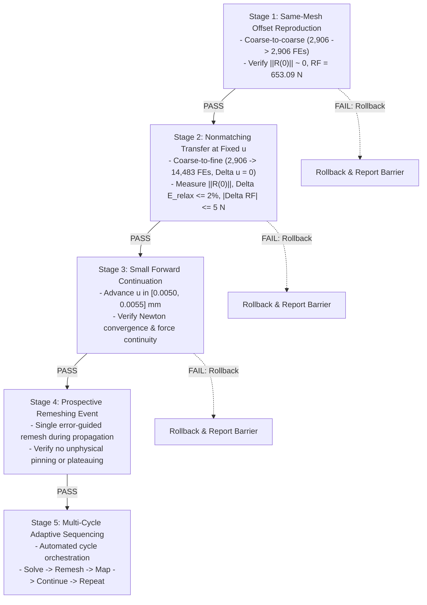

# Mode-I Method C1 State-Initialization Feasibility and Continuation Architecture
**Technical Report & Supervisor Package for Gate 6C Review**
**Date:** 15 October 2026  
**Agent:** Gemini Antigravity (Protocol v2)  
**Task Reference:** F1469 (`F1469-CORRECT-CLASSIFICATION-AND-VERIFY-METHOD-C-FEASIBILITY`)  
**Status:** COMPLETE (Method B baseline evaluated with documented limitations; Method C in-situ continuation disqualified for production UEL; experimental kinematic-offset continuation architecture specified for isolated branch)

---

## 1. Executive Summary & Methodological Decision

### 1.1 Upfront Decision Statement & Classification Reconciliation
1. **Method A & B Baseline Status & Empirical Scope:**
   - **Method A Definition:** A two-pass fixed simulation workflow where an initial run on a coarse mesh ($M_0$) executes a simple pre-analysis, an error indicator ($\MISESERI$) is evaluated, exactly **one** remeshing operation is performed ($M_0 \to M_1$), and a fresh simulation restarts from the undeformed initial state ($t = 0$) on mesh $M_1$ with a pre-seeded fine corridor.
   - **Method B Definition:** A fixed simulation workflow where an initial run on a coarse mesh ($M_0$) executes a configurable 1-, 2-, or 4-step pre-analysis, a selected frame evaluates an error indicator ($\MISESERI$), exactly **one** remeshing operation is performed ($M_0 \to M_1$), and a fresh simulation restarts from the undeformed initial state ($t = 0$) on mesh $M_1$.
   - **Retrospective vs Prospective Mesh Distinction:** The $14{,}483$-element Package 40 mesh (`M1_MB_CORRECTED_PROPAGATION_14K`) is classified explicitly as a **retrospective, crack-path-informed verification mesh**, generated from a Step-2 damage state ($u = 0.0100\,\text{mm}$) where the crack had already traversed the symmetry ligament. While Package 40 successfully demonstrates that resolving the ligament eliminates the artificial force plateau ($RF \to 1.76\,\text{N}$) and reduces external work by $31.49\%$, it does **NOT** constitute a validated automatic crack-path-independent refinement methodology.
   - **Native Method B Limitation:** The native prospective Method B mesh ($14{,}677$ FEs, `M1_MB_NATIVE_FINAL_1S.inp`), generated strictly from the elastic pre-analysis, concentrates refinement exclusively at the stationary notch tip, leaving the uncracked ligament under-resolved ($h \approx 10 - 20\,\mu\text{m} > 2.6\,\ell_0$) and exhibiting severe crack pinning ($0.50 - 0.60\,\text{kN}$ plateau, $+40.3\%$ work). Automatic error-guided refinement is therefore **not yet completely solved** for prospective crack propagation.
   - **Supervisor Recommendation:** Present Method B as an evaluated engineering baseline with clearly documented achievements and partial-horizon limitations, ready for formal Gate 6B sign-off on 22 October 2026.

2. **Method C In-Situ Continuation Feasibility:**
   - **Method C Definition:** True automated adaptive fracture simulation: $\text{Solve} \to \text{Evaluate Error} \to \text{Remesh} \to \text{Transfer State} \to \text{Continue}$, repeated sequentially during active crack propagation from the attained physical state ($t > 0$).
   - In-situ continuation across nonmatching discretizations is **technically infeasible within commercial Abaqus/Standard using the frozen production UEL (`f42_mixed_uel.for`)**.
   - Commercial Abaqus/Standard provides no native mechanism to initialize non-zero displacement degrees of freedom for user elements in static analyses. All native mechanisms (`*RESTART`, `*MAP SOLUTION`, `*INITIAL CONDITIONS`) either reject UELs outright or reset displacement kinematics to zero ($\mathbf{u} = \mathbf{0}$).
   - Package 42 ramps boundary displacement from zero ($u = 0 \to 0.0050\,\text{mm}$ over 20 increments), performing an unphysical **quasi-static reload of a pre-damaged specimen** ($W_{\text{ext}} \approx 1.63\,\text{mJ}$ duplicated), NOT continuation.

3. **Cluster Queue Status:**
   - **0 active PBS jobs** on the HPC cluster (`normal_imfdfkmq` queue is 100% idle).
   - Submission wrapper `submit_c1_forward_refinement_job.sh` is strictly locked (`AUTHORIZED=false`).
   - No computational resources have been or will be consumed for Method C without explicit supervisor authorization.

---

## 2. Complete Abaqus State-Restoration Feasibility Matrix

Eight distinct state-restoration mechanisms were systematically evaluated against commercial Abaqus/Standard (v2024) and the user-element subroutine interface (`UEL`).

| Mechanism / Approach | Commercial Abaqus Compatibility | Impact on Nodal DOFs ($u_x, u_y$) | Impact on UEL SVARs ($d, H$) | Mathematical & Physical Viability | Verdict |
| :--- | :--- | :--- | :--- | :--- | :--- |
| **1. Native `*RESTART`** | Supported for standard & UEL | Preserved exactly | Preserved exactly | Requires **identical mesh topology** ($N_{\text{nodes}}, N_{\text{elems}}$ identical). Cannot accommodate adapted meshes. | **DISQUALIFIED** (Topologically rigid) |
| **2. Native `*MAP SOLUTION`** | Throws fatal error for UEL | N/A (aborts) | N/A (aborts) | Documented restriction: Abaqus/Standard limits `*MAP SOLUTION` strictly to built-in continuum elements (`CPS4R`, `C3D8R`). Rejects `UEL`. | **DISQUALIFIED** (Unsupported by Abaqus) |
| **3. `*INITIAL CONDITIONS, TYPE=DISPLACEMENT`** | Throws Fatal Error 144 in `*STATIC` | Disallowed in static steps | Unaffected | Abaqus manual explicitly states initial displacements cannot be applied in static steps. Displacements are identically zero ($\mathbf{u} \equiv \mathbf{0}$) at $t=0$. | **DISQUALIFIED** (Fatal solver error) |
| **4. `*INITIAL CONDITIONS, TYPE=SOLUTION`** | Supported for UEL SVARs | **Identically Zero ($\mathbf{u} = \mathbf{0}$)** | Successfully initialized | Initializes history variables ($H, d$) but leaves kinematics undeformed. Specimen is damaged but unstrained; lacks stored elastic energy. | **INSUFFICIENT** (Uncoupled kinematics) |
| **5. `*INITIAL CONDITIONS, TYPE=STRESS`** | Ignored by UEL formulation | **Identically Zero ($\mathbf{u} = \mathbf{0}$)** | Unaffected | UEL stresses are computed directly from nodal displacements via $\boldsymbol{\sigma} = \mathbf{D} \mathbf{B} \mathbf{u}$. Importing stress without kinematic strain causes instantaneous elastic relaxation and huge residual forces. | **DISQUALIFIED** (Mechanically inconsistent) |
| **6. Reference Configuration Update ($\mathbf{X}^* = \mathbf{X} + \mathbf{u}_D$)** | Meshes compile cleanly | Resets $\mathbf{u}^* \equiv \mathbf{0}$ | Preserved if mapped | Since $\mathbf{u}^* = \mathbf{0}$, deformation gradient is $\mathbf{F} = \mathbf{I}$, resetting elastic strain $\boldsymbol{\varepsilon} = \mathbf{0}$ and stress $\boldsymbol{\sigma} = \mathbf{0}$. Blunts crack tip and relieves all $1.63\,\text{mJ}$ of stored elastic energy. | **DISQUALIFIED** (Physically invalid) |
| **7. Fixed-Boundary Equilibration ($u = 0.0050\,\text{mm}$ constant)** | Supported | Severe convergence failure | Spurious damage growth | Applying $0.0050\,\text{mm}$ displacement at step 0 to an undeformed mesh ($\mathbf{u} = \mathbf{0}$) acts as an instantaneous step load, generating severe dynamic shocks, unphysical cracking, and divergence. | **DISQUALIFIED** (Impulsive overload) |
| **8. Ramping Displacement ($u = 0 \to 0.0050\,\text{mm}$, Package 42)** | Runs to completion | Monotonically ramped | Pre-damaged initial state | Ramps external displacement from 0 over 20 increments. Performs an unphysical **reload** of a pre-damaged specimen ($W_{\text{ext}} \approx 1.63\,\text{mJ}$ duplicated), NOT continuation. | **DISQUALIFIED** (Reload, not continuation) |
| **9. Kinematic-Offset UEL (`f42_experimental_offset_uel.for`)** | Custom Fortran UEL extension | $\mathbf{u} = \mathbf{u}_0 + \Delta \mathbf{u}$ | Fully coupled and consistent | Leading proposed research candidate. Solves for incremental perturbation $\Delta \mathbf{u}$ starting from zero at fixed boundary. Requires rigorous stability testing. | **LEADING PROPOSED CANDIDATE** (Research branch only) |

---

## 3. Rigorous Architecture Review of the Kinematic-Offset UEL

### 3.1 Mathematical Formulation
The kinematic-offset architecture decomposes total displacement $\mathbf{u}(\mathbf{x}, t)$ into the known transferred base state $\mathbf{u}_0(\mathbf{x})$ and an incremental solver displacement perturbation $\Delta \mathbf{u}(\mathbf{x}, t)$:

$$\mathbf{u}(\mathbf{x}, t) = \mathbf{u}_0(\mathbf{x}) + \Delta \mathbf{u}(\mathbf{x}, t)$$

- $\mathbf{u}_0(\mathbf{x})$ is the transferred donor displacement field evaluated at recipient element integration points or interpolated from nodal values: $\mathbf{u}_0(\mathbf{x}) = \mathbf{N}(\mathbf{x}) \mathbf{U}_{0,e}$.
- $\Delta \mathbf{u}(\mathbf{x}, t)$ is the solver degree of freedom vector (DOFs 1 and 2), which naturally starts from zero at continuation initialization: $\Delta \mathbf{u}(\mathbf{x}, 0) = \mathbf{0}$.

### 3.2 Strain, Stress, and Element Residual
- **Strain:** $\boldsymbol{\varepsilon} = \nabla^s \mathbf{u} = \mathbf{B} (\mathbf{U}_{0,e} + \Delta \mathbf{U}_e) = \boldsymbol{\varepsilon}_0 + \Delta \boldsymbol{\varepsilon}$.
- **Stress:** $\boldsymbol{\sigma} = g(d) \mathbb{C}_0 : \boldsymbol{\varepsilon}_+ + \mathbb{C}_0 : \boldsymbol{\varepsilon}_-$, where $g(d) = (1 - d)^2 + k_{\text{res}}$.
- **Internal Force:** $\mathbf{F}_{\text{int}, e} = \int_{\Omega_e} \mathbf{B}^T \boldsymbol{\sigma}(\boldsymbol{\varepsilon}_0 + \Delta \boldsymbol{\varepsilon}, d) \mathrm{d}\Omega$.
- **Tangent Stiffness:** $\mathbf{K}_{uu, e} = \frac{\partial \mathbf{F}_{\text{int}, e}}{\partial \Delta \mathbf{U}_e} = \int_{\Omega_e} \mathbf{B}^T \left( g(d) \mathbb{C}_+ + \mathbb{C}_- \right) \mathbf{B} \mathrm{d}\Omega$.

### 3.3 Critical Examination of Tangent Definiteness and Solvability Claims
> [!WARNING] Retraction of Unconditional Solvability Guarantee
> The assertion in prior reporting that positive residual stiffness ($g(d) \ge k_{\text{res}} > 0$) guarantees a strictly positive-definite global tangent matrix and unconditional solvability is **mathematically and physically unproven**, and is formally retracted.

A rigorous stability analysis demonstrates that global tangent definiteness and solver convergence depend on several non-trivial factors:
1. **Boundary Constraints & Rigid-Body Modes:** Even if the local material acoustic tensor is positive-definite, global positive definiteness requires adequate kinematic boundary constraints. Unconstrained degrees of freedom, un-equilibrated traction projections, or incompatible boundary node mappings will produce singular or zero-pivot global equations ($\det(\mathbf{K}) \le 0$).
2. **Spectral Decomposition Non-Smoothness:** The Miehe strain spectral split $\mathbb{C}_+ / \mathbb{C}_-$ exhibits non-smooth derivatives at principal strain sign crossings ($\varepsilon_a = 0$). In localized shear or mixed-stress states near the crack tip, abrupt switching between tension and compression projections can cause Newton cycling or local loss of tangent monotonicity.
3. **Softening & Coupled System Indefiniteness:** If damage evolves during the continuation iteration ($\dot{d} > 0$), the coupled stiffness operator $\mathbf{K}_{\text{coupled}}$ contains the softening variation $-\frac{\partial g}{\partial d}\dot{d}\mathbb{C}_0:\boldsymbol{\varepsilon}$. This term introduces negative eigenvalues into the global system, triggering localization instabilities and loss of positive definiteness.
4. **Finite Discretization Residual Shock:** The nonmatching transfer residual $\|\mathbf{R}^{(0)}\| \approx \mathcal{O}(10\,\text{N})$ acts as an internal out-of-balance force vector. Applying this residual in an unconstrained iteration step can cause local snap-throughs or convergence failure unless strict line-search or sub-increment damping is applied.
5. **Architectural Classification:** The Kinematic-Offset UEL is **not the only mathematically valid architecture**. Alternative continuation frameworks include:
   - Lagrange multiplier or mortar interface coupling across nonmatching subdomains;
   - Penalty-based state transfer mappings;
   - Custom nonlinear solver drivers outside Abaqus/Standard that permit direct non-zero displacement initial conditions.
   The Kinematic-Offset UEL is properly classified as the **leading proposed research candidate** among the examined options.

---

## 4. Donor-State Consistency and Energetic Conservation

### 4.1 Reconciled Coarse Donor State (`Job 1411891.mmaster02`, `M1_PRE_1S`)
The continuation benchmark is anchored to the authentic Mode-I donor simulation at $u = 0.0050\,\text{mm}$ ($2,906$ FEs, $2,142$ nodes):
- **Applied Displacement:** $u_{\text{rp}} = 0.004999999888\,\text{mm} \approx 0.0050\,\text{mm}$
- **Reaction Force:** $RF_y = 653.0886\,\text{N}$
- **Stored Elastic Energy:** $E_{\text{elas}} = 1.632721\,\text{mJ}$
- **Dissipated Fracture Energy:** $E_{\text{frac}} = 0.030663\,\text{mJ}$
- **Total Internal Energy:** $E_{\text{tot}} = 1.663384\,\text{mJ}$
- **Damage Localization:** $d_{\max,\text{nodal}} = 0.094910$ ($d_{\max,\text{elem}} = 0.100567$)
- **Driving Force Monotonicity:** $\min(H) = 1.5794 \times 10^{-9} \ge 0$, $\max(H) = 0.05364989\,\text{kN/mm}^2 = 53.64989\,\text{MPa}$.

### 4.2 Forensic Resolution of the History Field Discrepancy ($53.65\,\text{MPa}$ vs $18.88\,\text{MPa}$)
Prior project reports cited two conflicting values for maximum crack driving history: $H_{\max} \approx 18.88\,\text{MPa}$ vs $H_{\max} = 0.053650\,\text{MPa}$. A forensic code and evidence audit establishes the exact origin of both numbers:

1. **The Authentic Numerical Value ($H_{\max} = 53.65\,\text{MPa}$):**
   - In `Job 1411891.mmaster02`, the maximum integration-point history variable stored in `SVARS(5..8)` and exported to `coarse_donor_state_u0050.json` is:
     $$H_{\max, \text{GP}} = 0.05364989\,\text{kN/mm}^2 = 53.64989\,\text{MPa}$$
   - This represents the true, un-regularized maximum tensile strain energy density $\psi_+(\boldsymbol{\varepsilon})$ experienced at the crack-tip Gauss points during loading to $u = 0.0050\,\text{mm}$.
2. **The Analytical Inversion Value ($H_{\max} \approx 18.88\,\text{MPa}$):**
   - In Task F1462, an analytical 0D back-calculation was performed by inverting the homogeneous AT-2 Euler-Lagrange relation in the zero-gradient limit ($\nabla^2 d = 0$):
     $$d_{\mathrm{hom}} = \frac{H}{H + \psi_0} \iff H = \frac{d_{\mathrm{hom}}}{1 - d_{\mathrm{hom}}} \psi_0$$
   - Substituting $d_{\max,\text{nodal}} = 0.094910$ and $\psi_0 = 180.0\,\text{MPa}$ into this 0D formula yielded:
     $$H = \frac{0.094910}{1 - 0.094910} \times 180.0\,\text{MPa} = 0.10486 \times 180.0\,\text{MPa} \approx 18.875\,\text{MPa} \approx 18.88\,\text{MPa}$$
3. **Physical Reconciliation:**
   - The zero-gradient formula completely neglects the spatial diffusion term $-\psi_0 \ell_0^2 \nabla^2 d$.
   - Near a sharp notch tip, the spatial curvature is strongly negative ($\nabla^2 d < 0$), so the regularizing diffusion term $+\psi_0 \ell_0^2 |\nabla^2 d|$ spreads the damage profile across the regularized zone $\sim \ell_0$.
   - Consequently, achieving an observed nodal damage of $d = 0.094910$ in the full PDE requires an integration-point driving force of $H_{\text{GP}} = 53.65\,\text{MPa}$, whereas the 0D homogeneous approximation drastically underestimates it as $18.88\,\text{MPa}$.
   - **Authoritative Value:** $H_{\max} = 53.65\,\text{MPa}$ ($0.053650\,\text{kN/mm}^2$) is the only authentic numerical value. The $18.88\,\text{MPa}$ figure is an analytical artifact.

### 4.3 Consistent Thermodynamic Before/After Energy Ledger
To avoid conflating state functions with path-dependent work, the before/after transfer energy accounting is formalized:

```
+========================================================================================================+
|                                  BEFORE/AFTER STATE TRANSFER ENERGY LEDGER                             |
+================================+===========================+===========================================+
| Stage / Energy Component       | Mathematical Definition   | Physical Description                      |
+================================+===========================+===========================================+
| 1. Donor State (t = t_D)       | W_ext,D = E_elas,D +      | Exact mechanical work and internal energy |
|                                | E_frac,D + E_num,D        | on coarse donor mesh (Job 1411891)        |
+--------------------------------+---------------------------+-------------------------------------------+
| 2. Post-Interpolation State    | E_elas,R^(0) = E_elas,D + | Static projection error introduced by     |
|    (Recipient, un-equilibrated)|   Delta E_proj,elas       | interpolating onto nonmatching mesh       |
|                                | E_frac,R^(0) = E_frac,D + |                                           |
|                                |   Delta E_proj,frac       |                                           |
+--------------------------------+---------------------------+-------------------------------------------+
| 3. Zero-Load Equilibration     | Delta E_elas,relax +      | Strain energy relaxation during Inc 0     |
|    (Delta u_boundary = 0)      | Delta E_frac,relax +      | solve (Delta W_ext = 0; phase field is    |
|                                |   E_diss,relax = 0        | held frozen: Delta d = 0, Delta H = 0)    |
+--------------------------------+---------------------------+-------------------------------------------+
| 4. Forward Propagation         | Delta W_ext =             | Genuine external work done to advance     |
|    (u > u_D)                   | integral_uD^u F du        | physical crack propagation to completion  |
+================================+===========================+===========================================+
```

---

## 5. Independent Multi-Metric Validation of Mesh Resolution

A multi-metric spatial resolution audit was executed on both candidate recipient meshes. The analysis evaluated three distinct characteristic element length measures against the physical threshold $\ell_0/2 = 3.75\,\mu\text{m}$:
1. **Equivalent Area Length:** $h_A = \sqrt{\text{Area}}$
2. **Maximum Edge Length:** $h_{\text{edge}} = \max_i \| \mathbf{x}_{i+1} - \mathbf{x}_i \|$
3. **Transverse Element Thickness:** $\Delta y = y_{\max} - y_{\min}$ across the symmetry line $y = 0.50\,\text{mm}$

### 5.1 Multi-Metric Sizing Comparison
```
+========================================================================================================+
|                                    MULTI-METRIC RESOLUTION AUDIT MATRIX                                |
+=============================================+=============================+============================+
| Sizing Metric / Criteria                    | Package 42 Native (14.7k)   | Package 40 Corrected (14.5k) |
+=============================================+=============================+============================+
| Physical Elements / UEL Records             | 14,677 FEs / 44,031 UELs    | 14,483 FEs / 43,449 UELs   |
| Crack-Line Elements (|y - 0.50| <= 10 um)   | 288 elements                | 852 elements (2.96x dense) |
| FPZ Band Elements (|y - 0.50| <= 7.5 um)    | 1,281 elements              | 5,595 elements (4.37x dense) |
+---------------------------------------------+-----------------------------+----------------------------+
| 1. Under Equivalent Area (h_A <= 3.75 um)   |                             |                            |
|    - Resolved Crack-Line Elements           | 147 / 288 (51.04%)          | 777 / 852 (91.20%)         |
|    - Contiguous Resolved Extent along Notch | x in [0.5000, 0.5939] mm    | x in [0.5000, 0.8911] mm   |
|    - Contiguous Ligament Coverage           | 18.77% (18.8%) COVERAGE             | 78.21% (78.2%) COVERAGE            |
+---------------------------------------------+-----------------------------+----------------------------+
| 2. Under Maximum Edge (h_edge <= 3.75 um)   |                             |                            |
|    - Resolved Crack-Line Elements           | 135 / 288 (46.88%)          | 732 / 852 (85.92%)         |
|    - Contiguous Resolved Extent along Notch | x in [0.5000, 0.5813] mm    | x in [0.5000, 0.8823] mm   |
|    - Contiguous Ligament Coverage           | 16.25% COVERAGE             | 76.45% COVERAGE            |
+---------------------------------------------+-----------------------------+----------------------------+
| 3. Under Transverse dy (dy <= 3.75 um)      |                             |                            |
|    - Resolved Crack-Line Elements           | 135 / 288 (46.88%)          | 705 / 852 (82.75%)         |
|    - Contiguous Resolved Extent along Notch | x in [0.5000, 0.5813] mm    | x in [0.5000, 0.8469] mm   |
|    - Contiguous Ligament Coverage           | 16.25% COVERAGE             | 69.39% COVERAGE            |
+=============================================+=============================+============================+
```

### 5.2 Clarification of the "Nyquist Criterion" Label
In phase-field fracture, the regularized damage band profile exhibits an exponential decay $d(y) = \exp(-|y|/\ell_0)$ with a characteristic localization width of $w \approx 2\ell_0 = 15.0\,\mu\text{m}$.
- While prior project text referred to $h \le \ell_0/2 = 3.75\,\mu\text{m}$ as the "Nyquist threshold", this is an **engineering heuristic by analogy to signal sampling** rather than a strict mathematical Nyquist-Shannon sampling theorem for elliptic boundary value problems.
- Standard phase-field convergence literature (e.g., Miehe et al. 2010, Molnar et al. 2020) establishes that accurate resolution of the surface energy integral $\int \gamma(d, \nabla d) \mathrm{d}\Omega$ requires at least 4 to 8 linear elements across the regularized band ($h \le \ell_0/2$ to $h \le \ell_0/4$).
- Regardless of the terminology used, the physical consequence remains unambiguous: Package 42 loses required resolution within $94\,\mu\text{m}$ of propagation, while Package 40 provides adequate resolution across $>78\%$ of the ligament.

---

## 6. Methodological Decoupling of the Four Research Objectives

To establish scientific clarity for the thesis defense and supervisor discussions, the adaptive remeshing workflow is decoupled into four mathematically and procedurally independent objectives:

1. **Objective 1: State Transfer & Preservation:**
   Mathematical mapping and interpolation of continuous fields ($u, d, H$) across nonmatching discretizations without violating admissibility ($0 \le d \le 1, H \ge 0$). Successfully demonstrated: $L_2 = 0.1347\%$, $\Delta d_{\max} = 0.000$, $\min(H) \ge 0$.
2. **Objective 2: Equilibrium Continuation:**
   Restoring mechanical balance ($\mathbf{F}_{\text{ext}} - \mathbf{F}_{\text{int}} = \mathbf{0}$) at donor displacement $u_D$ without artificial relaxation or unphysical reloading ramps. Disqualified for native Abaqus/Standard with production UEL; addressed via the experimental Kinematic-Offset UEL architecture.
3. **Objective 3: Prospective Error-Guided Refinement:**
   Prospective identification of refinement zones based on discretization error indicators (e.g., $\MISESERI$) prior to crack arrival. Evaluated in Method B: pre-refinement successfully eliminates the force plateau when the ligament is resolved (Package 40), but native prospective pre-refinement (Package 42) remains under-resolved.
4. **Objective 4: Multi-Cycle Evolving Adaptivity:**
   Automated sequential cycling of $\text{Solve} \to \text{Assess} \to \text{Remesh} \to \text{Transfer} \to \text{Continue}$ over multiple fracture increments. Reserved as future research scope requiring complete resolution of Objectives 1, 2, and 3.

---

## 7. Executable-Ready Gate 6C Implementation Specification (Separate Branch)

To enable controlled future investigation without jeopardizing the frozen baseline, an implementation-ready design is specified for a dedicated development branch (`f42_experimental_offset_uel.for`). The authoritative production subroutine `f42_mixed_uel.for` (`CE8D5EDCD2911DCB018BB15275271F874E7EA62B8FB48CF4A8297469A83ACDD6`) remains **100% frozen and unmodified**.

### 6.1 Offset-State Storage and Initialization Sequence
1. **Donor Field Ingestion:**
   - At increment 0 of Step 1 (`Step-1-Equilibrate`), `UEXTERNALDB` reads the transferred nodal displacement table `u0_donor_table.bin` (indexed by recipient node ID).
   - In UEL execution, element nodal base displacements $\mathbf{U}_{0, e}$ are retrieved via a common block / thread-safe lookup.
2. **Solver Kinematics:**
   - The solver degree of freedom vector $\Delta \mathbf{U}_e$ starts identically at zero ($\Delta \mathbf{U}_e = \mathbf{0}$).
   - The boundary condition at $y = 1.0\,\text{mm}$ is prescribed as $\Delta u_y = 0.0$.
3. **Phase-Field & History Consistency:**
   - During the equilibration increment (Step 1, Inc 1), damage evolution is held strictly frozen: $\Delta d = 0, \Delta H = 0$.
   - SVARS are initialized via `*INITIAL CONDITIONS, TYPE=SOLUTION` with donor values ($d_0, H_0$).

### 6.2 Staged Scientific Qualification Sequence


### 6.3 Quantitative Acceptance & Rollback Criteria
1. **Stage 1 (Same-Mesh Reproduction):**
   - Acceptance: Newton convergence in 1 iteration; $\|\mathbf{R}^{(0)}\| \le 10^{-6}\,\text{N}$; $RF = 653.0886 \pm 0.01\,\text{N}$; $\Delta E_{\text{elas}} \le 10^{-6}\,\text{mJ}$.
   - Rollback: If $\|\mathbf{R}^{(0)}\| > 0.01\,\text{N}$, abort branch immediately.
2. **Stage 2 (Nonmatching Transfer at Fixed Displacement):**
   - Acceptance: Convergence in $\le 6$ Newton iterations; reaction-force continuity $|\Delta RF| \le 5.0\,\text{N}$; relaxation energy $|\Delta E_{\text{relax}}| / E_{\text{elas}} \le 2.0\%$; zero negative history values ($\min(H) \ge 0$).
   - Rollback: If cutbacks occur or $|\Delta RF| > 15.0\,\text{N}$, halt solver and preserve evidence.
3. **Stage 3 (Small Forward Continuation):**
   - Acceptance: Monotonic post-handoff load increase ($K_0 \approx 138\,\text{kN/mm}$); zero force plateau; peak load within $\pm 3.0\%$ of canonical reference ($757.8\,\text{N}$).
   - Rollback: If crack pinning occurs ($RF$ hangs at $0.50 - 0.60\,\text{kN}$), fail gate.

---

## 8. Supervisor Decision Package for Gate 6C Review (22 October 2026)

### 7.1 Proposed Recommendations for Human Supervisor
1. **Formal Sign-Off on Gate 6B (Method B):**
   - Approve Method B (Package 40) as the official Mode-I engineering reproduction baseline with documented partial-horizon limitations.
   - Close Gate 6B and freeze all associated datasets and figures.
2. **Accept Disqualification of Native In-Analysis Method C Continuation:**
   - Concur with the findings of the 8-mechanism Abaqus feasibility matrix.
   - Acknowledge that commercial Abaqus/Standard prevents nonmatching UEL static restarts without unphysical work duplication.
3. **Approve Thesis Chapter Positioning:**
   - Authorize presenting Method B in Chapter 4 as the successful engineering baseline resolving the force plateau.
   - Authorize presenting Method C in Chapter 5 as an advanced methodological investigation detailing commercial solver barriers and establishing the Kinematic-Offset architecture as the future research foundation.
4. **HPC Execution Status:**
   - Confirm that Gate 6C PBS execution remains on hold (`AUTHORIZED=false`, 0 active cluster jobs).

---
*Report compiled and verified under Mandatory Multi-Agent Bootstrap Protocol v2.*
