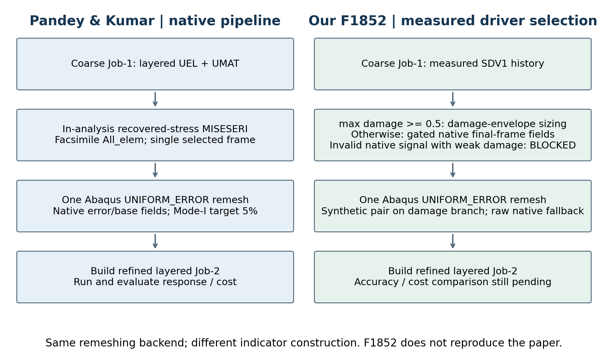
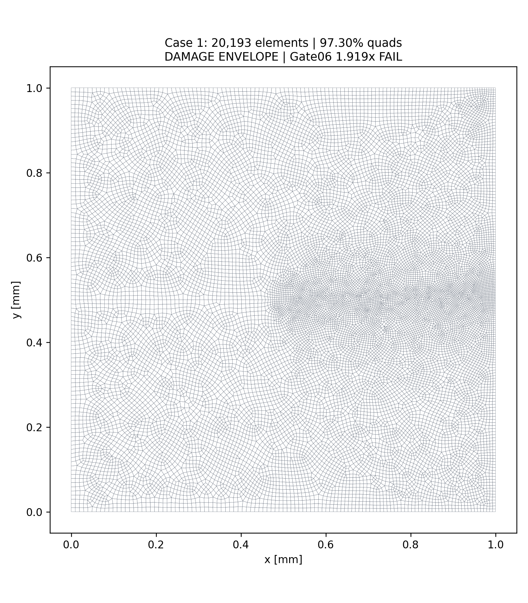
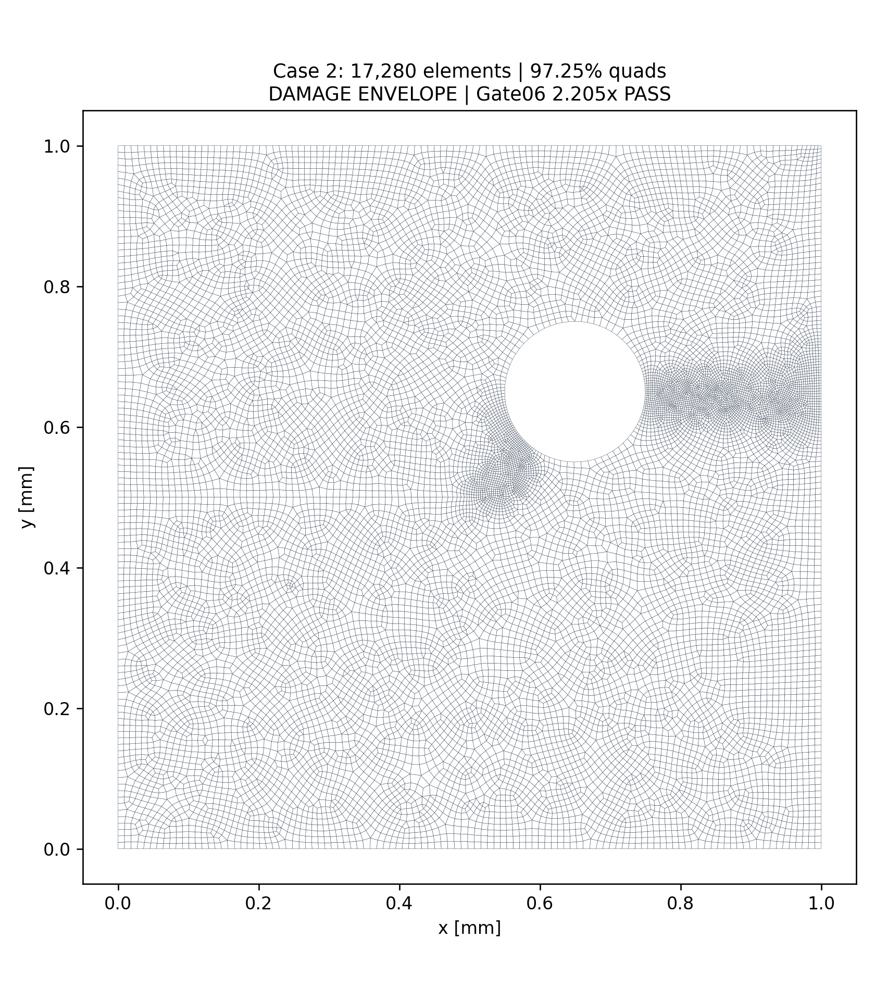
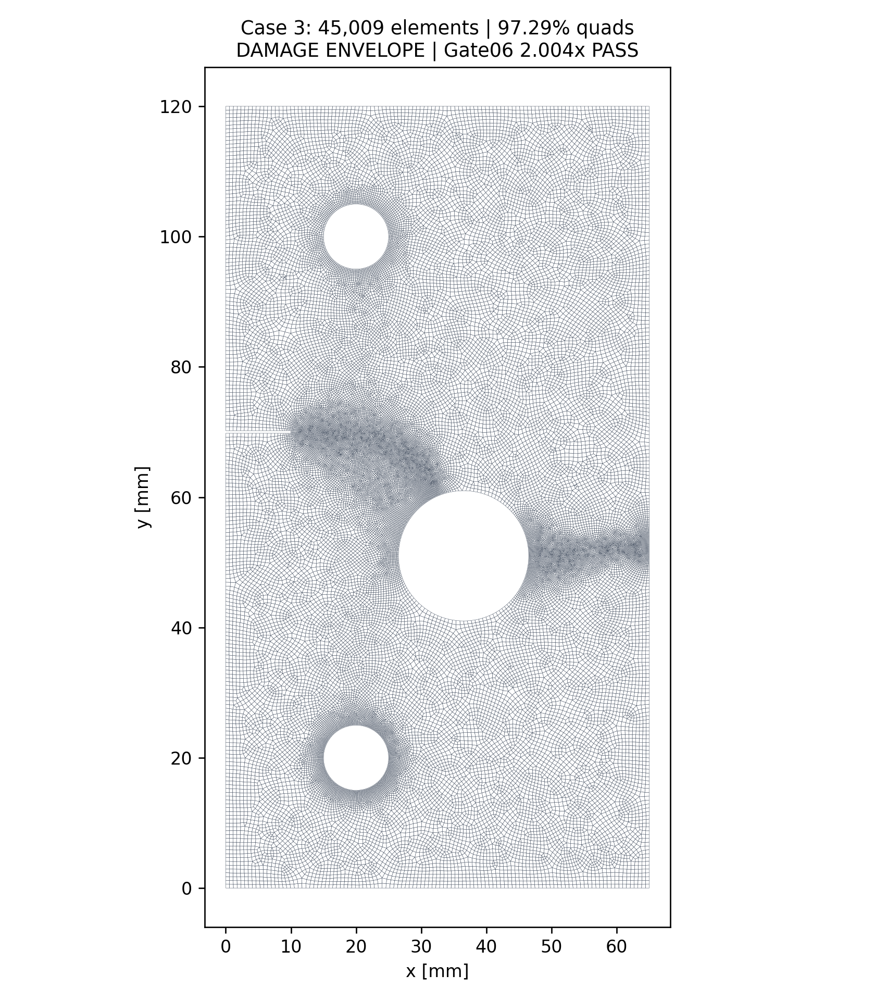
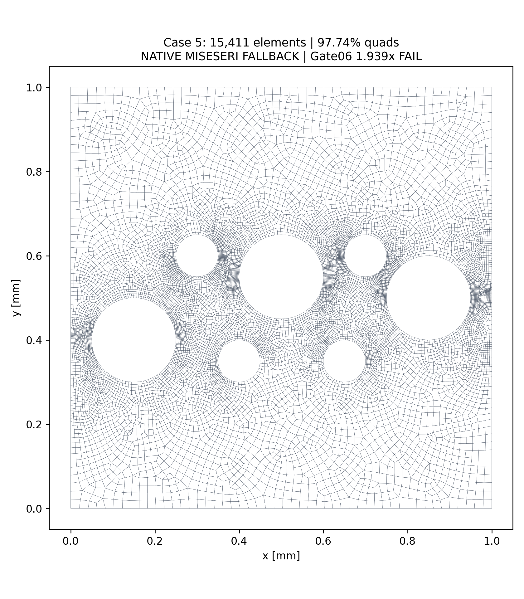

# Supervisor meeting | 19 November 2026

F1860 | Evidence cut-off: 18 November 2026 | Master research goal: OPEN | Documentation only; zero new PBS jobs.

**Meeting assessment.** F1852 provides automatic, field-driven mesh generation, but accuracy and total computational savings are not yet demonstrated. Cases 1 and 5 fail far-field coarsening; Case 3 remains expensive. The intended paper Mode-II benchmark is not the geometry currently called Case 2 in our results.

**Evidence labels.** DIRECTLY_VERIFIED means checked against the committed code or recorded audit at the source revision below, not an independent rerun of Abaqus. REPORTED_ONLY means historical report or user/AGY status without independently verified underlying solver evidence. INFERRED means an interpretation. MISSING means unsupported or unavailable. PENDING is an unavailable result expected from the ongoing comparison.

Source freeze: `4ef02faaa0004e495b468fcf288e3bb9dfc43840`. Individual source and image hashes are recorded in the accompanying evidence manifest. AGY retains its F1859 session; no framework, model, scheduler or shared session state is changed by this report.

## 1. Our framework: algorithm and indicator construction

DIRECTLY_VERIFIED [S1-S3]. F1852 selects a driver from measured Job-1 SDV1. If maximum available damage is at least D_CORE = 0.5, it preserves the F1849 constructed damage-envelope branch. The core-element fraction is recorded, not used as another fitted threshold. With weaker damage, native fields are accepted only through the native audit gate. Weak damage plus absent/anomalous native fields yields BLOCKED. Invalid non-finite or negative damage also fails. No case coordinates enter this selection rule.

DIRECTLY_VERIFIED [S2]. On the damage branch, Step-2 frames are sampled at indices 0, 5, 10, ... plus the last available frame. The per-element running maximum SDV1 defines the damage envelope. This is automatic history sampling, rather than hand-selected crack-path coordinates or selected MISESERI frames. Driver-strength measurement uses all available SDV1 frames. The frozen remesh is a full-history offline comparison; it does not establish online causal prediction of future cracks.

| Maximum sampled damage d | Target size h_target |
| --- | --- |
| d >= 0.5 | l0 / 2.5 |
| 0.1 <= d < 0.5 | Linear interpolation: l0 / 1.2 at d=0.1 to l0 / 2.5 at d=0.5 |
| 0.01 <= d < 0.1 | Linear interpolation: background h_bg to l0 / 1.2 |
| d < 0.01 | Background h_bg |

DIRECTLY_VERIFIED [S2]. With h_old = sqrt(element area), the sizing encoding is MISESERI_synthetic = 100 * error_target * h_old / h_target, MISESAVG_synthetic = 100, and EVOL = element area. Synthetic frameId 9999 is a constructed container, not a physical Job-1 time/frame. Field names make this compatible with Abaqus sizing; they do not turn damage into recovered-stress error. Material thresholds and min/max size limits are calibrated implementation choices.

DIRECTLY_VERIFIED [S1, S3, S5, S6]. F1852 native fallback uses audited raw native fields from one last available donor frame. Case 5 uses the original coarse ODB, Step-2 index 171, frameId 341, time 0.7788659334. It does not perform a new recovery solve here. Native stress-recovery output produced by Abaqus must be distinguished from the historical separate degraded-elasticity recovery solves and their synthesized envelopes.

REPORTED_ONLY [S4]; DIRECTLY_VERIFIED recorded parameters [S7]. F1812 assembled several degraded-modulus continuum recovery states and a maximum-error envelope. Case 1 reported source frame IDs 400, 420, 450, 460 and 470. Historical error targets for Cases 1/2/3/5 were 4.5%, 4.0%, 3.0%, 5.68%. Current frozen F1849 configs instead contain 1.85%, 2.30%, 3.00%, 5.68%; these generations must not be conflated. The F1833 local error/base normalization variant is a separate historical construction.

INFERRED operational sequence: coarse fracture Job-1 -> donor validation and extraction -> measured driver selection -> one native remeshing call -> build layered Job-2 -> evaluate response and total cost. Remeshing alone does not validate fracture accuracy. Total cost must include Job-1, extraction, any recovery solves, remeshing and Job-2.

## 2. Comparison with Pandey and Kumar

Figure 1. Side-by-side pipelines; the damage branch is explicitly synthetic.

| Feature | Pandey and Kumar | Our frozen F1852 |
| --- | --- | --- |
| Donor | Coarse layered UEL + UMAT Job-1 | Coarse fracture Job-1 SDV1 history; gated native alternative |
| Indicator | Native in-analysis stress-recovery error on All_elem | Constructed damage envelope for Cases 1/2/3; raw native Case 5 |
| Temporal use | One remeshing state in the one-shot sequence | Sampled damage maximum; native fallback last available frame |
| Backend | Abaqus UNIFORM_ERROR | Abaqus UNIFORM_ERROR |
| Target | Mode-I study adopts 5%; Listing 1 uses example 1.0 | Per-case and revision-dependent settings |
| Outcome | Refined Job-2 then response/cost comparison | Job-2 comparison pending; no reproduction claim |

DIRECTLY_VERIFIED paper source [P], Sections 3.2-3.3 and 4.1.3. The shared backend does not imply equivalent indicators. Our primary method is damage-informed adaptive sizing. A uniform damage strategy is not qualified as reproducing F1779 across all four cases; F1779 mixed historical methods. REPORTED_ONLY historical F1779 counts: 20,232 / 17,280 / 9,975 / 15,330.

## 3. Benchmark identity and sourced setups

**Identity correction (DIRECTLY_VERIFIED [S10]).** The intended paper Case 2 is Section 4.2, an edge-cracked plate under Mode-II shear. Our committed Case 2 config is explicitly OFF_AXIS_HOLE_PLATE under EDGE_PULL. Its mesh and F1859 comparison must retain that identity. No verified F1852 Mode-II result is available. The following blocks separate the intended benchmark from the implemented dataset instead of relabeling the hole mesh.

### Case 1: Mode-I edge-cracked plate (paper Section 4.1)

DIRECTLY_VERIFIED committed setup [S9]: plate 1.0 x 1.0 mm; geometry type STRAIGHT_NOTCH_PLATE. Notch from left edge to x=0.5 mm at y=0.5 mm; slit opening 0.001 mm.

E=210000 MPa (210 GPa), nu=0.3, Gc=0.0027 kN/mm, l0=0.0075 mm; residual stiffness=1e-07.

Configured displacement control: EDGE_PULL; Step-1 u2=0.005 mm, Step-2 u2=0.01 mm. Bottom u2=0, bottom-left u1=0, top edge pulled vertically. These are committed configuration values, not an assertion that every historical donor used the identical deck.

Frozen remeshing config: target 1.85%; h_min=0.001 mm, h_max=0.02 mm; refinementFactor=10; coarsening=NOT_ALLOWED. Historical F1812 target: 4.5%.

### Case 2: intended Mode-II shear (paper Section 4.2); implemented dataset differs

DIRECTLY_VERIFIED committed setup [S10]: plate 1.0 x 1.0 mm; geometry type OFF_AXIS_HOLE_PLATE. Notch from left edge to x=0.5 mm at y=0.5 mm; slit opening 0.001 mm.

Hole centres (x,y) and radii in mm: (0.65, 0.65), r=0.1.

E=210000 MPa (210 GPa), nu=0.3, Gc=0.0027 kN/mm, l0=0.0075 mm; residual stiffness=1e-07.

Configured displacement control: EDGE_PULL; Step-1 u2=0.005 mm, Step-2 u2=0.012 mm. Bottom u2=0, bottom-left u1=0, top edge pulled vertically. These are committed configuration values, not an assertion that every historical donor used the identical deck.

Frozen remeshing config: target 2.3%; h_min=0.0015 mm, h_max=0.02 mm; refinementFactor=10; coarsening=NOT_ALLOWED. Historical F1812 target: 4.0%.

DIRECTLY_VERIFIED [P, Section 4.2]: intended shear model fixes the bottom and drives horizontal top displacement; l0=0.015 mm. MISSING: corresponding committed Mode-II F1852 donor/config/results. The off-axis-hole count cannot be compared as the same problem.

### Case 3: rectangular notched plate with a hole and pins (paper Section 4.3)

DIRECTLY_VERIFIED committed setup [S11]: plate 65.0 x 120.0 mm; geometry type NOTCHED_PLATE_WITH_PIN_HOLES. Notch from left edge to x=10.0 mm at y=70.0 mm; slit opening 0.2 mm.

Hole centres (x,y) and radii in mm: (36.5, 51.0), r=10.0; (20.0, 20.0), r=5.0; (20.0, 100.0), r=5.0.

E=210000 MPa (210 GPa), nu=0.3, Gc=0.00228 kN/mm, l0=0.285 mm; residual stiffness=1e-07.

Configured displacement control: PIN_HOLE_PULL; Step-1 u2=0.05 mm, Step-2 u2=1.5 mm. Lower pin hole fixed, upper pin hole driven; exact applied pin constraints require deck verification. These are committed configuration values, not an assertion that every historical donor used the identical deck.

Frozen remeshing config: target 3.0%; h_min=0.08 mm, h_max=1.5 mm; refinementFactor=10; coarsening=DEFAULT_LIMIT. Historical F1812 target: 3.0%.

DIRECTLY_VERIFIED mismatch: paper Section 4.3 states notch width 0.4 mm; committed config uses slit opening 0.2 mm. Establish equivalence before claiming exact setup reproduction.

### Case 5: seven-hole plate (paper Section 4.6)

DIRECTLY_VERIFIED committed setup [S12]: plate 1.0 x 1.0 mm; geometry type SEVEN_HOLE_PLATE. No initial notch specified.

Hole centres (x,y) and radii in mm: (0.15, 0.4), r=0.1; (0.5, 0.55), r=0.1; (0.85, 0.5), r=0.1; (0.3, 0.6), r=0.05; (0.7, 0.6), r=0.05; (0.4, 0.35), r=0.05; (0.65, 0.35), r=0.05.

E=210000 MPa (210 GPa), nu=0.3, Gc=0.0027 kN/mm, l0=0.008 mm; residual stiffness=1e-07.

Configured displacement control: EDGE_PULL; Step-1 u2=0.005 mm, Step-2 u2=0.01 mm. Bottom u2=0, bottom-left u1=0, top edge pulled vertically. These are committed configuration values, not an assertion that every historical donor used the identical deck.

Frozen remeshing config: target 5.68%; h_min=0.001 mm, h_max=0.03 mm; refinementFactor=10; coarsening=NOT_ALLOWED. Historical F1812 target: 5.68%.

| Dataset | Coarse donor elements | F1812 | F1852 | F1779 historical | Paper proposed |
| --- | --- | --- | --- | --- | --- |
| 1 | 2906 | 25461 | 20193 | 20232 | 13,941 (reported) |
| 2 | 2906 | 41438 | 17280 | 17280 | 19,963 Mode-II [P]; different geometry |
| 3 | 3923 | 77779 | 45009 | 9975 | 12,168 (reported) |
| 5 | 2566 | 15466 | 15411 | 15330 | MISSING: verified count; config target 15,714 is not paper proof |

Coarse counts are the F1852 recorded damage-history element populations, not independently recounted Job-1 decks. F1812 and F1852 counts are DIRECTLY_VERIFIED recorded audits [S4-S6]; F1779 and paper counts lacking a directly inspected figure are REPORTED_ONLY. The requested 23,618 value is not the Section 4.2 narrative value and is not adopted as Mode-II ground truth.

## 4. Mesh results, resolution and gates

DIRECTLY_VERIFIED recorded audits [S4-S7]. Gate 06 is mean far-field h / mean process-region h >= 2.0, with h=sqrt(area). A budget pass or low count does not imply adequate resolution. Historical critical masks and current process masks differ; their percentages below are not matched-mask improvement claims.

| Dataset case | F1812 critical count coverage | F1812 Gate 06 | F1852 process count % <=l0 / <=l0/2 | F1852 process area % <=l0 / <=l0/2 | F1852 Gate 06 |
| --- | --- | --- | --- | --- | --- |
| 1 | Full ligament 97.19% <=l0/2 | 2.3867 PASS | 100.00 / 58.65 | 100.00 / 48.29 | 1.9187 FAIL |
| 2 | Outer ligament 100% <=l0/2 | 1.9349 FAIL | 96.29 / 75.28 | 81.88 / 42.08 | 2.2048 PASS |
| 3 | Secondary 93.84% <=l0 | 1.4462 FAIL | 95.39 / 9.62 | 82.37 / 3.68 | 2.0039 PASS |
| 5 | Inter-hole 99.04% <=l0 | 2.1174 PASS | 98.78 / 73.29 | 92.15 / 44.21 | 1.9387 FAIL |

Gate 07 was redefined in F1812 from a universal <=30,000 elements to 30,000 for Cases 1/5 and 80,000 for Cases 2/3 [S7, lines 373-375]. All four F1812 and F1852 counts fit those redefined budgets. Under the original universal cap, F1812 Cases 2/3 fail and F1852 Case 3 fails. This is a gate redefinition, not an efficiency gain.

| Case | F1852 quads % | min detJ | max aspect ratio | remesh + audit seconds |
| --- | --- | --- | --- | --- |
| 1 | 97.30 | 1.03e-06 | 2.469 | 4.545 |
| 2 | 97.25 | 4.94e-07 | 2.646 | 4.094 |
| 3 | 97.29 | 0.00114 | 2.922 | 10.489 |
| 5 | 97.74 | 3.63e-07 | 2.409 | 4.415 |

All four recorded meshes have zero non-positive Jacobians. Timings exclude donor solution, initial hashing and damage extraction; they cannot establish end-to-end speedup. F1852 Case 3 has 45,009 elements despite its narrowly passing 2.004 coarsening ratio. Current Case 1 process count coverage <=l0/2 is 58.65%; historical full-ligament 97.19% is a different mask and cannot be claimed preserved from this table.

Figure 2. Existing frozen F1852 Case 1 mesh, reused unchanged. Recorded geometry and resolution audit above apply.

Figure 3. Existing frozen F1852 Case 2 mesh, reused unchanged. Repository off-axis-hole Mode-I dataset; not paper Mode-II.

Figure 4. Existing frozen F1852 Case 3 mesh, reused unchanged. Recorded geometry and resolution audit above apply.

Figure 5. Existing frozen F1852 Case 5 mesh, reused unchanged. Recorded geometry and resolution audit above apply.

## 5. F1859 reference versus Job-2 comparison: pending

REPORTED_ONLY status: the user/AGY reports eight comparison jobs in parallel (four adaptive Job-2 and four reference solves), cumulative PBS 45. No completed committed F1859 comparison report is available at this report cut-off. The local F1859 staging receipt still labels jobs STAGED_READY_FOR_EXECUTION; staging alone does not independently prove live scheduler state. No scheduler commands were issued for this documentation task.

INFERRED reference qualification issue: the staging receipt describes historical target-aligned comparison meshes, including Case 1 with 13,960 and Case 3 with 12,110 elements. Those are not demonstrably highly refined or converged references. Before interpreting accuracy differences, require mesh convergence, matched material/formulation/loading and donor provenance. Do not infer accuracy from agreement with a potentially under-resolved comparator.

### Comparison dataset Case 1

| Metric | Reference solve | Framework Job-2 | Relative difference |
| --- | --- | --- | --- |
| Physical element count | PENDING | PENDING | PENDING |
| Walltime (s) | PENDING | PENDING | PENDING |
| CPU time (s) | PENDING | PENDING | PENDING |
| Peak reaction load | PENDING | PENDING | PENDING |
| Displacement at peak (mm) | PENDING | PENDING | PENDING |
| Crack path / coverage | PENDING | PENDING | PENDING |

### Comparison dataset Case 2 (off-axis-hole Mode-I, not paper Mode-II)

| Metric | Reference solve | Framework Job-2 | Relative difference |
| --- | --- | --- | --- |
| Physical element count | PENDING | PENDING | PENDING |
| Walltime (s) | PENDING | PENDING | PENDING |
| CPU time (s) | PENDING | PENDING | PENDING |
| Peak reaction load | PENDING | PENDING | PENDING |
| Displacement at peak (mm) | PENDING | PENDING | PENDING |
| Crack path / coverage | PENDING | PENDING | PENDING |

### Comparison dataset Case 3

| Metric | Reference solve | Framework Job-2 | Relative difference |
| --- | --- | --- | --- |
| Physical element count | PENDING | PENDING | PENDING |
| Walltime (s) | PENDING | PENDING | PENDING |
| CPU time (s) | PENDING | PENDING | PENDING |
| Peak reaction load | PENDING | PENDING | PENDING |
| Displacement at peak (mm) | PENDING | PENDING | PENDING |
| Crack path / coverage | PENDING | PENDING | PENDING |

### Comparison dataset Case 5

| Metric | Reference solve | Framework Job-2 | Relative difference |
| --- | --- | --- | --- |
| Physical element count | PENDING | PENDING | PENDING |
| Walltime (s) | PENDING | PENDING | PENDING |
| CPU time (s) | PENDING | PENDING | PENDING |
| Peak reaction load | PENDING | PENDING | PENDING |
| Displacement at peak (mm) | PENDING | PENDING | PENDING |
| Crack path / coverage | PENDING | PENDING | PENDING |

PENDING means completed results unavailable; running status is REPORTED_ONLY. If a run does not complete, replace with MISSING and its solver reason. Do not substitute configured mesh counts for extracted comparison results. Relative scalar difference = 100*(adaptive-reference)/reference; zero denominator -> undefined. Walltime and CPU definitions must match across jobs; crack comparison needs a common damage threshold, geometric distance and same-region coverage rather than a scalar percent invented from pictures.

## 6. Limitations and open evidence

DIRECTLY_VERIFIED: Case 1 Gate 06 = 1.9187 FAIL and Case 5 = 1.9387 FAIL [S5-S6]. Case 3 remains diffuse and expensive at 45,009 elements. Shared code and mesh-quality passes do not qualify all geometries or prove fracture accuracy. Full-history extraction includes available crack wake and cannot establish causal online refinement.

INFERRED historical mechanism: F1833 local error/base ratios can be amplified by small local stress denominators and retained by a maximum across states. This is a strong diagnostic suspect for that historical variant, not established causation and not the F1852 damage-envelope formula. A matched ablation is required before attribution.

DIRECTLY_VERIFIED recorded F1851 diagnostic [S8]: the Case 2 pilot has CPE3 triangles with zero stress tensors and zero MISESAVG. Treat native error validity as a prerequisite; an ODB field existing is insufficient. F1852 Case 5 records no such zero-stress/base elements. This does not independently establish mechanical neutrality or completed fracture evolution.

REPORTED_ONLY unresolved provenance: the F1850 bridge transport response remains unreconciled; this report proceeds on the direct user request, not a manufactured review approval. F1828 Job-2 status was previously unknown. A newer local F1859 staging receipt reports no usable completed F1828 Job-2 outputs (Case 1 datacheck only; other cases not run); independent scheduler/solver verification is MISSING here, so no completed-result claim is made.

MISSING acceptance evidence: independently reviewed four-case accuracy/cost comparison, a verified Mode-II dataset, converged reference qualification, matched critical-region coverage across revisions, and reliable generalization beyond the tested configurations. Historical F1779 Case 3 efficiency is not reproduced by the present uniform damage strategy.

## 7. Supervisor decisions and timeline

| When | Decision / action | Measurable evidence needed |
| --- | --- | --- |
| 19 November meeting | Confirm the four intended benchmark identities; separate Mode-II from off-axis-hole dataset | Correct geometry, loading, formulation and input hashes before any paper-equivalence claim |
| After F1859 completes | Review completed response/cost results and reference validity | Force-displacement, peak metrics, crack geometry, convergence and full pipeline cost |
| Before research freeze: 13 December 2026 | Prioritize Case 1/5 coarsening and Case 3 efficiency | Gate 06 >=2 without critical-resolution loss; lower count/cost with matched-mask coverage |
| If supervisor directs native reproduction | Scope remaining native interface / single-state remeshing / Job-2 tasks (Tasks 4-6) | Full-scale damage-converged donors, valid native stress fields and mechanical parity; no new jobs authorized here |
| Submission: 13 January 2027 | Consolidate only validated conclusions and preserved failures | Reviewed frozen evidence package and reproducible provenance |

The master goal remains OPEN. The meeting should select a numerical hypothesis after the pending comparison; report preparation is not framework finalization.

## Sources and evidence register

[P] Pandey, A. and Kumar, S. (2025), A Simple and Robust Mesh Refinement Implementation in Abaqus for Phase Field Modelling of Brittle Fracture, CMES 144(3), 3251-3286. DOI: 10.32604/cmes.2025.067858. https://www.techscience.com/CMES/v144n3/63944/html (checked 18 November 2026; Sections 3.2-3.3, 4.1.3, 4.2, 4.3 and 4.6).

[S1] `scripts/remeshing/generalized_2d_adaptive_framework_driver_selection_f1852.py`; committed revision 4ef02faaa000; SHA256 42217dab0b8c3b7eff9c8bf46fd75b7e99f06e436d9841846df36c46e618a30a.

[S2] `scripts/remeshing/generalized_2d_adaptive_framework_damage_envelope_f1849.py`; committed revision 4ef02faaa000; SHA256 694e7ababd739e6f5cbca5597cb39ada500116895b8c4a21ca470b64f9247096.

[S3] `scripts/remeshing/generalized_2d_adaptive_framework_f1846.py`; committed revision 4ef02faaa000; SHA256 22c58ed7631ee12e8e0837c0cb2e742ce9a55438b5226b0b9830a6def880d8d2.

[S4] `docs/validation/F1812_UNIVERSAL_CRACK_PATH_REFINEMENT_REPORT.md`; committed revision 4ef02faaa000; SHA256 d3063f569aa022b56d4c18f5745e26f938f0569f133a4834aba58b8043c55831.

[S5] `docs/validation/F1852_DRIVER_SELECTION_REPORT.md`; committed revision 4ef02faaa000; SHA256 81a43dd36fc17ac5bd25273b9cc731ae72821f605d8b0c7a8cfba709e888ac48.

[S6] `results/validation/f1852_driver_selection_summary.json`; committed revision 4ef02faaa000; SHA256 3b9fe926b4e7201e7bd2d38bc563b905f10159bc0cedd416936e10a0bd4b8cee.

[S7] `scripts/remeshing/run_f1812_single_target.py`; committed revision 4ef02faaa000; SHA256 c83eec21f3f8cb5f303d893c229a8f1ecc8a0d682c08c369bce02c4232cfc791.

[S8] `docs/validation/F1851_NATIVE_MISESERI_DIAGNOSTICS_REPORT.md`; committed revision 4ef02faaa000; SHA256 eda49df81f9c8d5565e982b377da6c35ca7380efa272e6b5be7d46e873f54304.

[S9] `models/pandey_kumar_mode1/279_f1849_damage_envelope/case1_config.json`; committed revision 4ef02faaa000; SHA256 7ac3a54f4baf47e8e5ae592736aac8c7ca941fbea90090bddf63b7e4fcc0d1dc.

[S10] `models/pandey_kumar_mode1/279_f1849_damage_envelope/case2_config.json`; committed revision 4ef02faaa000; SHA256 5d22014e1a8e1fa281f975c1c4d32eee9d9eca763bea6794e4ae5f79b8b2c088.

[S11] `models/pandey_kumar_mode1/279_f1849_damage_envelope/case3_config.json`; committed revision 4ef02faaa000; SHA256 ef42522a51c8f06644027fd0793858690df46c65bcd01f7e76e0fb8e4d23d691.

[S12] `models/pandey_kumar_mode1/279_f1849_damage_envelope/case5_config.json`; committed revision 4ef02faaa000; SHA256 a262360e9c32f6837aad11fc0c18e9609c223e4d18e5bc8a1c22dea1c1db5b48.

Additional recorded audit: `models/pandey_kumar_mode1/261_f1812_crack_path_refinement/PK_F1812_UNIVERSAL_CRACK_PATH_REFINEMENT_RECEIPT.json`. Live/uncommitted status only: `models/pandey_kumar_mode1/286_f1859_four_benchmark_reference_comparison/f1859_suite_receipt.json`; not used as completed numerical evidence. Meeting scope is explicitly authorized by the attached F1860 request.
