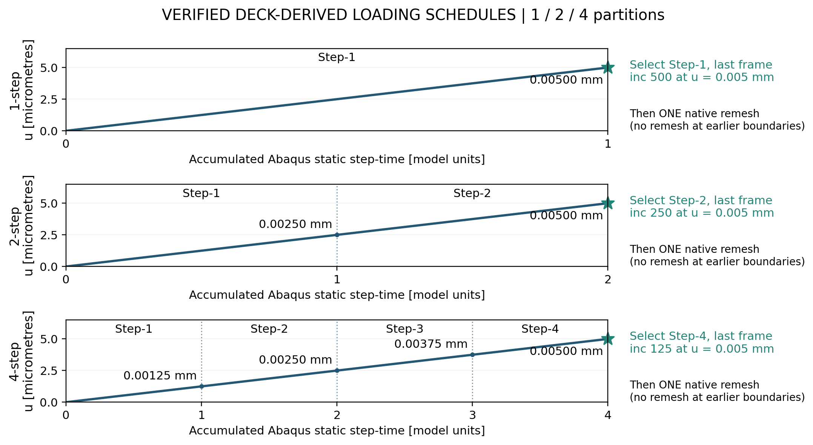
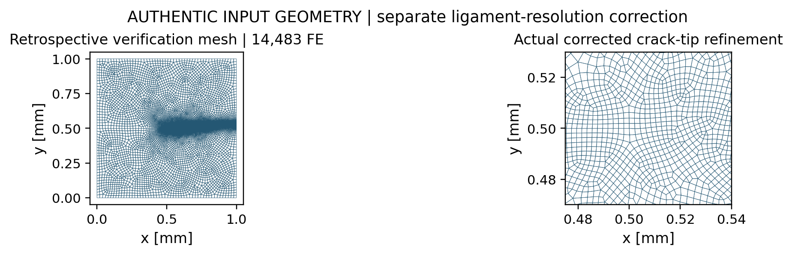

# Mode-I adaptive remeshing: validated results

Technical progress report | 22 October 2026

## 1. Method A and Method B: what changes?

Method A: one preliminary simulation, one native adaptive remesh, then a fresh final simulation from zero load. Method B extends that same two-pass approach by partitioning preliminary loading into configurable 1, 2 or 4 steps and selecting/evaluating the relevant MISESERI field before one remesh and a fresh final solve.

B varies the loading schedule and field-selection opportunities. It does not preserve a loaded fracture state across meshes or perform multiple remeshing cycles. With one step and the same controls, its architecture reduces to Method A.

Figure 1. Conceptual A/B workflow. The shared architecture has two simulation passes and exactly one remesh; only the pre-analysis schedule and field-selection flexibility differ.

Figure 2. Authentic coarse and automatically generated native Method B mesh (14,677 FE), with native tip zoom. This demonstrates implemented native remeshing and belongs to the partition study; it is not the mesh used for the corrected response on page 3.

## What did B add beyond A?

B made preliminary loading and field selection configurable, and tested whether step boundaries alone alter the native mesh. For this common pre-peak endpoint, they did not. This is consistent with linear-elastic companion-layer stress recovery: at the same mesh and endpoint state, subdividing a monotonic load schedule adds no new spatial error information.

Keep two findings separate: A - the partition study produced equivalent native 14,677-element meshes; B - a distinct retrospective ligament-resolution study evaluated the corrected 14,483-element fracture response.

# 2. Finding A: Method B loading-partition study

The executed infinitesimal-companion decks prescribe cumulative RP displacements of 0.005 mm (1 step); 0.0025, 0.005 mm (2 steps); and 0.00125, 0.0025, 0.00375, 0.005 mm (4 steps). Equal divisions are verified from these decks, not assumed.

Figure 3. Verified deck-derived prescribed histories, not measured solver curves. Each step lasts 1.0 static step-time unit; total times are 1, 2 and 4. Stars mark the selected terminal MISESERI frames; one native remesh follows each complete pre-analysis.

| Partitions | Endpoint [mm] | MISESERI comparison | Native FE | Observed difference |
| --- | --- | --- | --- | --- |
| 1 | 0.005000 | Reference terminal field | 14,677 | Baseline |
| 2 | 0.005000 | Max |difference| = 0 | 14,677 | No field/mesh change |
| 4 | 0.005000 | Max |difference| = 0 | 14,677 | No field/mesh change |

Field output is requested every increment. The compared selections are the last frames of Step-1, Step-2 and Step-4 respectively (increments 500, 250 and 125). The physical displacement increment is 0.000010 mm in every schedule. Archived verification reports identical recovered fields and native mesh identity, with 14,646 nodes in each case.

This is an observed invariance result, not an accuracy advantage. Companion-layer elasticity does not make the physical phase-field model globally linear. Benefits of selecting intermediate frames were not tested. Different frames, evolving damage, unloading or other controls could change the result. No final fracture-response improvement is attributed to partition count; B remains a one-remesh/two-pass extension, not a demonstrated sequential adaptive algorithm.

# 3. Finding B: corrected ligament-resolution study

The separate retrospectively refined 14,483-element verification mesh (serial job 1412465) is compared with canonical fixed reference job 1398090. It uses prior crack-path/ligament information. Its improved brittle fracture response is a mesh-resolution finding, not a benefit caused by choosing 1, 2 or 4 loading partitions.

Figure 4. Authentic 14,483-element retrospective verification mesh and crack-tip zoom. Refinement used prior knowledge of the fracture ligament. This is the mesh used for the corrected response below.

| Quantity | Corrected Method B | Fixed reference | Difference |
| --- | --- | --- | --- |
| Base elements | 14,483 | 15,192 | -4.67% |
| Initial stiffness [kN/mm] | 137.9096 | 137.9455 | -0.026% |
| Peak force [N] | 743.701 | 757.778 | -1.86% |
| Matched external work [mJ] | 2.2674 | 2.3587 | -3.87% |
| Comparison endpoint [mm] | 0.007889 | 0.007889 | Same horizon |

Figure 5. Authentic corrected Method B and fixed-reference histories, both ending at 0.007889 mm. Force is in N; work is in mJ; plotted displacement is in micrometres. No corrected data are extrapolated.

## Validated range and interpretation

Stiffness and peak-force differences meet the reported 0.5% and 2% criteria; matched work differs by -3.87%. The corrected solve reached 0.007889 mm; the full 0.010 mm horizon was not completed. Reference data are cropped to the same endpoint. This supports a retrospectively refined baseline within the verified range, not predictive native crack tracking.

Matched-work integration convention and rounding details: FIGURE_SOURCES.md.

# 4. Planned Method C1 and Method C2 strategies

C1 - Forward refinement follows the advancing crack while generally retaining previously refined regions. C2 - Forward refinement with selective coarsening investigates removing unnecessary resolution behind the advancing crack, subject to physical preservation criteria. Both target four state-preserving remeshing cycles.

Figure 6. Conceptual four-cycle progressions: C1 accumulates refinement; C2 investigates conditional wake coarsening while protecting the damaged corridor. Every panel is illustrative, not an accepted solver cycle.

## Achieved building blocks and remaining gate

Native adaptive mesh generation is implemented. A same-mesh continuation control reached -0.0264% endpoint force difference at u=0.00270 mm; this does not establish whole-trajectory or nonmatching-transfer equivalence.

No nonmatching sequential continuation is physically qualified: force, energy and damage-preservation checks remain unresolved. Both C1/C2 remain unqualified; coarsening is an additional unverified extension and must preserve displacement compatibility, fracture energy and irreversibility. Damaged regions and the active tip require sufficient resolution; crack opening and mechanical compliance must also be preserved.

Question for the supervisor: after the first qualified nonmatching handoff, which should be prioritized - C1 sequential cycles or investigation of C2 selective coarsening?

## Evidence references

- `models/pandey_kumar_mode1/40_method_b_corrected_propagation_14k/evidence_1412465/corrected_method_b_evaluation.json`

- `results/pandey_kumar_mode1/master_fracture_curves/curve_standard_1398090.csv`

- `models/pandey_kumar_mode1/40_method_b_corrected_propagation_14k/evidence_1412465/corrected_method_b_load_displacement.csv`

- `runs/mode1/method_b_inf_companion/inf_companion_method_b_results.json`

- `models/pandey_kumar_mode1/method_b_preflight_manifest.json`

- `docs/decisions/SUPERVISOR_DECISION_METHOD_B_MODE1_LOAD_PARTITIONING.md`

- `models/pandey_kumar_mode1/method_b_inf_companion_decks/M1_MB_INF_1S.inp`

- `models/pandey_kumar_mode1/method_b_inf_companion_decks/M1_MB_INF_2S.inp`

- `models/pandey_kumar_mode1/method_b_inf_companion_decks/M1_MB_INF_4S.inp`

- `runs/mode1/method_b_inf_companion/01_pre_1s/submit_M1_PRE_INF_1S.pbs`

- `runs/mode1/method_b_inf_companion/02_pre_2s/submit_M1_PRE_INF_2S.pbs`

- `runs/mode1/method_b_inf_companion/03_pre_4s/submit_M1_PRE_INF_4S.pbs`

- `docs/reports/MODE1_METHOD_C_CONTINUATION_ARCHITECTURE_VALIDATION.md`

- `docs/reports/MODE1_METHOD_C_EXPERIMENTAL_PREFLIGHT_AND_GATE_6C_READINESS.md`

- `docs/reports/MODE1_METHOD_C1_CONTINUATION_FEASIBILITY_AND_PLAN.md`

- `docs/reports/MODE1_METHOD_B_EVIDENCE_AUDIT_AND_SUPERVISOR_DECISION_PACKAGE.md`

- `docs/reports/MODE1_METHOD_B_SCIENTIFIC_VALIDATION_AND_ADAPTIVE_LIMITATION_REPORT.md`

- `models/pandey_kumar_mode1/experimental_offset_uel/evidence_f1575/F1575_SAME_MESH_CONTINUATION_RESOLUTION.json`

- `models/pandey_kumar_mode1/72_method_c_coupled_state_transfer/PACKAGE72_STATE_TRANSFER_AUDIT.json`

- Figure classes and hashes: [FIGURE_SOURCES.md](FIGURE_SOURCES.md).
