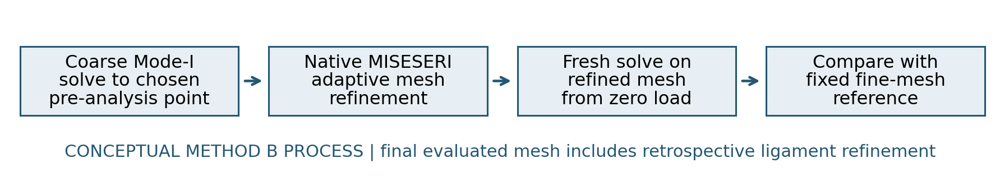
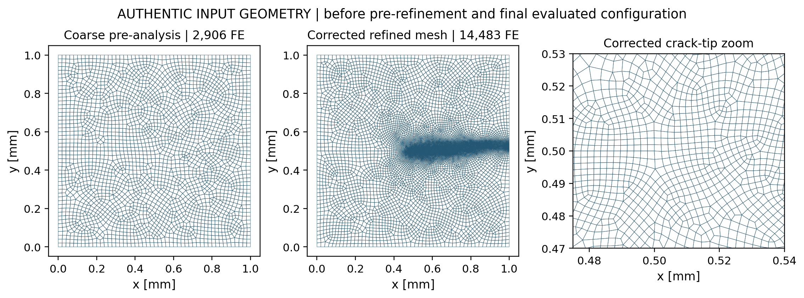
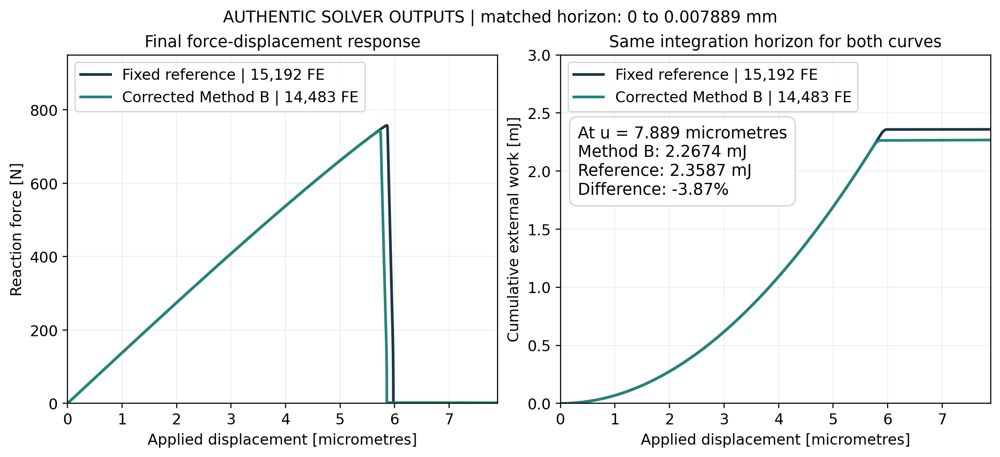
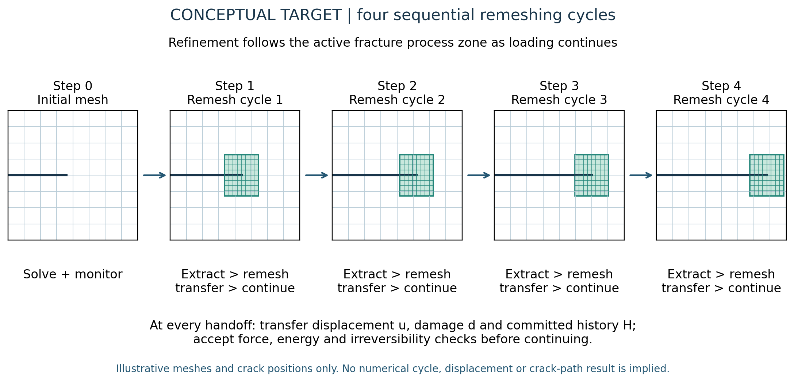
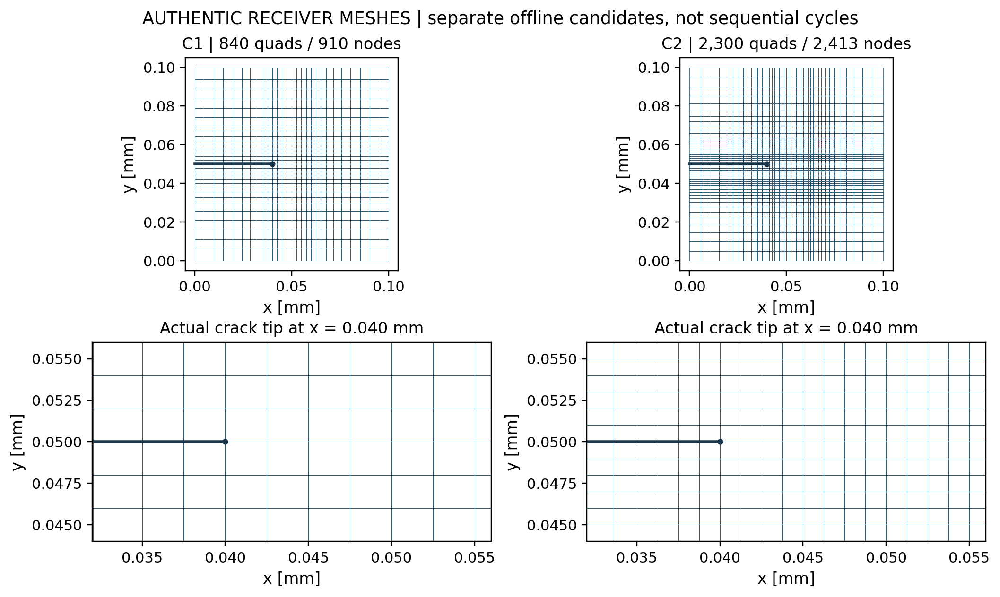
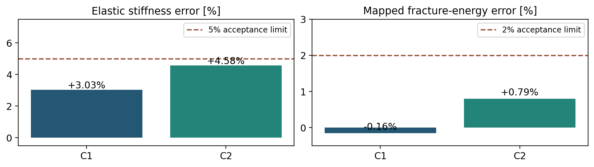

# Mode-I adaptive remeshing: validated results

Technical progress report | 22 October 2026

## 1. Objective and demonstrated progress

Preserve phase-field fracture accuracy while concentrating resolution where needed. Corrected Method B is successful within its verified displacement range. Method C has verified building blocks, but a physically continuous nonmatching handoff remains incomplete.

## 2. Method B: pre-refine, then solve afresh

Start with a coarse Mode-I analysis and evaluate MISESERI at the chosen pre-analysis point. Native Abaqus remeshing generates a refined mesh; Method B then runs a fresh phase-field solve from zero load. It does not transfer a loaded fracture state between meshes.

Method B process schematic. A fresh refined-mesh solve is distinct from Method C state-preserving continuation.

Figure 2. Authentic coarse and corrected refined meshes, with the crack-tip region. Final ligament refinement uses retrospective crack-path information; this is not a purely predictive automatic remeshing demonstration.

## What the final evaluated configuration establishes

The 14,483-element configuration resolves the expected propagation ligament using retrospective refinement. Its comparison with the fine fixed mesh tests the resulting fracture response. Predictive remeshing that follows an evolving crack remains a Method C target.

## Independent pre-analysis reproducibility result

At fixed displacement resolution, preliminary loading split into 1, 2 or 4 steps produced identical recovered MISESERI fields (maximum difference zero) and identical native 14,677-element meshes. This establishes invariance for the tested pre-peak window, separately from the corrected 14,483-element evaluation.

# 3. Method B: final quantitative comparison

Corrected Method B (serial job 1412465) versus canonical fixed-mesh reference (job 1398090). Results are restricted to the common displacement horizon.

| Quantity | Corrected Method B | Fixed reference | Difference |
| --- | --- | --- | --- |
| Base elements | 14,483 | 15,192 | -4.67% |
| Initial stiffness [kN/mm] | 137.9096 | 137.9455 | -0.026% |
| Peak force [N] | 743.701 | 757.778 | -1.86% |
| Matched external work [mJ] | 2.2674 | 2.3587 | -3.87% |
| Comparison endpoint [mm] | 0.007889 | 0.007889 | Same horizon |

Figure 1. Authentic corrected Method B and fixed-reference histories, both ending at 0.007889 mm. Force is in N; work is in mJ; plotted displacement is in micrometres. No corrected data are extrapolated.

## Validated range and interpretation

Initial stiffness and peak-force differences meet the reported 0.5% and 2% criteria. Matched-horizon external work differs by -3.87%. This supports the corrected mesh as a useful pre-refinement baseline within the verified range.

The corrected solve reached 0.007889 mm; the full 0.010 mm horizon was not completed. The reference is deliberately cropped to the same endpoint. Retrospective ligament refinement does not establish that native automatic remeshing independently predicted the whole crack path.

Work provenance: direct CSV re-integration gives 2.267379 mJ and 2.358732 mJ (approximately -3.87%). The earlier summary listed reference 2.3586 mJ; 2.3587 mJ is the reproducible rounded CSV value. Work follows the established first-recorded-row zero convention; see FIGURE_SOURCES.md.

# 4. Method C: intended sequential adaptation

Method C aims to retain the current fracture state while changing the mesh. The target is four genuine adaptive remeshing cycles, with refinement following the active crack-tip/process-zone region rather than a preselected full propagation ligament.

Figure 3. Conceptual Step 0 plus four intended remeshing cycles. Every panel is illustrative: no authentic four-cycle solver trajectory has yet been qualified.

## Intended sequence: Step 0 and cycles 1-4

Step 0: solve on the coarse mesh and monitor damage and the error indicator. Cycle 1: at a chosen remeshing point, extract displacement, damage and committed history; remesh around the active region; transfer and re-equilibrate; continue loading. Cycles 2, 3 and 4 repeat that sequence from the newly continued solution. Remeshing points must be selected and validated; no cycle displacements are claimed here.

| Building block | Achieved evidence | Remaining target |
| --- | --- | --- |
| Native mesh generation | Authentic refined input meshes | Adapt repeatedly to evolving crack |
| Same-mesh continuation | -0.0264% endpoint force error | Preserve state on a new mesh |
| Nonmatching transfer | Offline components evaluated | Force/energy continuity; no healing |
| Sequential loading cycles | No qualified complete cycle | Four accepted remesh/continue cycles |

## Successful continuation control and current boundary

The experimental same-mesh control reaches 5.2881993 N versus 5.2895973 N at u=0.00270 mm with the guarded predictor: -0.0264% endpoint difference. This is endpoint agreement for a specific same-mesh control, not whole-trajectory or nonmatching-transfer equivalence.

Nonmatching transfer remains unqualified because force continuity, energy and pointwise damage irreversibility must all survive re-equilibration. Separate mesh-generation and continuation controls do not yet form a validated multi-cycle solution. Candidate C2 isolates the current limitation below.

# 5. Method C - Candidate C2: Crack-Band-Resolved Receiver Mesh

Candidate C2 is a small receiver mesh developed for Method C: 2,300 quadrilateral elements, 2,413 physical nodes and 0.001 mm crack-band element size. Its minimum Jacobian is positive (3.125e-7). C1 is a separate intermediate candidate.

Figure 4. Authentic C1/C2 receiver geometries and common-scale crack-tip close-ups. These are separate offline transfer candidates, not successive remeshing cycles.

Figure 5. Authentic passing offline checks: C2 elastic stiffness error 4.58% (limit 5%) and mapped fracture-energy error +0.79% (limit 2%). These do not qualify loaded continuation.

## Remaining limitation: physical state continuity

C2 equilibrated force is 0.366 N versus donor 7.851 N (-95.34%, FAIL). The evaluated C2 prototype also reports maximum damage healing 0.0021837. Thus C2 is a successful mesh-generation and partial verification result, not qualified Method C continuation. Zero healing in the separate constrained 650-element prototype must not be attributed to C2.

## Scientific decision and immediate next work

Retain corrected Method B as the retrospectively refined baseline within 0.007889 mm. For Method C, prioritize one transfer hypothesis preserving the damaged profile and committed history under consistent boundary conditions. Check force, energy, residuals and irreversibility offline before a distinct qualified serial single-handoff test. Require physical acceptance before any four-cycle demonstration.

## Evidence references

- `models/pandey_kumar_mode1/40_method_b_corrected_propagation_14k/evidence_1412465/corrected_method_b_evaluation.json`

- `results/pandey_kumar_mode1/master_fracture_curves/curve_standard_1398090.csv`

- `models/pandey_kumar_mode1/40_method_b_corrected_propagation_14k/evidence_1412465/corrected_method_b_load_displacement.csv`

- `docs/reports/MODE1_METHOD_B_EVIDENCE_AUDIT_AND_SUPERVISOR_DECISION_PACKAGE.md`

- `docs/reports/MODE1_METHOD_B_SCIENTIFIC_VALIDATION_AND_ADAPTIVE_LIMITATION_REPORT.md`

- `models/pandey_kumar_mode1/experimental_offset_uel/evidence_f1575/F1575_SAME_MESH_CONTINUATION_RESOLUTION.json`

- `results/validation/mesh_convergence_prototype.json`

- `results/validation/mode1_f1597/correction_prototype.json`

- Figure classes and hashes: [FIGURE_SOURCES.md](FIGURE_SOURCES.md).
