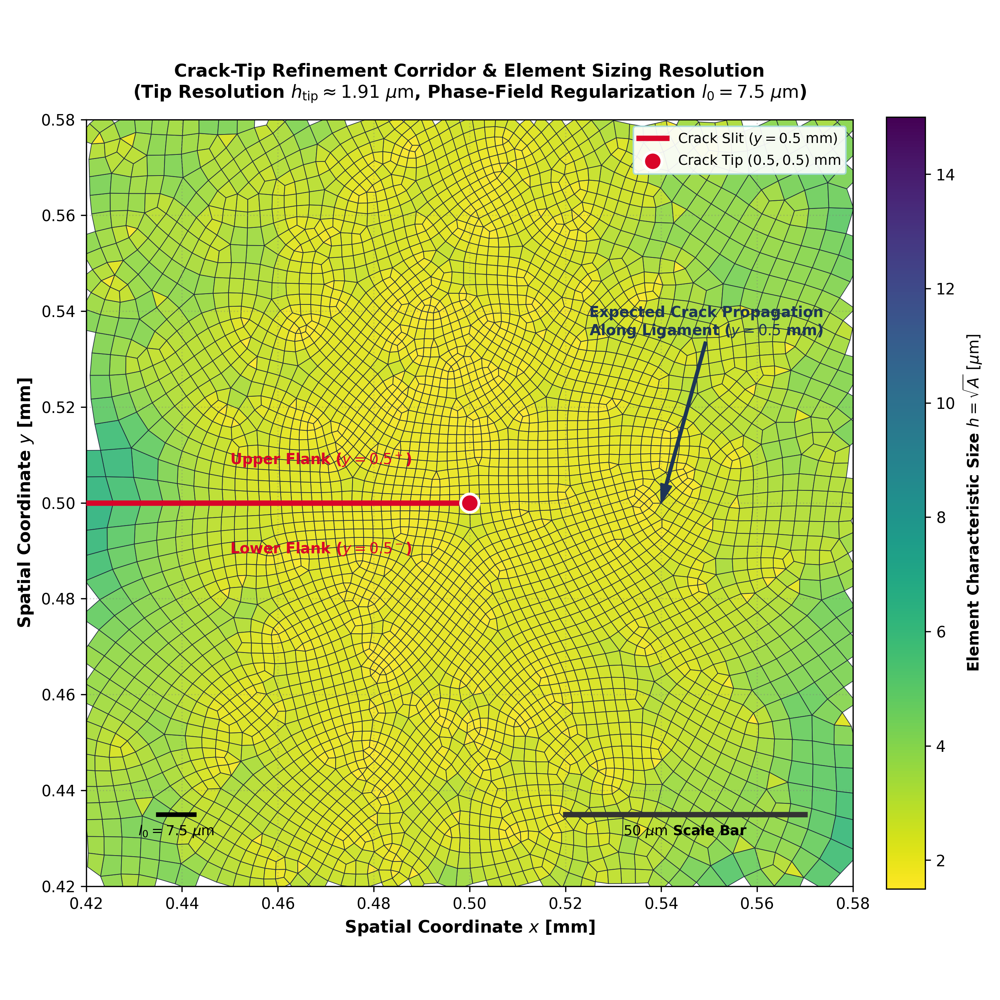

# Supervisor meeting | 22 October 2026

Evidence reviewed 21 October 2026. Successful results are scoped to the tested case and evidence type.

# 1. Objective of the current work

Develop adaptive remeshing for Mode-I phase-field fracture while preserving the physical state. Method B establishes indicator-driven pre-refinement followed by a fresh solve from zero load. Method C aims to remesh during loading and continue from the transferred state. Candidate C2 is a crack-band-resolved receiver mesh developed for Method C.

# 2. Successful validated progress since the previous meeting

- Method B: tested 1/2/4-step pre-analysis partitions produced identical recovered indicators and native 14,677-element geometry.
- Corrected Method B: ligament refinement removed the sustained post-peak plateau in the recorded response; initial stiffness and peak are close to the reference.
- Method C building block: guarded-predictor same-mesh continuation achieved 0.0264% endpoint force agreement in the specific experimental control.
- Candidate C2: offline elastic stiffness and mapped fracture-energy checks meet their stated 5% and 2% criteria. These are subchecks, not a qualified transfer cycle.

# 3. Mode I — Method B

Method B uses a preliminary load window to obtain MISESERI, generates a native adapted mesh, then solves the phase-field model afresh. The small companion stiffness permits indicator recovery with negligible measured force perturbation (relative discrepancy 5.50e-10). At fixed displacement resolution, the 1/2/4-step tests give max indicator difference zero and identical 14,677-element meshes. This is a tested pre-peak invariance result.

The propagation-resolved correction refines the ligament ahead of the notch. The corrected 14,483-element response has initial stiffness 137.9096 kN/mm versus reference 137.9455 kN/mm (about -0.026%) and peak 743.701 N versus 757.778 N (about -1.86%). The recorded response demonstrates the load drop without the original extended plateau. These successes establish a useful mesh-design correction; they do not establish full-horizon or universal adaptive accuracy.

Figure 1 uses authentic recorded force data and integrated external work. Energy histories are shown over each available horizon only; unequal endpoints must not be interpreted as matched-horizon energy convergence.

Figure 1. Authentic solver histories; recorded horizons only.

# 4. Mode I — Method C

## 4.1 Planned Method C workflow

Coarse simulation → extract displacement, damage, committed history and indicator → native remesh → transfer and re-equilibrate → continue loading → repeat. Each handoff must preserve boundary conditions, reaction force, energy and damage irreversibility before the next cycle. Figure 2 is conceptual and distinguishes planned stages from accepted building blocks.

Figure 2. Conceptual workflow and planned-versus-achieved comparison.

## 4.2 What has been successfully demonstrated

Native remeshing has generated authentic adapted geometry. A separate experimental offset-state same-mesh control, using extrapolation=NO, reaches 5.2881993 N versus continuous-control 5.2895973 N at u=0.00270 mm: -0.0264% endpoint discrepancy. Earlier increments differ by -1.7769% and -0.2283%; the endpoint number is not whole-trajectory equivalence. This is a controlled same-mesh continuation result using the experimental architecture, not nonmatching transfer qualification. Production UEL remains frozen. A separate offline constrained PDAS prototype verifies zero healing at all 713 receiver nodes; this result belongs to that prototype, not the C2 mesh-convergence experiment.

## 4.3 Current problems and limitations

The nonmatching state handoff is still scientifically unqualified. The independent Package 72 audit at u=0.00254 mm reports receiver 1.748264 N versus donor 7.8512395 N (-77.73%), 291/713 healing nodes, and +15.12% fracture-energy change. Solver Exit 0 does not satisfy physical continuity. This solver audit is distinct from the later offline prototype.

The newer Candidate C2 offline experiment passes selected mesh checks but reports +27.05% damaged stiffness error and an equilibrated-force deficit of 95.34%; it also does not converge within its reported 15 iterations. Thus resolution alone has not qualified the mapped damaged state. The mechanism remains a research hypothesis, not a universally proven interpolation failure. Zero complete sequential nonmatching remeshing-and-continuation cycles are qualified. Forward cycles remain on hold.

# 5. Method C — Candidate C2: Crack-Band-Resolved Receiver Mesh

Candidate C2 is a receiver mesh developed for Method C. It contains 2,300 quadrilateral elements and 2,413 physical nodes, with crack-band element size 0.001 mm and positive minimum Jacobian 3.125e-7. Offline elastic stiffness discrepancy is 4.58% (PASS against 5%); mapped fracture-energy discrepancy is +0.79% (PASS against 2%). Candidate C1 has corresponding +3.03% and -0.16%. These are successful mesh-generation and partial verification results. Figure 3 shows passing checks; Figure 6 shows authentic C1/C2 geometry.

Zero damage healing is verified in the separate constrained 650-element PDAS correction prototype (0/713 healing nodes), a useful Method C building block. It cannot be attributed to Candidate C2: the current C2 mesh-convergence JSON records max_damage_healing=0.0021837. That discrepancy needs reconciliation before a zero-healing C2 claim is validated.

The unresolved Candidate C2 force-transfer result is reported separately in Section 4.3: 0.366 N versus donor 7.851 N (-95.34%, FAIL). Candidate C2 is not a qualified Method C continuation.

Figure 3. Authentic offline passing subchecks, not solver qualification.

# 6. Visual summary of remeshing progression

Figure 4 compares authentic coarse and native adapted full-plate geometry with the separate Candidate C2 transfer-test mesh. These are distinct artifacts, not frames from an accepted sequential cycle. Figure 5 shows the actual native crack-tip refinement. The planned progression is Figure 2; the achieved state is mesh generation plus limited continuation controls, with the nonmatching handoff still unresolved.

Figure 4. Authentic mesh artifacts; separate models and scales.

Figure 5. Authentic native adapted crack-tip geometry.

Figure 6. Authentic C1/C2 receiver meshes and crack-tip close-ups.

# 7. Conclusions for the supervisor meeting

Method B supplies reproducible pre-refinement and a demonstrated ligament-resolution improvement. Method C has meaningful mesh-generation and same-mesh continuation building blocks. Candidate C2 adds passing offline mesh and mapped-energy checks. A physically continuous nonmatching handoff remains the central unresolved dependency.

# 8. Immediate next work

Review a bounded history-aware, profile-preserving transfer hypothesis against the authentic donor checkpoint. First compare mapped damaged stiffness, reaction force, phase/history residuals and irreversibility offline. Only after scientific review and technical qualification should a distinct serial single-handoff solver test be executed. Require reaction-force, energy and pointwise irreversibility acceptance before any sequential cycle or wake-coarsening extension.

## Evidence references

- Method B: `docs/reports/MODE1_METHOD_B_SCIENTIFIC_VALIDATION_AND_ADAPTIVE_LIMITATION_REPORT.md`; existing Method B final briefing in this folder.
- Same-mesh control: `models/pandey_kumar_mode1/experimental_offset_uel/evidence_f1575/F1575_SAME_MESH_CONTINUATION_RESOLUTION.json`.
- Solver handoff audit: `models/pandey_kumar_mode1/72_method_c_coupled_state_transfer/PACKAGE72_STATE_TRANSFER_AUDIT.json`.
- Candidate checks: `results/validation/mesh_convergence_prototype.json`.
- Zero-healing control: `results/validation/mode1_f1597/correction_prototype.json`.
- Figure paths and SHA-256 hashes: `FIGURE_SOURCES.md`.