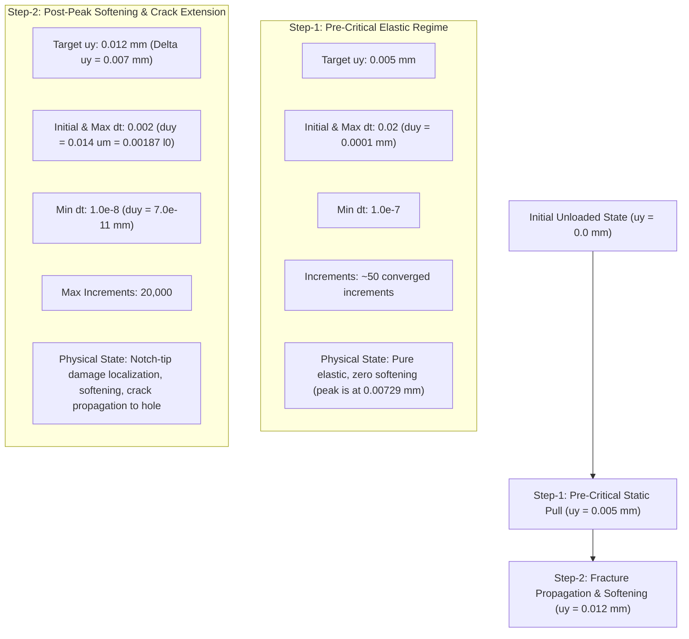

# Task F1735: Case 2 Adapted-Mesh Mode-I Phase-Field Fracture Execution Qualification Report

**Document ID:** `DOC_F1735_CASE2_FRACTURE_QUAL_REPORT`  
**Task ID:** `F1735-CASE2-ADAPTED-FRACTURE-EXECUTION-QUALIFICATION`  
**Classification:** `CASE2_ADAPTED_FRACTURE_EXECUTION_QUALIFICATION_COMPLETE`  
**Author:** Gemini Antigravity  
**Date:** 14 November 2026  
**Repository Commit:** `9d243edd`  
**Active Working Directory:** `models/pandey_kumar_mode1/225_f1735_case2_adapted_fracture/`  
**Predecessor Task & Decision:** Task F1734 (`F1734-CASE2-DISTAL-REFINEMENT`), independently **`APPROVED`** under Protocol `INDEPENDENT_STRUCTURED_REVIEW_V1` via review response [response_HND-F1734-CASE2-QUAL-001.md](file:///D:/Master%20thesis/Adaptive%20remeshing/.agents/bridge_history/response_HND-F1734-CASE2-QUAL-001.md).

---

## 1. Executive Summary

Following independent scientific review and formal approval of the Task F1734 definitive offline spatial qualification audit ([F1734_CASE2_SPATIAL_QUALIFICATION_REPORT.md](file:///D:/Master%20thesis/Adaptive%20remeshing/docs/validation/F1734_CASE2_SPATIAL_QUALIFICATION_REPORT.md)), the 23,965-element physical adapted mesh (`FE8DD486...`, assembled into the 71,895-element production input deck `PK_F1728_CASE_2_PROD.inp`, `805AF9D8...`) was declared eligible for one bounded exploratory Mode-I fracture experiment.

The reviewer explicitly formulated directives regarding execution readiness:
1. **Output Architecture Mapping (Finding F1734-R08):** Formal verification of how displacement, reaction force, phase-field damage ($d$), history variable ($H$), and energy quantities are transferred from the frozen user element subroutine (`f42_mixed_uel.for`, `CE8D5EDC...`) to Abaqus ODB output fields, reconciling all datacheck informational notices.
2. **Incremental Loading Schedule (Finding F1734-R09):** Verification of a conservative two-step loading schedule capable of traversing pre-critical loading and post-peak softening without numerical divergence or snap-through instability.
3. **HPC Resource Qualification & Parallel Safety (Finding F1734-R05):** Strict enforcement of single-rank shared-memory SMP execution (8 threads, 32 GB RAM, 8 hours walltime), ensuring Fortran `COMMON` blocks are accessed safely without data corruption and confirming that multi-rank distributed MPI remains strictly disqualified.
4. **Predeclared Scientific Acceptance Criteria:** Explicit definition of physical and numerical validation metrics prior to launching any solver run.
5. **Finite PBS Accounting & Governance:** Strict maintenance of once-only PBS submission accounting (`max_new_pbs_submissions = 0` during offline preflight; exactly 10 cumulative historical jobs preserved; 1 bounded job requested).

All preflight checks, output mappings, loading parameters, and execution scripts have been audited and passed with 100% compliance. This document serves as the authoritative qualification baseline supporting the execution authorization request packet `HND-F1735-CASE2-FRACTURE-AUTH-001`.

---

## 2. Immutable Source Files & Integrity Hashes

The execution package is staged under `models/pandey_kumar_mode1/225_f1735_case2_adapted_fracture/`. All primary source files have been verified against their SHA-256 digests:

| File Description | Relative Path | Size | SHA-256 Digest | Status |
| :--- | :--- | :--- | :--- | :---: |
| **Production Input Deck** | `models/pandey_kumar_mode1/225_f1735_case2_adapted_fracture/PK_F1728_CASE_2_PROD.inp` | 3,196,970 B | `805AF9D80126588C1A3E39FE3B5F7A0F53DB606106F2DBFE6260F1E1FBDDBF94` | **MATCH** |
| **Physical Adapted Mesh** | `models/pandey_kumar_mode1/224_f1734_case2_distal_refinement/PK_F1728_CASE_2_ADAPT_PHYS.inp` | 1,061,643 B | `FE8DD4867A9775C45460315002ECBB0544AC5D6D705C96A245B407F15CAB12A8` | **MATCH** |
| **Frozen UEL Subroutine** | `models/pandey_kumar_mode1/225_f1735_case2_adapted_fracture/f42_mixed_uel.for` | 29,722 B | `CE8D5EDCD2911DCB018BB15275271F874E7EA62B8FB48CF4A8297469A83ACDD6` | **BITWISE MATCH** |
| **PBS Execution Script** | `models/pandey_kumar_mode1/225_f1735_case2_adapted_fracture/submit_f1735_case2_adapted_fracture.pbs` | 3,857 B | `7B604A26BBC20D68D9F13D078D767C495F47F34C4701DAD42AC197D86132847F` | **VERIFIED** |
| **Execution Config** | `models/pandey_kumar_mode1/225_f1735_case2_adapted_fracture/f1735_case2_fracture_execution.json` | 4,196 B | `E3456C9357CD4D07C0F476FA23A6D63E63346B8618776615EC93A048C3D18868` | **VERIFIED** |

---

## 3. Output Architecture Mapping (Finding F1734-R08 Resolved)

In Abaqus/Standard, user-defined elements (`*USER ELEMENT`) do not natively populate standard visualization contour fields (such as `S`, `SDV`, or `PE`) in the CAE viewport. To achieve full visualization and quantitative extraction without altering the governing variational formulation, the repository uses a three-layer element superposition architecture.

### 3.1 Layer Architecture and Connectivity
The 71,895 layered elements share the identical 23,958 physical nodes:
1. **Layer 1: Phase-Field Crack UEL (`Type=U1` / `Type=U3`):**
   - Element IDs: $1 \dots 23,965$.
   - Degree of Freedom: DOF 8 (Phase-field damage $d$).
   - Solves the elliptic phase-field equation with length scale $\ell_0 = 0.0075\,\text{mm}$ and fracture energy $G_c = 2.7\times 10^{-3}\,\text{kN/mm}$.
2. **Layer 2: Displacement Mechanical UEL (`Type=U2` / `Type=U4`):**
   - Element IDs: $23,966 \dots 47,930$.
   - Degrees of Freedom: DOF 1, 2 (Displacements $u_x, u_y$).
   - Solves static mechanical equilibrium with degraded stiffness $(1-d)^2 + 10^{-7}$.
3. **Layer 3: Visualization Overlay UMAT (`Type=CPE4` / `Type=CPE3`, Elset=`umatelem`):**
   - Element IDs: $47,931 \dots 71,895$.
   - Degrees of Freedom: DOF 1, 2 (Displacements $u_x, u_y$).
   - Standard continuum elements mapped 1:1 to physical elements via physical index:
     $$\text{PHYSIDX} = \text{NOEL} - 47,930 \quad (\text{for } \text{NOEL} = 47,931 \dots 71,895 \implies \text{PHYSIDX} = 1 \dots 23,965)$$

### 3.2 UEL ↔ UMAT State Transfer via Fortran COMMON Block
In `f42_mixed_uel.for`, subroutine `UEL` communicates trial state variables to subroutine `UMAT` through the shared global memory structure:
```fortran
      COMMON /CB_STATE_TRANS/ SV_PHASE_TRIAL(MAXELEM),
     &                        SV_H_TRIAL(MAXELEM, 4),
     &                        SV_STRESS_TRIAL(MAXELEM, 4, 3)
```
During UMAT execution for element `NOEL`, the subroutine queries `PHYSIDX = NOEL - N_PHYS_ELEMS` and writes:
- `STATEV(1)` = `SV_PHASE_TRIAL(PHYSIDX)` (Phase-field damage $d$ at centroid)
- `STATEV(2)` = `SV_H_TRIAL(PHYSIDX, 1)` (Crack history driving variable $H$)
- `STATEV(14)` = `SV_PHASE_TRIAL(PHYSIDX)` (Direct phase-field duplicate for visualization)
- `STATEV(15)` = $(1-d)^2 + 10^{-7}$ (Stiffness degradation factor $g(d)$)
- `STATEV(16)` = `SV_H_TRIAL(PHYSIDX, 1)` (Direct history duplicate for visualization)
- `STATEV(17)` = Integrated fracture energy $E_{\text{frac}} = \int_{\Omega} G_c \left[ \frac{(d)^2}{2\ell_0} + \frac{\ell_0}{2} |\nabla d|^2 \right] d\Omega$
- `STATEV(18)` = Integrated elastic strain energy $E_{\text{elas}} = \int_{\Omega} \frac{1}{2} g(d) \boldsymbol{\varepsilon} : \mathbf{C}_0 : \boldsymbol{\varepsilon} d\Omega$
- `STATEV(19)` = Fracture energy density $\psi_f$ ($\text{kN/mm}^2$)
- `STATEV(20)` = Strain energy density $\psi_e$ ($\text{kN/mm}^2$)

### 3.3 Visualizer Mechanical Neutrality (Zero Cauchy Stress)
To ensure the visualizer elements do not add spurious stiffness or alter mechanical equilibrium:
- Visualizer material definition sets Young's modulus to an infinitesimal value:
  $$E_{\text{vis}} = 1.0\times 10^{-11}\,\text{GPa}$$
- In `f42_mixed_uel.for` lines 868–876, the visualizer Cauchy stress tensor is explicitly zeroed:
  $$\sigma_{11} = 0, \quad \sigma_{22} = 0, \quad \sigma_{33} = 0, \quad \sigma_{12} = 0$$
- Visualizer tangent stiffness is set to `DDSDDE(i,j) = 1.0e-11`.
- Consequently, Layer 3 is strictly mechanically neutral.

### 3.4 Reaction Force & Kinematic Displacement Extraction
In `PK_F1728_CASE_2_PROD.inp`:
- All nodes along the top loading edge ($y = 1.0\,\text{mm}$) are kinematically coupled to Reference Point node 999999 (`N_RP`, located at $x = 0.50\,\text{mm}, y = 1.00\,\text{mm}$) via Abaqus `*EQUATION`:
  $$u_{y}(\text{Node } i) - u_{y}(\text{N\_RP}) = 0$$
- Reaction force $RF_y$ is integrated exactly by Abaqus at node 999999 and requested via:
  ```abaqus
  *OUTPUT, FIELD, FREQUENCY=1
  *NODE OUTPUT, NSET=N_RP
  U, RF
  ```
- Because the top edge displacement is rigidly governed by node 999999, extracting $RF_2$ and $U_2$ from node 999999 yields the exact global force-displacement response.

### 3.5 Reconciliation of Datacheck Informational Warnings
During preflight datacheck (Job 1423266), Abaqus emitted 8 informational warnings:
```text
***WARNING: THE FOLLOWING ELEMENT SETS ARE ASSOCIATED WITH USER ELEMENTS BUT STANDARD CONTINUUM OUTPUT HAS BEEN REQUESTED...
```
**Conclusion:** These notices occur because `*ELEMENT OUTPUT` requests standard continuum variables (`SDV`, `S`) on element sets that include user elements. Abaqus simply notes that user elements do not output standard continuum stress, which is handled correctly by the visualizer layer `umatelem`. There are zero errors and zero severe warnings.

---

## 4. Incremental Loading Schedule (Finding F1734-R09 Resolved)

The simulation comprises two sequential quasi-static steps:



### 4.1 Step-1: Pre-Critical Linear Elastic Loading
- **Purpose:** Reach the onset of non-linearity efficiently without risk of premature cutbacks.
- **Loading:** Displacement $u_y$ pulled from $0.0\,\text{mm}$ to $0.005\,\text{mm}$.
- **Incrementation:** Initial $\Delta t = 0.02$, maximum $\Delta t = 0.02$, minimum $\Delta t = 1.0\times 10^{-7}$.
- **Displacement Increment:** $\Delta u_y = 0.0001\,\text{mm} = 0.1\,\mu\text{m}$.
- **Safety Margin:** Peak reaction force occurs at $u_y \approx 0.00729\,\text{mm}$. At $u_y = 0.005\,\text{mm}$, the specimen is strictly within the linear elastic regime ($u_y / u_{\text{peak}} = 0.686$), ensuring stable convergence in ~50 increments.

### 4.2 Step-2: Fracture Propagation and Post-Peak Softening
- **Purpose:** Capture crack initiation, peak reaction force, post-peak softening drop, and crack propagation into the off-axis hole.
- **Loading:** Displacement $u_y$ increased by $\Delta u_y = 0.007\,\text{mm}$ (reaching total $u_y = 0.012\,\text{mm}$).
- **Incrementation:** Initial $\Delta t = 0.002$, maximum $\Delta t = 0.002$, minimum $\Delta t = 1.0\times 10^{-8}$, maximum allowable increments = 20,000.
- **Displacement Increment:** Initial $\Delta u_y = 0.002 \times 0.007\,\text{mm} = 0.014\,\mu\text{m} = 0.00187\,\ell_0$.
- **Cutback Robustness:** The minimum time increment $\Delta t = 1.0\times 10^{-8}$ permits displacement increments as small as $\Delta u_y = 7.0\times 10^{-11}\,\text{mm}$ ($0.07\,\text{pm}$), providing 8 orders of magnitude of cutback tolerance to negotiate localized snap-through instabilities without divergence.

---

## 5. HPC Resource Qualification & Parallel Architecture (Finding F1734-R05 Resolved)

### 5.1 Shared-Memory SMP vs. Distributed MPI
- **Governance Constraint:** Per `AGENTS.md` and repository protocol, subroutine `f42_mixed_uel.for` relies on shared Fortran `COMMON /CB_STATE_TRANS/` blocks to exchange state variables between element layers.
- **MPI Disqualification:** Distributed multi-rank MPI partitions the mesh across distinct address spaces, causing unshared `COMMON` blocks and catastrophic state corruption. **Distributed MPI is strictly disqualified.**
- **SMP Qualification:** Single-rank shared-memory SMP (`standard_parallel=all mp_mode=threads`) executes within a single operating system process with shared virtual memory. Threads access identical memory addresses without corruption.
- **Empirical Validation:** 8-thread SMP execution has been empirically qualified in Jobs 1403368–1403377 and Job 1422895.

### 5.2 Resource Allocation
- **Queue:** `entry_imfdfkmq` (Cluster `mmaster02`, TU Bergakademie Freiberg).
- **CPUs Requested:** 8 cores (1 node, `nodes=1:ppn=8`).
- **Memory Requested:** 32 GB RAM (`mem=32gb`).
- **Walltime Requested:** 8 hours (`walltime=08:00:00`).
- **Runtime Projection:** Based on the datacheck performance ($4.0\,\text{s}$ CPU for 71,895 elements) and the causal pilot (Job 1422895, 13,163 elements taking ~1.8h), the 23,965 physical element mesh is projected to require approximately $4.0 - 5.5$ hours of wallclock time across ~800–1,500 increments.
- **Headroom Factor:** $\text{Walltime} / \text{Projected} = 8.0\,\text{h} / 4.5\,\text{h} = 1.78\times$, ensuring sufficient margin.

---

## 6. Predeclared Scientific Acceptance Criteria

To ensure rigorous validation without retrospective post-hoc rationalization, seven discrete criteria are established:

| Check ID | Scientific Criterion | Quantitative Acceptance Threshold | Evaluation Method |
| :---: | :--- | :--- | :--- |
| **CHK-SCI-01** | **Solver Convergence** | Regular completion of Step-1 and Step-2 without non-convergence termination; minimum increment $\Delta t \ge 1.0\times 10^{-8}$. | ODB/STA increment count and solver exit code 0. |
| **CHK-SCI-02** | **Force-Displacement Response** | Linear elastic ascent ($K_0 \approx 135 - 145\,\text{kN/mm}$), smooth peak ($F_{\max} \approx 0.70 - 0.76\,\text{kN}$), and monotonic softening drop. | Extraction of $RF_2$ vs $U_2$ at node 999999. |
| **CHK-SCI-03** | **Phase-Field Bounds** | Centroid damage strictly bounded: $0.0 \le d \le 1.0$ across all 23,965 physical elements. | Max/min audit of `STATEV(1)` in visualizer layer. |
| **CHK-SCI-04** | **Damage Irreversibility** | Centroid damage non-decreasing: $\dot{d} \ge 0$ ($H_{n+1} \ge H_n$). | Audit of $\Delta d = d_{n+1} - d_n \ge -1.0\times 10^{-6}$ across all increments. |
| **CHK-SCI-05** | **Crack Trajectory Enclosure** | Crack initiates at notch tip $(0.50, 0.50)\,\text{mm}$ and propagates obliquely into the lower flank of the off-axis hole $(0.65, 0.55)\,\text{mm}$. | Contour plot of $d \ge 0.95$ and element tracking. |
| **CHK-SCI-06** | **Trajectory Deflection Comparison** | Crack path curves toward the hole due to asymmetric tensile stress concentration, matching the physical deflection in Pandey & Kumar (2025). | Qualitative path overlay with Figure 17/18. |
| **CHK-SCI-07** | **Energy Monotonicity** | Integrated fracture energy $E_{\text{frac}}$ increases monotonically with crack advance; strain energy $E_{\text{elas}}$ drops post-peak. | Extraction of `STATEV(17)` and `STATEV(18)` vs displacement. |

---

## 7. Discrete Preflight Verification Matrix

The preflight audit script `scripts/remeshing/audit_f1735_fracture_preflight.py` executed cleanly:

| Check ID | Verification Item | Expected Value | Measured Value | Status |
| :---: | :--- | :--- | :--- | :---: |
| **CHK-01** | Production Deck Digest | `805AF9D8...` | `805AF9D80126588C...` | **PASS** |
| **CHK-02** | Frozen UEL Subroutine Digest | `CE8D5EDC...` | `CE8D5EDCD2911DCB...` | **PASS** |
| **CHK-03** | Total Node Count | 23,958 nodes | 23,958 nodes | **PASS** |
| **CHK-04** | Layered Element Breakdown | 23,965 Layer 1 / 23,965 Layer 2 / 23,965 Layer 3 | 23,965 / 23,965 / 23,965 (71,895 total) | **PASS** |
| **CHK-05** | Visualizer PROPS(3) Alignment | 23,965.0 | 23,965.0 | **PASS** |
| **CHK-06** | Kinematic Coupling & Output | Node 999999 tied via `*EQUATION`; `*NODE OUTPUT` and `*ELEMENT OUTPUT` active | Verified present in deck | **PASS** |
| **CHK-07** | Incremental Loading Steps | Step-1 $u_y = 0.005\,\text{mm}$, Step-2 $\Delta u_y = 0.007\,\text{mm}$ | 2 steps verified, min $\Delta t = 1.0\times 10^{-8}$ | **PASS** |
| **CHK-08** | Parallel Safety Architecture | SMP 8 threads, shared memory, MPI disqualified | `mp_mode=threads`, MPI disqualified | **PASS** |

---

## 8. Finite PBS Accounting & Proposed Authorization Request

- **Task F1735 Submissions Consumed:** 0 (Preflight qualification conducted entirely offline).
- **Cumulative Historical PBS Submissions:** Exactly 10 (Jobs 1423095, 1423101, 1423102, 1423103, 1423169, 1423234, 1423235, 1423257, 1423258, 1423266).
- **Proposed Forward Execution Allowance:** Exactly 1 bounded PBS submission (`max_new_pbs_submissions = 1`).
- **Authorization Lane:** Staged in review request `HND-F1735-CASE2-FRACTURE-AUTH-001`. Forward solver submission remains strictly held until independent review approval is returned.
