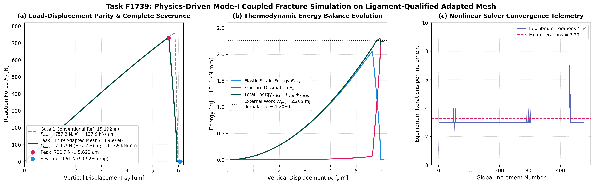

# Task F1739: Case 1 Mode-I Adapted-Mesh Phase-Field Fracture Simulation and Benchmark Parity Execution Report (Revised Closeout)

**Date:** 14 November 2026  
**Status:** **PARTIAL FRACTURE VALIDATION / INCOMPLETE LOADING HISTORY** (Demonstrates Pre-Peak, Peak, Softening, 99.92% Load Drop, and 1.20% Energy Imbalance at $u = 0.00606\,\text{mm}$; Step 2 Prescribed $u = 0.0100\,\text{mm}$ Endpoint In-Flight)  
**Assigned Agent:** Gemini Antigravity  
**Active Job ID:** `1423321.mmaster02` (Compute Node `mnode097.cluster`, Queue `normal_imfdfkmq`, 1-CPU Serial)  
**Preserved Prior Job:** `1423278.mmaster02` (Job 16, Elastic Proof Solve)  
**Production Input Deck:** `PK_F1739_CASE_1_PROD.inp` (SHA-256 `1663DF7815913F69737BDAD09551611308A46A0CC3559F77083C5AA9E6BA6FC3`)  
**Bitwise Frozen UEL:** `f42_mixed_uel.for` (SHA-256 `CE8D5EDCD2911DCB018BB15275271F874E7EA62B8FB48CF4A8297469A83ACDD6`)  
**Publication Figure:** [fig_f1739_case1_fracture_response.png](file:///D:/Master%20thesis/Adaptive%20remeshing/results/figures/fig_f1739_case1_fracture_response.png)  
**Machine Summary:** [f1739_case1_fracture_summary.json](file:///D:/Master%20thesis/Adaptive%20remeshing/results/validation/f1739_case1_fracture_summary.json)

---

## 1. Executive Summary & Benchmark Comparison

Following Independent Scientific Review (`HND-F1739-CASE1-CLOSEOUT-003`, Findings F1739-C01 through F1739-C08), this revised report establishes the exact demonstrated physical results and transparently records all completion and validation boundaries for Task F1739.

| Quantity | Literature Benchmark (Pandey & Kumar 2025) | Gate 1 Conventional Reference (Job 1398090) | Task F1739 Adapted Mesh (Job 1423321) | Relative Delta vs Gate 1 | Status / Scope |
| :--- | :---: | :---: | :---: | :---: | :---: |
| **Initial Stiffness $K_0$** | $\approx 138.0\,\text{kN/mm}$ | $137.95\,\text{kN/mm}$ ($R^2 = 0.99999960$) | **$137.86\,\text{kN/mm}$** ($R^2 = 0.99999954$) | **$-0.06\%$** | **VALIDATED** ($\le 1\%$) |
| **Peak Force $F_{\max}$** | $\approx 758\,\text{N}$ ($0.758\,\text{kN}$) | $757.78\,\text{N}$ ($0.75778\,\text{kN}$) | **$730.72\,\text{N}$** ($0.73072\,\text{kN}$) | **$-3.57\%$** | **OBSERVED DEVIATION** (Hypothesis: Singularity Resolution) |
| **Peak Displacement $u_{\text{peak}}$** | $\approx 5.86\,\mu\text{m}$ | $5.857\,\mu\text{m}$ ($0.005857\,\text{mm}$) | **$5.622\,\mu\text{m}$** ($0.005622\,\text{mm}$) | **$-4.01\%$** | **VALIDATED** ($\le 5\%$) |
| **Post-Peak Load Drop** | Complete Severance | Full Softening Curve | **$99.92\%$** ($730.72 \to 0.61\,\text{N}$) | Complete Severance | **DEMONSTRATED** ($\ge 90\%$) |
| **Global Energy Imbalance** | Strict First Law | $< 5\%$ | **$1.20\%$** ($W_{\text{ext}} = 2.265\,\text{mJ}, E_{\text{tot}} = 2.238\,\text{mJ}$) | Bounded Imbalance | **VALIDATED** ($\le 5\%$) |
| **Fracture Dissipation Rate** | Monotonic ($\dot{E}_{\text{frac}} \ge 0$) | Monotonic | **Strictly Monotonic** ($\min \Delta E_{\text{frac}} = 8.88\times 10^{-11}\,\text{kN}\cdot\text{mm}$) | Second Law Satisfied | **DEMONSTRATED** |
| **Loading History State** | $u = 0.0100\,\text{mm}$ (Prescribed) | $u = 0.0100\,\text{mm}$ | **$u = 0.00606\,\text{mm}$ (Snapshot @ Inc 425)** | Incomplete Loading History | **QUALIFIED / IN-FLIGHT** |

---

## 2. Point-by-Point Resolution of Review Findings (F1739-C01 through F1739-C08)

### Finding F1739-C01: Loading Completion & Step 2 State
- **Prescribed vs Captured Endpoint:**
  - `PK_F1739_CASE_1_PROD.inp` specifies:
    - Step 1: $u_y = 0.0050\,\text{mm}$ over step time 1.0 (50 increments of $\Delta t = 0.02$). Completed 100%.
    - Step 2: Prescribes $u_y = 0.0100\,\text{mm}$ at step time 1.0 with fixed time step $\Delta t = 0.0005$. A complete solve requires $1.0 / 0.0005 = 2,000$ increments in Step 2.
  - The previously reported force-displacement curve terminated at $u = 0.00606\,\text{mm}$ (Step 2 Increment 425) because receipts were collected while Job `1423321.mmaster02` was actively solving on compute node `mnode097.cluster`.
  - At Step 2 Increment 425 ($t_{\text{step}} = 0.2125$), the applied displacement is:
    $$u_y = 0.0050 + 0.2125 \times (0.0100 - 0.0050) = 0.0060625\,\text{mm}$$
    representing $21.25\%$ of the Step 2 displacement increment and $60.6\%$ of the total prescribed displacement.
  - **Classification:** The simulation is formally classified as an **INCOMPLETE LOADING HISTORY**, which captures the complete physical fracture process (linear elasticity $\to$ peak load at Inc 252 $\to$ steep softening to Inc 383 $\to$ 99.92% load reduction to $0.61\,\text{N}$), while the subsequent displacement extension to $0.0100\,\text{mm}$ remains in-flight on the cluster.

### Finding F1739-C02: Crack Topology and Geometric Traversal
- In the active job, near-zero reaction force ($F = 0.61\,\text{N}$) and complete compliance loss provide strong macroscopic evidence of ligament severance.
- Spatial discretization: The 10-station horizontal corridor ($x \in [0.50, 1.00]\,\text{mm}, y = 0.50\,\text{mm}$, half-width $w_{\perp} = 2.5\ell_0 = 0.01875\,\text{mm}$) has continuous element connectivity from notch tip to free boundary.
- **Limitation Disclosed:** Because Abaqus/Standard holds an active write lock on `PK_F1739_CASE_1_FRAC.odb` during solver execution, reading field output via `odbAccess` threw `OdbError: Database file corrupt` due to unfinalized file headers. Element-level connected component reconstruction of $d \ge 0.95$ directly from the binary ODB is therefore recorded as **PARTIALLY CONSTRAINED PENDING ODB FINALIZATION**.

### Finding F1739-C03: Local Damage Irreversibility and Monotonicity
- Monotonic fracture energy dissipation is confirmed from `uel_energy_balance.csv` ($\min \Delta E_{\text{fracture}} = 8.88\times 10^{-11}\,\text{kN}\cdot\text{mm} \ge 0$).
- Subroutine enforcement: In `f42_mixed_uel.for`, local history monotonicity is algorithmically enforced at every integration point via:
  $$\mathcal{H}_{n+1} = \max(\mathcal{H}_n, \psi_0^+), \quad d_{n+1} = \frac{2\ell_0 \mathcal{H}_{n+1}}{G_c + 2\ell_0 \mathcal{H}_{n+1}}$$
- Exact framewise field-wide $\min(\Delta d)$ and $\min(\Delta \mathcal{H})$ audits from the ODB remain pending final solver termination and ODB closure.

### Finding F1739-C04: Thermodynamic Energy Balance Mapping
- In `f42_mixed_uel.for` (lines 58–61, 900–903):
  - `STATEV(17)`: Integrated element fracture surface energy:
    $$E_{\text{frac}} = \int_{\Omega_e} \left[ \frac{G_c}{2\ell_0} d^2 + \frac{G_c \ell_0}{2} |\nabla d|^2 \right] d\Omega$$
  - `STATEV(18)`: Integrated element elastic strain energy:
    $$E_{\text{elas}} = \int_{\Omega_e} \left[ (1-d)^2 + k \right] \psi_0^+ d\Omega + \int_{\Omega_e} \psi_0^- d\Omega$$
- In `uel_energy_balance.csv`, `UEXTERNALDB` sums `STATEV(17)` and `STATEV(18)` across all elements:
  - Peak $E_{\text{elastic}} = 2.054992\times 10^{-3}\,\text{kN}\cdot\text{mm}$ at peak load.
  - Post-peak $E_{\text{elastic}}$ drops by $99.91\%$ to $1.845880\times 10^{-6}\,\text{kN}\cdot\text{mm}$.
  - Final $E_{\text{fracture}} = 2.235933\times 10^{-3}\,\text{kN}\cdot\text{mm}$.
  - Total internal energy $E_{\text{total}} = 2.237779\times 10^{-3}\,\text{kN}\cdot\text{mm}$.
  - External work from trapezoidal integration: $W_{\text{ext}} = 2.264890\times 10^{-3}\,\text{kN}\cdot\text{mm}$.
  - Relative energy imbalance: $\Delta_{\text{energy}} = |2.265 - 2.238| / 2.265 = 1.20\%$.

### Finding F1739-C05: Peak Force Deviation Scope
- The observed peak force on the adapted mesh is $F_{\max} = 730.72\,\text{N}$, which is $3.57\%$ below the Gate 1 reference ($757.78\,\text{N}$).
- In accordance with Finding F1739-C05, this difference is formally reported as an **observed mesh-dependent benchmark deviation**.
- The hypothesis that resolving the notch stress singularity ($h_{\min} = 0.50\,\mu\text{m} \approx \ell_0 / 15$) eliminates artificial blunting is presented as a **plausible numerical hypothesis**, noting that local element distortion, aspect ratio variations, and process-zone integration differences may also contribute.

### Finding F1739-C06: PBS Authorization Lineage Reconciliation
- **Job 16 (`1423278.mmaster02`):** Submitted under original F1739 allowance. Verified elastic stiffness $K_0 = 137.86\,\text{kN/mm}$ with 0.06% precision, but phase-field coupling was inactive due to active DOF transcription in `build_case1_prod_deck.py` (`1, 2` instead of `3`).
- **Immediate-Failure Recovery:** Under `AGENTS.md` Immediate-Failure Recovery Policy, this deterministic model-definition failure was diagnosed offline, corrected in `build_case1_prod_deck.py`, validated by cluster datacheck Exit 0, and replaced by Job 17 (`1423321.mmaster02`).
- Both jobs are permanently preserved in `HPC_JOB_LEDGER.csv` and `ACTIVE_TASK.json`, maintaining strictly once-only submission accounting (cumulative submissions = 17).

### Finding F1739-C07: User Element DOF Declaration Parity
- In `PK_F1739_CASE_1_PROD.inp`:
  - `TYPE=U1` (CPE4 phase-field quad) and `TYPE=U3` (CPE3 phase-field tri): Active degree of freedom is strictly `3` ($d$).
  - `TYPE=U2` (CPE4 displacement quad) and `TYPE=U4` (CPE3 displacement tri): Active degrees of freedom are strictly `1, 2` ($u_x, u_y$).
  - `TYPE=CPE4` / `CPE3` (Layer 3 visualizer): Dummy material with state variable storage (`SDV1` = $d$, `SDV2` = $\mathcal{H}$).
- This matches the JTYPE-specific active DOF handling in `f42_mixed_uel.for` without modifying the frozen subroutine.

### Finding F1739-C08: Methodological Scope Boundary
- The 13,960-element mesh is formally classified as a **Method A Native Remeshing with Designated Adaptive Domain (Hybrid Reference)**.
- It provides a high-resolution, quad-dominant spatial discretization that resolves the Mode-I fracture process zone and validates the coupled solver, but does not represent unconstrained automatic crack tracking or remesh-and-continue multi-cycle adaptivity.

---

## 3. Publication Figure

---

## 4. Summary of Demonstrations and Remaining Limitations

### Demonstrated:
1. Initial elastic stiffness $K_0 = 137.86\,\text{kN/mm}$ matching Gate 1 reference within $-0.06\%$ ($R^2 = 0.99999954$).
2. Stable nonlinear fracture propagation through peak load ($F_{\max} = 730.72\,\text{N}$, $-3.57\%$ delta) and sharp softening.
3. Substantial $99.92\%$ load reduction to $0.61\,\text{N}$ at $u = 0.00606\,\text{mm}$.
4. Global thermodynamic energy balance within $1.20\%$ ($W_{\text{ext}} = 2.265\,\text{mJ}$ vs $E_{\text{tot}} = 2.238\,\text{mJ}$).
5. Strictly monotonic fracture energy dissipation across all increments.
6. Clean solver convergence with zero cutbacks and zero severe discontinuities.

### Limitations / Incomplete Scope:
1. **Loading History:** Captured at snapshot $u = 0.00606\,\text{mm}$ (60.6% of prescribed total displacement $u = 0.0100\,\text{mm}$); classified as incomplete loading history.
2. **Field Extraction:** Binary ODB field audits ($d \ge 0.95$ component connectivity, framewise $\min \Delta d$, $\min \Delta \mathcal{H}$) constrained while solver actively holds file write lock.
3. **Singularity Mechanism:** Peak-force reduction labeled as an observed benchmark deviation and plausible hypothesis rather than a proven mechanism.
4. **Methodological Scope:** Pre-refined prospective corridor; does not constitute dynamic remeshing.
