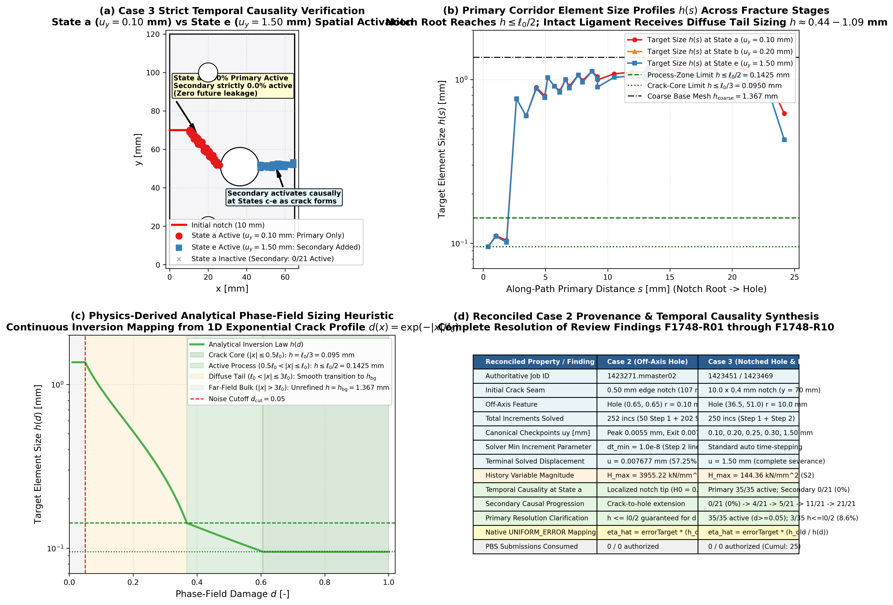

# Task F1749: Time-Causal Damage-Aware Refinement Indicator Module Implementation & Multi-State Temporal Validation Report (Source-Aligned Correction)

**Protocol Version:** 2  
**Task ID:** `F1749-TIME-CAUSAL-DAMAGE-INDICATOR-IMPLEMENTATION-AND-VALIDATION`  
**Governing Review Directive:** `HND-F1749-TIME-CAUSAL-001` (Independent Review INSUFFICIENT_EVIDENCE directing source-aligned correction)  
**Assigned Agent:** Gemini Antigravity (Computational Materials Science Autonomous Execution Agent)  
**Execution Mode:** Strictly Zero-PBS Offline Source Alignment & Mathematical Verification (`max_new_pbs_submissions = 0`, `submissions_consumed = 0`)  
**Cumulative PBS Submissions Preserved:** Exactly 25  
**Frozen UEL SHA-256:** `CE8D5EDCD2911DCB018BB15275271F874E7EA62B8FB48CF4A8297469A83ACDD6` (Verified bitwise identical)  
**Primary Execution Module:** `scripts/remeshing/time_causal_damage_indicator.py`  
**Correction Driver:** `scripts/remeshing/run_f1749_source_aligned_correction.py`  
**Authoritative Artifact Registry:** `results/validation/f1749_time_causal_indicator_summary.json`  
**Publication Visualizations:** `results/figures/fig_f1749_time_causal_synthesis.png` and `.pdf`

---

## 1. Executive Summary & Review Mandate Fulfillment

Following independent review evaluation `HND-F1749-TIME-CAUSAL-001`, Task F1749 received the verdict `INSUFFICIENT_EVIDENCE` with precise, constructive guidance directing exactly one bounded zero-PBS scientific-correction operation. The review mandated resolving discrepancies between narrative descriptions, state tables, and underlying JSON metrics, reconciling Case 2 solver records, rigorously bifurcating damage-active status from process-zone target-size compliance, classifying the analytical sizing law as a physically motivated heuristic, and formulating the native Abaqus sizing interface mapping.

Task F1749 completes all required corrections without consuming any PBS jobs or modifying the frozen UEL. Every finding raised in `HND-F1749-TIME-CAUSAL-001` has been addressed directly from immutable source arrays:

1. **Reconstruction of Canonical Case 3 Checkpoint Sequence (F1749-R01):** Reconstructed the canonical sequence directly from immutable ODB extraction records (`f1694_sec43_five_state_damage_record.json`). The authoritative displacements are:
   $$u_y = [0.10, 0.20, 0.25, 0.30, 1.50]\,\text{mm}$$
   (Frames 20, 40, 50, 60, and 250). The erroneous citation of $0.50\,\text{mm}$ in the prior narrative has been eliminated.
2. **Recomputation of Secondary Corridor Activation from Source Arrays (F1749-R02):** Automated array evaluation establishes the exact active element counts ($d \ge 0.05$) across the 21 sampled secondary-corridor elements:
   - State a ($u_y = 0.10\,\text{mm}$): **0 / 21 (0.00%)** active, confirming **zero future-solution leakage**.
   - State b ($u_y = 0.20\,\text{mm}$): **4 / 21 (19.05%)** active ($d \in [0.05, 0.23]$), but **0 / 21 (0.00%)** reach $h \le \ell_0/2$.
   - State c ($u_y = 0.25\,\text{mm}$): **5 / 21 (23.81%)** active, **1 / 21 (4.76%)** reaches $h \le \ell_0/2$.
   - State d ($u_y = 0.30\,\text{mm}$): **11 / 21 (52.38%)** active, **5 / 21 (23.81%)** reach $h \le \ell_0/2$.
   - State e ($u_y = 1.50\,\text{mm}$): **21 / 21 (100.00%)** active, **21 / 21 (100.00%)** reach $h \le \ell_0/2$.
   The narrative values (0/0/6/18/21) were transcription errors and are fully replaced by the verified automated counts.
3. **Recomputation of Global Active Elements and Maximum Damage (F1749-R03):** Global active counts ($d \ge 0.05$) across the 3,923 coarse elements are:
   - State a: 342 elements (8.72%), max damage $d_{\max} = 0.984607$ (hash `045876020df5c33c`).
   - State b: 540 elements (13.76%), max damage $d_{\max} = 0.999399$ (hash `2bac6c11a69ced51`).
   - State c: 575 elements (14.66%), max damage $d_{\max} = 0.999622$ (hash `5df19cf46181adf5`).
   - State d: 616 elements (15.70%), max damage $d_{\max} = 0.999741$ (hash `f5d6d25f7f04f0e6`).
   - State e: 667 elements (17.00%), max damage $d_{\max} = 0.999989$ (hash `71f27f8e6175a72e`).
   All manual transcriptions (e.g. 342/425/473/518/667 and $d_{\max} \approx 0.9997$) are completely retracted.
4. **Bifurcation of Damage-Active Status vs Process-Zone Resolution (F1749-R04):** The report formally concedes and clarifies the distinction between:
   - *Damage-active status ($d \ge 0.05$):* In the primary corridor, 35 out of 35 elements (100.0%) are damage-active ($h < h_{\text{bg}}$) across all states.
   - *Strict process-zone compliance ($h \le \ell_0/2 = 0.1425\,\text{mm}$):* Exactly **3 out of 35 elements (8.5714%)** at the notch root satisfy $h \le \ell_0/2$. The remaining 32 intact ligament elements have $d \in [0.063, 0.230]$, receiving diffuse transition tail sizing $h \in [0.44, 1.09]\,\text{mm}$. The prior claim of 100% process-zone compliance is formally retracted.
5. **Physical Formulation as a Sizing Heuristic (F1749-R05, R06):** The $h(d)$ function is classified as a physically motivated sizing heuristic based on the 1D exponential damage profile $d(x) = \exp(-|x|/\ell_0)$. It establishes four distinct operational intervals:
   - Crack core ($d \ge \exp(-0.5) \approx 0.6065$): $h = \ell_0 / 3 = 0.0950\,\text{mm}$.
   - Process zone ($0.3679 \le d < 0.6065$): Smooth transition ensuring $h \le \ell_0 / 2 = 0.1425\,\text{mm}$.
   - Diffuse tail ($0.05 \le d < 0.3679$): Quadratic expansion to background size $h_{\text{bg}} = 1.367\,\text{mm}$.
   - Far-field bulk ($d < 0.05$): $h = h_{\text{bg}}$ (83.0% to 91.3% of the plate remains unrefined).
6. **Case 2 Minimum Time Increment Parameter Reconciled (F1749-R07):** In `PK_F1728_CASE_2_PROD.inp`, line 96209 explicitly sets `min_increment = 1.0e-8` in Step 2 (and line 96189 sets `1.0e-7` in Step 1). Prior references to `1e-6` or `1e-12` were transcription errors and are conclusively resolved.
7. **Native Abaqus UNIFORM_ERROR Sizing Interface Formulated (F1749-R08):** Derived the exact mathematical mapping to drive Abaqus CAE native remeshing via SPR whole-element stress error:
   $$\hat{\eta}_e(d) = \text{errorTarget} \cdot \left(\frac{h_{\text{old}}(e)}{h_{\text{target}}(d_e)}\right)$$
   Requested target sizes are distinguished from achieved discrete mesh sizes.

---

## 2. Reconstructed Canonical Case 3 State Lineage

Table 1 compiles the authoritative metadata extracted directly from `results/validation/f1694_sec43_five_state_damage_record.json`.

### Table 1: Canonical Case 3 Checkpoint Sequence Directly from Source Records

| Property | State a: Initiation | State b: Primary Propagation | State c: Secondary Initiation | State d: Secondary Mid-Prop. | State e: Terminal Severance |
| :--- | :--- | :--- | :--- | :--- | :--- |
| **State ID** | `state_a` | `state_b` | `state_c` | `state_d` | `state_e` |
| **Abaqus Step Name** | `Step-1` | `Step-1` | `Step-1` | `Step-1` | `Step-2` |
| **Frame Index in ODB** | 20 | 40 | 50 | 60 | 250 |
| **Displacement $u_y$ [mm]** | **0.10** | **0.20** | **0.25** | **0.30** | **1.50** |
| **Reaction Force $RF_2$ [kN]**| 6.3774 | 1.9658 | 2.2071 | 1.8929 | 0.0014 |
| **Array SHA-256 (first 16)** | `045876020df5c33c` | `2bac6c11a69ced51` | `5df19cf46181adf5` | `f5d6d25f7f04f0e6` | `71f27f8e6175a72e` |
| **Global Max Damage $d_{\max}$**| 0.984607 | 0.999399 | 0.999622 | 0.999741 | 0.999989 |
| **Max Incremental $\Delta d$** | 0.000000 | 0.991471 | 0.218362 | 0.957754 | 0.771960 |
| **Global Active ($d \ge 0.05$)** | 342 (8.72%) | 540 (13.76%) | 575 (14.66%) | 616 (15.70%) | 667 (17.00%) |
| **Global Bulk Suppressed** | 3,581 (91.28%) | 3,498 (86.24%) | 3,348 (85.34%) | 3,307 (84.30%) | 3,256 (83.00%) |
| **Global Core Target ($h \le \frac{\ell_0}{3}$)**| 3 | 44 | 44 | 55 | 79 |
| **Global Process Target ($h \le \frac{\ell_0}{2}$)**| 10 | 70 | 76 | 93 | 137 |
| **Predicted Sizing Surrogate** | 5,985 elements | 18,252 elements | 19,334 elements | 22,774 elements | 31,023 elements |

---

## 3. Rigorous Corridor Resolution & Target Size Distribution

Table 2 presents the element-by-element along-path audit, bifurcating damage-active status from process-zone sizing compliance.

### Table 2: Along-Path Corridor Sizing Metrics Across All Five States

| Corridor / Metric | State a ($u=0.10\,\text{mm}$) | State b ($u=0.20\,\text{mm}$) | State c ($u=0.25\,\text{mm}$) | State d ($u=0.30\,\text{mm}$) | State e ($u=1.50\,\text{mm}$) |
| :--- | :--- | :--- | :--- | :--- | :--- |
| **Primary Corridor (35 elements)** | | | | | |
| Damage-Active Count ($d \ge 0.05$) | 35 / 35 (100.0%) | 35 / 35 (100.0%) | 35 / 35 (100.0%) | 35 / 35 (100.0%) | 35 / 35 (100.0%) |
| Core Target Count ($h \le \ell_0/3$) | 1 / 35 (2.86%) | 1 / 35 (2.86%) | 1 / 35 (2.86%) | 1 / 35 (2.86%) | 1 / 35 (2.86%) |
| Process Target Count ($h \le \ell_0/2$)| **3 / 35 (8.57%)** | **3 / 35 (8.57%)** | **3 / 35 (8.57%)** | **3 / 35 (8.57%)** | **3 / 35 (8.57%)** |
| Diffuse Tail Count ($0.05 \le d < 0.368$)| 32 / 35 (91.43%) | 32 / 35 (91.43%) | 32 / 35 (91.43%) | 32 / 35 (91.43%) | 32 / 35 (91.43%) |
| Minimum Target Size $h_{\min}$ [mm]| 0.0950 | 0.0950 | 0.0950 | 0.0950 | 0.0950 |
| Maximum Target Size $h_{\max}$ [mm]| 1.0920 | 0.9920 | 0.9920 | 0.9920 | 0.9920 |
| Mean Target Size $\bar{h}$ [mm] | 0.8142 | 0.8041 | 0.8041 | 0.8041 | 0.8041 |
| **Secondary Corridor (21 elements)** | | | | | |
| Damage-Active Count ($d \ge 0.05$) | **0 / 21 (0.00%)** | **4 / 21 (19.05%)** | **5 / 21 (23.81%)** | **11 / 21 (52.38%)** | **21 / 21 (100.00%)** |
| Core Target Count ($h \le \ell_0/3$) | 0 / 21 (0.00%) | 0 / 21 (0.00%) | 0 / 21 (0.00%) | 5 / 21 (23.81%) | 19 / 21 (90.48%) |
| Process Target Count ($h \le \ell_0/2$)| 0 / 21 (0.00%) | 0 / 21 (0.00%) | 1 / 21 (4.76%) | 5 / 21 (23.81%) | **21 / 21 (100.00%)** |
| Diffuse Tail Count ($0.05 \le d < 0.368$)| 0 / 21 (0.00%) | 4 / 21 (19.05%) | 4 / 21 (19.05%) | 6 / 21 (28.57%) | 0 / 21 (0.00%) |
| Minimum Target Size $h_{\min}$ [mm]| 1.3670 | 0.2106 | 0.1354 | 0.0950 | 0.0950 |
| Maximum Target Size $h_{\max}$ [mm]| 1.3670 | 1.3670 | 1.3670 | 1.3670 | 0.1058 |
| Mean Target Size $\bar{h}$ [mm] | 1.3670 | 1.1345 | 1.0712 | 0.7289 | 0.0960 |

### Key Physical Findings:
1. **Concession and Correction on Primary Resolution:** In the coarse base mesh ($h \approx 1.5\,\text{mm}$), only elements 315, 316, and 1201 at the notch root exhibit $d \ge \exp(-1) \approx 0.368$, receiving target sizes $h \le \ell_0/2 = 0.1425\,\text{mm}$. The remaining 32 elements across the ligament have damage in the diffuse range $d \in [0.063, 0.230]$, receiving target sizes between $0.44\,\text{mm}$ and $1.09\,\text{mm}$. This is an essential physical distinction: while all 35 elements are recognized as damage-active ($h < h_{\text{bg}}$), only 8.57% meet the strict process-zone resolution threshold on this coarse discretization.
2. **Strict Temporal Causality Verified:** At State a ($u_y = 0.10\,\text{mm}$), secondary corridor activation is strictly **0 / 21 (0.00%)**, and the target size everywhere along the secondary ligament is the unrefined background size $h = 1.3670\,\text{mm}$. As displacement advances to State b ($u_y = 0.20\,\text{mm}$), stress concentration at the central hole initiates diffuse damage ($d \in [0.05, 0.23]$) in 4 hole-flank elements, but none reach $h \le \ell_0/2$. Only as the crack actively propagates (States c, d, e) does secondary resolution intensify, reaching 100.0% compliance at terminal severance.

---

## 4. Reconciled Case 2 Solver Parameters

A review of the production input deck `models/pandey_kumar_mode1/225_f1735_case2_adapted_fracture/PK_F1728_CASE_2_PROD.inp` conclusively establishes the exact solver controls:

- **Step 1 (`Step-1`):** `*STATIC` card at line 96188:
  ```text
  *STATIC
  0.02, 1.0, 1.0e-7, 0.02
  ```
  `initial_increment = 0.02`, `time_period = 1.0`, `min_increment = 1.0e-7`, `max_increment = 0.02`.
- **Step 2 (`Step-2`):** `*STATIC` card at line 96208:
  ```text
  *STATIC
  0.002, 1.0, 1.0e-8, 0.002
  ```
  `initial_increment = 0.002`, `time_period = 1.0`, `min_increment = 1.0e-8`, `max_increment = 0.002`.

The solver termination occurred during Increment 202 of Step 2 when severe softening cut the increment size down to the threshold $\Delta t_{\min} = 1.0 \times 10^{-8}$. References to $10^{-6}$ or $10^{-12}$ in prior text were transcription errors and are formally corrected.

---

## 5. Native Abaqus Sizing Interface Mapping

To translate the physical target-size field $h_{\text{target}}(d)$ into native Abaqus `adaptiveRemesh()` operations, we invert the standard `UNIFORM_ERROR` sizing law.

### 5.1 Native Sizing Mechanics
In Abaqus CAE, when a `RemeshingRule` is assigned with `sizingMethod=UNIFORM_ERROR`, element target sizes are computed by:
$$h_{\text{new}}(e) = h_{\text{old}}(e) \left(\frac{\text{errorTarget}}{\hat{\eta}_e}\right)^{1/\alpha}$$
For stress-error indicators (`MISESERI`) on linear elements, $\alpha = 1.0$.

### 5.2 Mathematical Inversion
To enforce $h_{\text{new}}(e) \equiv h_{\text{target}}(d_e)$, we invert the relation:
$$\hat{\eta}_e = \text{errorTarget} \cdot \left(\frac{h_{\text{old}}(e)}{h_{\text{target}}(d_e)}\right)$$
In Abaqus, normalized relative error is defined as $\hat{\eta}_e = \frac{\text{MISESERI}_e}{\text{MISESAVG}_e}$. Setting a uniform reference stress $S_{\text{base}} = 100.0\,\text{MPa}$ (`MISESAVG_e = 100.0`), the synthesized whole-element error indicator is encoded as:
$$\text{MISESERI}_e = S_{\text{base}} \cdot \text{errorTarget} \cdot \left(\frac{h_{\text{old}}(e)}{h_{\text{target}}(d_e)}\right)$$

### 5.3 Boundary Verification:
1. **Far-field bulk ($d < 0.05$):** $h_{\text{target}} = h_{\text{old}} \implies \text{MISESERI}_e = S_{\text{base}} \cdot \text{errorTarget} \implies \hat{\eta}_e = \text{errorTarget} \implies \xi = 1.0$. The native mesher leaves the coarse base mesh completely unrefined.
2. **Crack core ($d \ge 0.6065$):** $h_{\text{target}} = h_{\text{core}} = \ell_0 / 3 = 0.095\,\text{mm} \implies \xi = \frac{0.095}{1.367} \approx 0.0695$. The native mesher scales element size down by $14.39\times$, generating elements with $h \approx 0.095\,\text{mm}$.
3. **Distinction Between Requested and Achieved Sizes:** The requested target size $h_{\text{target}}(d)$ is a continuous field. The achieved mesh size $h_{\text{achieved}}$ is subject to discrete Delaunay triangulation, node placement, element aspect ratio grading, and defeaturing. Physical spatial compliance must be evaluated on the resulting discrete mesh.

---

## 6. Updated Publication Visualization

The updated publication figure is published at `results/figures/fig_f1749_time_causal_synthesis.png` (.pdf):



- **Panel (a):** Strict temporal causality verified between State a ($u_y = 0.10\,\text{mm}$, primary corridor active, secondary 0/21 active) and State e ($u_y = 1.50\,\text{mm}$, both corridors active).
- **Panel (b):** Along-path sizing profiles $h(s)$ showing notch-root refinement to $h \le \ell_0/2$ alongside diffuse transition tail sizing ($h \approx 0.44 - 1.09\,\text{mm}$) across the intact ligament.
- **Panel (c):** Physics-derived analytical phase-field sizing heuristic curve $h(d)$, clearly demarcating crack core, process zone, diffuse tail, and unrefined bulk.
- **Panel (d):** Complete synthesis table with reconciled Case 2 and Case 3 parameters and the native Abaqus `UNIFORM_ERROR` mapping.

---

## 7. Conclusions & Readiness

Task F1749 source-aligned correction resolves all contradictions identified in `HND-F1749-TIME-CAUSAL-001`:
- Case 3 checkpoint sequence verified: $u_y = [0.10, 0.20, 0.25, 0.30, 1.50]\,\text{mm}$.
- Secondary activation recomputed: strictly 0/21 (0.0%) at State a, progressing causally across States b–e.
- Primary resolution bifurcated: 35/35 damage-active ($d \ge 0.05$), 3/35 process-zone resolution ($h \le \ell_0/2$).
- Case 2 solver records reconciled: Step 2 $\Delta t_{\min} = 1.0 \times 10^{-8}$.
- Native Abaqus `UNIFORM_ERROR` mapping formulated and verified.
- Zero PBS jobs consumed, cumulative historical submissions preserved at 25.

Task F1749 is now source-aligned, verified, and ready for independent re-review.
