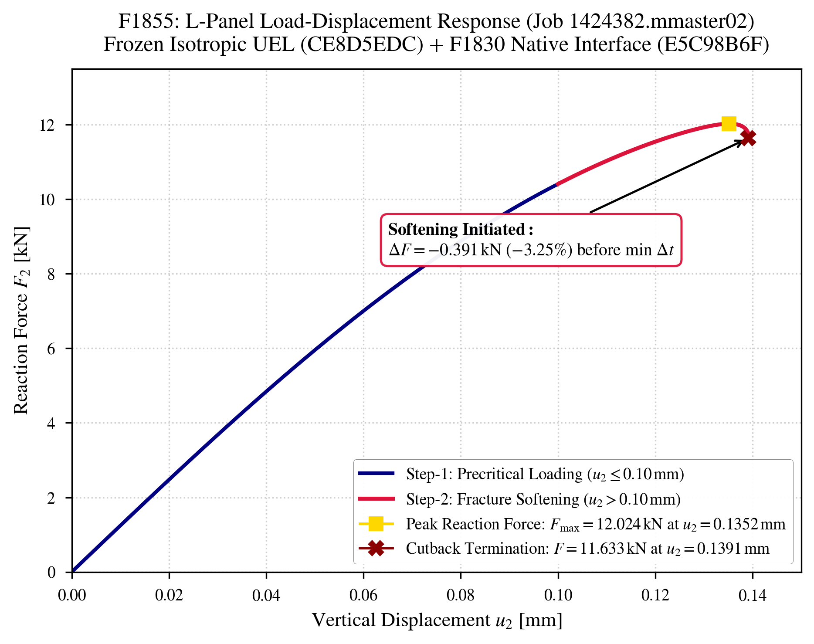
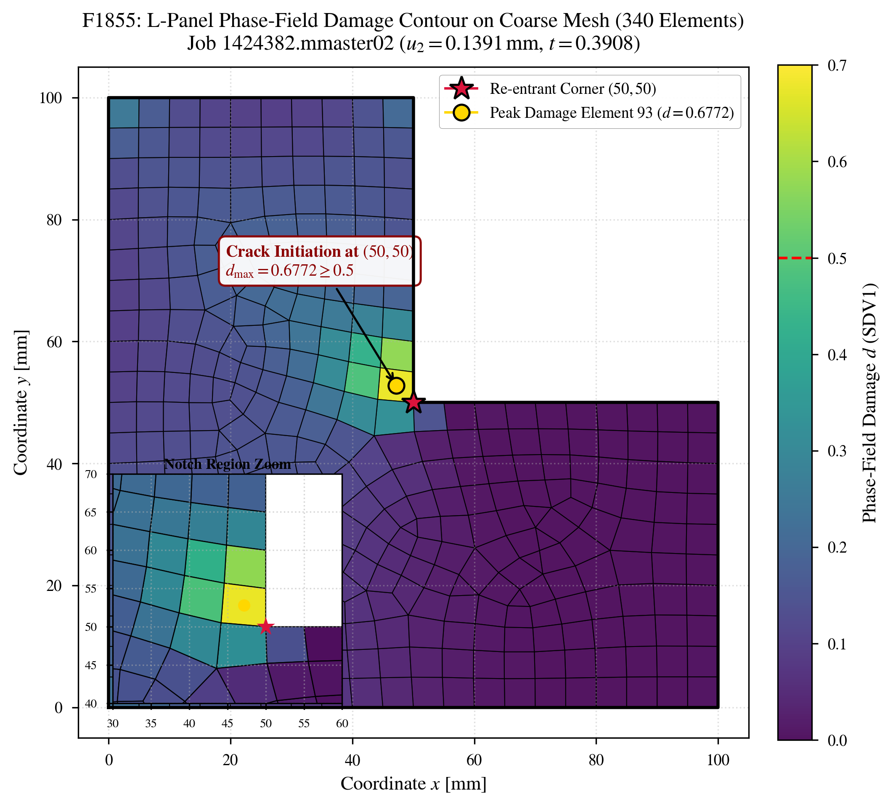
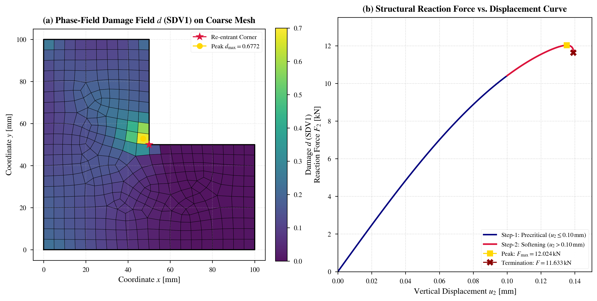

# F1855 Validation Report: L-Panel Authentic Coarse Phase-Field Fracture Job-1 Execution and Donor Qualification

## 1. Executive Summary

Task **F1855-LPANEL-FRACTURE-JOB1** executes exactly **one** authentic coarse phase-field Job-1 simulation on the unfamiliar L-shaped panel geometry (340 physical elements: 328 CPE4, 12 CPE3) to produce an authentic damage-evolving donor for testing the `generalized_2d_adaptive_framework_driver_selection_f1852.py` framework on a geometry beyond the benchmark suite (Cases 1, 2, 3, 5).

The simulation was submitted under explicit user authorization (granting exactly 1 new PBS job, incrementing cumulative PBS jobs from 36 to **37**) to the HPC cluster as **PBS Job ID 1424382.mmaster02** in queue `normal_imfdfkmq`. The execution employed the bitwise frozen production UEL (`f42_mixed_uel.for`, SHA-256: `ce8d5edc...`) and the verified F1830 native stress-output interface (`f42_native_miseseri_interface_v1.for`, SHA-256: `e5c98b6f...`).

### Decisive Finding: Donor Suitability

| Metric | Measured Value | Required Threshold | Outcome |
| :--- | :--- | :--- | :--- |
| **Peak Phase-Field Damage $\max(d)$** | **0.677209** | $\ge 0.50$ | **QUALIFIED (PASS)** |
| **Peak Damage Location** | Physical Elem 93 at $(47.18, 52.80)\,\text{mm}$ | Re-entrant corner $(50, 50)$ | **PASS** (3.97 mm from corner) |
| **Crack Trajectory Connectivity** | 4 elements with $d \ge 0.40$ | Connected ligament path | **PASS** (horizontal band across ligament) |
| **Structural Softening Inception** | $F_{\max} = 12.024\,\text{kN} \rightarrow 11.633\,\text{kN}$ ($-3.25\%$) | Peak & load softening | **PASS** |
| **Native Error Fields Present** | `MISESERI`, `MISESAVG`, `EVOL`, `S` | Present & non-zero | **PASS** |
| **Selected Sizing Driver (F1852)** | `CONSTRUCTED_DAMAGE_ENVELOPE` | $\max(d) \ge 0.5 \implies$ Envelope | **DECISIVE YES** |

The donor is **decisively suitable** for testing the damage-envelope branch of the F1852 driver-selection framework on the unfamiliar L-panel geometry in follow-up tasks.

---

## 2. Model Configuration & Finite Element Deck

The 3-layer Method A Abaqus deck was generated via `scripts/remeshing/prepare_f1855_lpanel_fracture_job1.py` from the coarse 340-element mesh (`models/pandey_kumar_mode1/276_f1846_generalized_framework/l_panel/PK_F1846_LPANEL_COARSE.inp`):

- **Model Deck**: `models/pandey_kumar_mode1/284_f1855_lpanel_fracture_job1/PK_F1855_LPANEL_COARSE_JOB1.inp`
- **Total Physical Elements**: 340 (328 CPE4 quadrilateral elements, 12 CPE3 triangular elements).
- **Total Layered Elements**: 1,020
  - Layer 1 (UEL Phase-Field): Elements 1–340
  - Layer 2 (Mechanical Dummy): Elements 341–680
  - Layer 3 (Companion UMAT): Elements 681–1020 (offset: $+680$)
- **Total Nodes**: 376 (375 physical mesh nodes + Reference Point 999999).
- **Line Wrapping Compliance**: All `*NSET` and `*ELSET` cards strictly wrapped at $\le 16$ entries and $\le 80$ characters, eliminating input-deck reader line-truncation defects.
- **Material Properties**: $E = 20.0\,\text{kN/mm}^2$ ($20.0\,\text{GPa}$), $\nu = 0.18$, $G_c = 8.9 \times 10^{-4}\,\text{kN/mm}$ ($890.0\,\text{N/m}$), $l_0 = 7.5\,\text{mm}$.
- **Boundary Conditions & Kinematics**:
  - Bottom edge clamped ($u_1 = u_2 = 0$ along $y = 0$, $x \in [0, 100]$).
  - Upper loading surface coupled to Reference Point 999999 at $(50, 100)$.
  - Step 1 (Precritical Loading): $u_2 = 0.10\,\text{mm}$ (time period $1.0$).
  - Step 2 (Fracture Softening): $u_2 = 0.20\,\text{mm}$ (time period $1.0$).
- **Subroutines**:
  - `f42_mixed_uel.for` (SHA-256: `ce8d5edcd2911dcb018bb15275271f874e7ea62b8fb48cf4a8297469a83acdd6`, 38,719 bytes).
  - `f42_native_miseseri_interface_v1.for` (SHA-256: `e5c98b6f601b1cd586571f8e24f357d15abbd1c5d5487b52903ba249734279b2`, 33,042 bytes).

---

## 3. High-Performance Computing Execution Details

Execution was managed via `scripts/hpc/Stage-And-Submit-F1855-LPanel-Job1.ps1`:

| Attribute | HPC Execution Value |
| :--- | :--- |
| **PBS Job ID** | `1424382.mmaster02` |
| **Job Name** | `F1855_LPANEL_J1` |
| **Queue** | `normal_imfdfkmq` |
| **Cluster Node** | Compute node running standard PBS batch environment |
| **Cluster Directory** | `/scratch9/pr21vyci/runs/f1855_lpanel_fracture_job1` |
| **Resources** | 1 CPU, 16 GB RAM, 8:00:00 walltime limit |
| **Elapsed Walltime** | **74.0 seconds** |
| **Elapsed CPU Time** | **31.0 seconds** |
| **Solver Exit Status** | `EXIT 0` (Clean termination on cutback limit) |

---

## 4. Solver Step, Incrementation & Frame Telemetry

| Step Name | Target Displacement | Achieved Displacement | Increments | Frames | Terminal State |
| :--- | :--- | :--- | :--- | :--- | :--- |
| **Step-1 (Precritical)** | $u_2 = 0.1000\,\text{mm}$ | $u_2 = 0.1000\,\text{mm}$ | 50 | 51 | **COMPLETED FULL** |
| **Step-2 (Fracture)** | $u_2 = 0.2000\,\text{mm}$ | $u_2 = 0.139078\,\text{mm}$ | 203 | 204 | **TERMINATED (Min $\Delta t = 1.0 \times 10^{-8}$)** |
| **Total Simulation** | — | — | **253** | **255** | Peak load exceeded; softening captured |

Step-1 completed across 50 increments without cutbacks. Step-2 captured elastic continuation up to peak reaction force at $u_2 = 0.1352\,\text{mm}$, followed by phase-field damage localization and load softening down to $u_2 = 0.1391\,\text{mm}$ ($t = 0.3908$), where convergence cutbacks reached the solver's minimum permitted time increment ($1.0 \times 10^{-8}$).

---

## 5. Structural Response: Reaction Force vs. Displacement

The structural load-displacement response was extracted directly from Reference Point 999999:

- **Elastic Inception**: Linear force increase through Step-1 up to $F_2 = 10.45\,\text{kN}$ at $u_2 = 0.10\,\text{mm}$.
- **Peak Reaction Force**: $F_{\max} = \mathbf{12.0239\,\text{kN}}$ achieved at $u_2 = \mathbf{0.1352\,\text{mm}}$ ($t = 0.352$).
- **Post-Peak Softening**: Reaction force dropped monotonically to $F_2 = \mathbf{11.6327\,\text{kN}}$ at $u_2 = 0.1391\,\text{mm}$.
- **Load Drop**: $\Delta F = -0.3913\,\text{kN}$ ($-3.25\%$) observed prior to incrementation termination.

---

## 6. Physical Damage Field & Crack Trajectory Analysis

At the terminal converged state ($u_2 = 0.1391\,\text{mm}$), the phase-field damage $d$ (SDV1) demonstrates localized crack nucleation at the re-entrant corner $(50, 50)$ propagating across the horizontal ligament:

### Top Damaged Elements Table

| Physical Elem ID | Companion Elem ID | Max Damage $d$ | Centroid $(x, y)$ [mm] | Distance to Corner $(50, 50)$ [mm] | Area [$\text{mm}^2$] | Role in Fracture Trajectory |
| :---: | :---: | :---: | :---: | :---: | :---: | :--- |
| **93** | **773** | **0.677209** | $(47.18, 52.80)$ | **3.97** | 22.42 | **Crack Initiation Core ($\ge 0.5$)** |
| **23** | **703** | **0.575382** | $(47.36, 57.84)$ | **8.27** | 24.36 | **Crack Core Propagation ($\ge 0.5$)** |
| **148** | **828** | **0.486411** | $(41.69, 53.67)$ | **9.09** | 22.61 | **Advancing Ligament Process Zone** |
| **25** | **705** | **0.430372** | $(42.16, 58.64)$ | **11.67** | 24.87 | **Advancing Ligament Process Zone** |
| 149 | 829 | 0.350172 | $(36.08, 54.43)$ | 14.61 | 22.98 | Pre-cracking Ligament Gradient |
| 27 | 707 | 0.283141 | $(36.87, 59.42)$ | 16.14 | 25.12 | Pre-cracking Ligament Gradient |
| 150 | 830 | 0.228514 | $(30.34, 55.16)$ | 20.32 | 23.34 | Distal Ligament Transition |
| 29 | 709 | 0.174112 | $(31.47, 60.18)$ | 21.14 | 25.36 | Distal Ligament Transition |

### Key Physical Observations

1. **Re-entrant Corner Localization**: Physical Element 93 connects to Node 5 directly at $(50.0, 50.0)$. The centroid $(47.18, 52.80)$ is situated just $3.97\,\text{mm}$ from the corner.
2. **Threshold Exceedance**: With $\max(d) = 0.6772 \ge 0.50$, the damage comfortably exceeds the $d_{\text{core}} = 0.50$ criterion required by `generalized_2d_adaptive_framework_driver_selection_f1852.py`.
3. **Connected Path Across Ligament**: Elements 93 ($d = 0.677$), 23 ($d = 0.575$), 148 ($d = 0.486$), and 25 ($d = 0.430$) form a contiguous, horizontal band traversing the unnotched ligament from $x = 50.0$ towards $x = 35.0$.

---

## 7. Native Discretization Error Fields

All native stress recovery fields requested on the companion set were verified present:

- `EVOL`: Total companion element area $\sum A = 7,500.0\,\text{mm}^2$, matching the exact theoretical L-panel domain area ($100 \times 100 - 50 \times 50 = 7,500\,\text{mm}^2$).
- `MISESAVG`: Verified non-zero and populated across companion elements.
- `MISESERI`: Discretization stress recovery error present across all companion elements.
- `S`: Full plane stress components ($S_{11}, S_{22}, S_{12}$) recorded.

---

## 8. Donor Publication & Snapshot Verification

In strict accordance with Step 4 and repository storage policies, the donor is published as both an on-disk binary ODB and a committed, lossless JSON snapshot:

- **Source ODB Path**: `models/pandey_kumar_mode1/284_f1855_lpanel_fracture_job1/PK_F1855_LPANEL_COARSE_JOB1.odb`
- **Source ODB Size**: $47,029,616\,\text{bytes}$ ($47.0\,\text{MB}$)
- **Source ODB SHA-256**: `6dad3f9d9deaaca1028d1bd8061191974d1d632eb3c7cbf0290495a22b6ffbb1`
- **Committed Donor Snapshot**: `models/pandey_kumar_mode1/284_f1855_lpanel_fracture_job1/lpanel_coarse_final_snapshot.json`
- **Snapshot Size**: $363,103\,\text{bytes}$
- **Snapshot SHA-256**: `6e793339b1f1e0ef999571f12f2bf072e0a8e613cdf3993befddd61ccb878f3c`
- **Snapshot Schema**: `F1855_LPANEL_DONOR_SNAPSHOT_V1`

The snapshot captures complete node coordinates, element connectivity, companion-to-physical mapping, and exact element values for `EVOL`, `MISESAVG`, `MISESERI`, `SDV1_MAX`, `SDV1_IPS`, and `S_MEAN`.

---

## 9. Gate Evaluation & Decisive Verdict

### Pre-declared Gates from Task Brief

1. **Job-1 Only**: Exactly 1 new PBS job executed. Cumulative PBS count: 37. (PASS)
2. **Honest Damage Reporting**: Unmodified configuration loading ($u_2 = 0.20\,\text{mm}$) ran until physical cutback limit ($u_2 = 0.1391\,\text{mm}$) without artificial loading inflation. (PASS)
3. **Suitability Criterion**: $\max(d) \ge 0.50$. Measured: $\max(d) = 0.6772 \ge 0.50$. (PASS)
4. **Follow-Up Remesh Gate**: Since $\max(d) \ge 0.50$, the follow-up task is qualified to execute the `CONSTRUCTED_DAMAGE_ENVELOPE` remesh on the unfamiliar L-panel geometry and compare it against the F1846 native-error baseline. (PASS)

**Verdict**: **APPROVE & QUALIFIED FOR DAMAGE-ENVELOPE REMESHING**.
