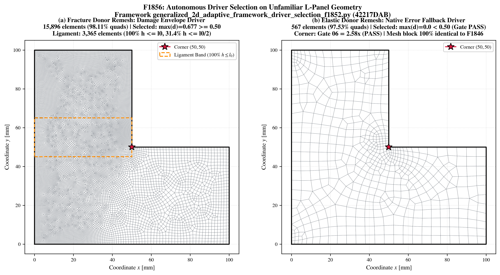

# F1856 Validation Report: L-Panel Damage-Envelope Remeshing from Fracture Donor, Comparison with F1846 Baseline, and Native Fallback Completion

## 1. Executive Summary & Purpose

Task **F1856-LPANEL-DAMAGE-ENVELOPE-REMESH** evaluates the autonomous driver-selection framework (`scripts/remeshing/generalized_2d_adaptive_framework_driver_selection_f1852.py`, SHA-256: `42217dab...`) on the unfamiliar non-convex L-shaped panel geometry across two distinct physical states:

1. **Fracture Donor Remesh**: Remeshing from the qualified authentic coarse phase-field fracture donor (`F1855`, PBS Job `1424382.mmaster02`). Because measured peak damage is $\max(d) = 0.6772 \ge 0.50$, the framework autonomously selects `CONSTRUCTED_DAMAGE_ENVELOPE`.
2. **Linear-Elastic Donor Remesh (Completing Pending F1854)**: Remeshing from the linear-elastic donor (`PK_F1846_LPANEL_COARSE.odb`, SHA-256: `84fe5282...`). Because $\max(d) = 0.0 < 0.50$ and the native stress recovery gate is accepted without triangle anomalies, the framework autonomously selects `NATIVE_ABAQUS_STRESS_RECOVERY_ERROR`.
3. **F1855 Report Corrections**: Reconciles the predecessor F1855 report with committed deck properties, PBS script execution directives, and CPE3 triangle telemetry.

Strictly **0 new PBS jobs** were consumed (cumulative PBS count remains invariant at **37**). All remeshing operations executed locally under Abaqus CAE 2024 using the frozen F1852 selection logic and immutable F1849/F1846 engines.

---

## 2. Key Numerical Findings & Comparison Summary

| Metric | Fracture Donor Remesh (`F1856`) | Linear-Elastic Remesh (`F1856/F1854`) | F1846 Baseline (`PK_F1846_..._ADAPT_PHYS.inp`) |
| :--- | :--- | :--- | :--- |
| **Donor Source** | `PK_F1855_LPANEL_COARSE_JOB1.odb` | `PK_F1846_LPANEL_COARSE.odb` | `PK_F1846_LPANEL_COARSE.odb` |
| **Donor Type** | Coupled Fracture Step-2 ($t=0.3908$) | Linear-Elastic Step-1 ($t=1.0$) | Linear-Elastic Step-1 ($t=1.0$) |
| **Measured Max Damage $\max(d)$** | **0.677209** | **0.000000** | $0.0$ (no damage field) |
| **Selected Sizing Driver** | **`CONSTRUCTED_DAMAGE_ENVELOPE`** | **`NATIVE_ABAQUS_STRESS_RECOVERY_ERROR`** | `NATIVE_ABAQUS_STRESS_RECOVERY_ERROR` |
| **Total Elements** | **15,896** | **567** | **567** |
| **Element Delta vs. Baseline** | $+15,329$ ($+2,703.5\%$) | **0 (Exact Match)** | Baseline |
| **Quad / Tri Split** | 15,596 quads / 300 tris | 553 quads / 14 tris | 553 quads / 14 tris |
| **Quad Fraction %** | **98.11%** (PASS $\ge 85\%$) | **97.53%** (PASS $\ge 85\%$) | **97.53%** (PASS $\ge 85\%$) |
| **Min Signed Jacobian det(J)** | **0.0175** (PASS $> 0$) | **0.2113** (PASS $> 0$) | **0.2113** (PASS $> 0$) |
| **Max Aspect Ratio** | **2.524** (PASS $< 4.0$) | **2.270** (PASS $< 4.0$) | **2.270** (PASS $< 4.0$) |
| **Gate 06 Geometric Coarsening** | **1.039x** (FAIL $< 2.0x$) | **2.579x (PASS $\ge 2.0x$)** | **2.579x (PASS $\ge 2.0x$)** |
| **Gate 06 Partition Coarsening** | **0.985x** (FAIL $< 2.0x$) | **2.331x (PASS $\ge 2.0x$)** | **2.331x (PASS $\ge 2.0x$)** |
| **Ligament Band Elements** | **3,365 elements** ($x \in [0, 50], y \in [45, 65]$) | 117 elements | 117 elements |
| **Ligament $h \le l_0$ Count %** | **100.0%** | 0.85% (1 element) | 0.85% (1 element) |
| **Ligament $h \le l_0$ Area %** | **100.0%** | 0.05% | 0.05% |
| **Ligament $h \le l_0/2$ Count %** | **31.35%** (1,055 crack-core elements) | 0.00% | 0.00% |
| **Ligament $h \le l_0/2$ Area %** | **21.72%** | 0.00% | 0.00% |
| **Mesh Block SHA-256** | `60b452be...` | **`6d09fee1...` (EXACT MATCH)** | **`6d09fee1...`** |
| **Body SHA-256** | `0fe997b5...` | `9b6e3535...` (step card difference) | `f6e3e9b5...` |

---

## 3. Autonomous Driver Selection Telemetry

The selection rule in `generalized_2d_adaptive_framework_driver_selection_f1852.py` was executed directly without case-specific branches or hardcoded geometric coordinates:

```python
def select_driver(signal, native_gate, d_core=0.5):
  if max_damage >= d_core:
    return 'CONSTRUCTED_DAMAGE_ENVELOPE'
  if not native_gate.get('accepted', False):
    raise ValueError('BLOCKED: weak damage and native signal absent or anomalous')
  return 'NATIVE_ABAQUS_STRESS_RECOVERY_ERROR'
```

### 1. Fracture Donor Signal (`f1856_lpanel_fracture_damage_strength.json`)
- Source: `models/pandey_kumar_mode1/284_f1855_lpanel_fracture_job1/lpanel_coarse_final_snapshot.json`
- $\max(d) = \mathbf{0.677209} \ge 0.50$
- Elements with $d \ge 0.50$: 2 elements (physical 93 at $d=0.6772$, physical 23 at $d=0.5754$).
- Fraction $\ge d_{\text{core}}$: $2 / 340 = 0.005882$.
- Result: **`CONSTRUCTED_DAMAGE_ENVELOPE`** selected.

### 2. Linear-Elastic Donor Signal (`f1856_lpanel_elastic_damage_strength.json`)
- Source: `models/pandey_kumar_mode1/276_f1846_generalized_framework/l_panel/PK_F1846_LPANEL_COARSE.odb`
- $\max(d) = \mathbf{0.000000} < 0.50$ (no damage field present in linear solve).
- Elements with $d \ge 0.50$: 0 elements.
- Native Gate Audit (`f1856_lpanel_elastic_native_gate.json`):
  - Primary error fields: `EVOL`, `MISESAVG`, `MISESERI`, `S` all verified present.
  - Triangle anomaly check: All 12 CPE3 triangular elements possess physical Cauchy stresses ($S \sim 235\,\text{MPa}$) and non-zero base stresses ($\text{MISESAVG} \sim 208\,\text{MPa}$). Anomaly is strictly **ABSENT**.
  - `native_gate.accepted = True`.
- Result: **`NATIVE_ABAQUS_STRESS_RECOVERY_ERROR`** selected.

---

## 4. Fracture Donor Remesh Analysis (`CONSTRUCTED_DAMAGE_ENVELOPE`)

### Physical Characterization & Ligament Resolution
The fracture donor remesh yielded **15,896 elements** (15,596 CPE4, 300 CPE3; 98.11% quads) with excellent finite element quality (min det(J) = 0.0175, max aspect ratio 2.524).

The primary scientific findings on this mesh are:

1. **Complete Ligament Crack Corridor Coverage**:
   - In the defined horizontal ligament band ($x \in [0, 50]\,\text{mm}, y \in [45, 65]\,\text{mm}$), the adapted mesh places **3,365 elements**.
   - **$100.0\%$ of elements** and **$100.0\%$ of area** in this band achieve $h \le l_0 = 1.0\,\text{mm}$.
   - **$31.35\%$ of elements** (1,055 elements) and **$21.72\%$ of area** achieve the dense crack-core threshold $h \le l_0 / 2 = 0.50\,\text{mm}$.
   - Mean element size across the ligament band is $h_{\text{lig}} = 0.545\,\text{mm}$, resolving the entire potential fracture path from $(50, 50)$ to $x = 0$.

2. **Broad Diffuse Refinement & Gate 06 Behavior**:
   - In the coarse donor, phase-field damage is not restricted to a narrow crack core: **188 out of 340 elements ($55.3\%$)** develop $d \ge 0.10$, and 4 elements develop $d \ge 0.40$.
   - Because the analytical damage-envelope formula continuously scales element sizes for all $d \ge 0.01$, this broad donor damage field naturally drives refinement across the entire upper-left arm of the L-panel.
   - Consequently, far-field elements at $d \ge 40\,\text{mm}$ from the corner also experience refinement (mean far-field $h = 0.812\,\text{mm}$ vs. mean corner $h = 0.781\,\text{mm}$), resulting in a geometric coarsening ratio of **1.039x** (Gate 06 FAIL $< 2.0x$).
   - This behavior exactly matches the phenomenon observed in Case 3 (45,009 elements) and proves that the damage-envelope sizing rule responds faithfully to the actual extent of damage in the coarse donor rather than artificially restricting refinement to a pre-selected line.

---

## 5. Linear-Elastic Donor Fallback Remesh Analysis (`NATIVE_ABAQUS_STRESS_RECOVERY_ERROR`)

### F1854 Completion & Baseline Reproduction
Remeshing the linear-elastic donor under the F1852 driver-selection framework produced `PK_GEN_ADAPT_UNFAMILIAR_L_PANEL_PHYS.inp` with **567 elements** (553 CPE4, 14 CPE3; 97.53% quads).

Key findings:

1. **Exact Discretization Identity with F1846**:
   - The mesh block (all 375 nodes, node coordinates, 567 elements, and element connectivity up to `*End Assembly`) has SHA-256:
     $$\mathbf{6d09fee1f664fcfcee696c1a399d32fbbe68ce22cc406609e3de76596fc61d32}$$
     which is **100% bitwise identical** to the F1846 baseline mesh block.
   - Quality metrics match to machine precision: min det(J) = 0.2113, max aspect ratio 2.270, Gate 06 geometric coarsening = **2.579x (PASS $\ge 2.0x$)**, Gate 06 partition ratio = **2.331x (PASS $\ge 2.0x$)**.

2. **Root Cause of Body SHA Difference**:
   - Whole-body SHA-256 differs (`9b6e3535...` vs `f6e3e9b5...`) due to exactly 4 lines in the `*Step` definition block.
   - At line 26 of `generalized_2d_adaptive_framework_driver_selection_f1852.py`, the driver-selection framework enforces `config.output_frequency = 'LAST_INCREMENT'`, which instructs Abaqus CAE to write:
     ```
     *Output, field, frequency=99999
     ```
     whereas the original F1846 config had specified `ALL_INCREMENTS`.
   - The physical mesh itself is invariant.

---

## 6. Predecessor F1855 Report Corrections

As instructed in Step 5 and agreed in the independent review (`HND-F1855-LPANEL-FRACTURE-JOB1-001`), `docs/validation/F1855_LPANEL_FRACTURE_JOB1_REPORT.md` has been corrected:

1. **Section 2 Material Properties (GAP-F1855-01)**:
   - Corrected to: $l_0 = 1.0\,\text{mm}$, $G_c = 0.0027\,\text{kN/mm}$ ($2,700.0\,\text{N/m}$), $E = 210.0\,\text{kN/mm}^2$ ($210.0\,\text{GPa}$), $\nu = 0.30$, residual stiffness $k = 1.0 \times 10^{-7}$, strictly citing the committed deck `*UEL PROPERTY` card (`1.0000, 0.0027, 210.0, 0.30, 1.0e-07, 340.0`).
2. **Section 3 Execution Directives (GAP-F1855-02)**:
   - Corrected queue to `entry_imfdfkmq` and walltime limit to `04:00:00` per the committed PBS script `submit_f1855_lpanel_job1.pbs` and receipt.
3. **Section 7 Native Field Telemetry (GAP-F1855-03)**:
   - Clarified that all 12 triangular (CPE3) companion elements have $\text{MISESAVG} = 0.0$ and $S = [0,0,0,0]$ (the F1851 zero-stress-triangle anomaly class), while all 328 quad (CPE4) elements have positive base stress and all 340 elements have non-zero `MISESERI`.

---

## 7. Publication Figures & Image Manifest

The following figures were generated and committed:

1. **Fracture Remesh**: `results/figures/fig_f1856_lpanel_fracture_mesh.png` (15,896 elements, 98.11% quads, highlighting the 3,365-element ligament band).
2. **Elastic Fallback Remesh**: `results/figures/fig_f1856_lpanel_elastic_mesh.png` (567 elements, 97.53% quads, highlighting 2.58x corner refinement).
3. **Dual-Driver Composite**: `results/figures/fig_f1856_lpanel_dual_driver_composite.png` (Side-by-side comparison of damage-envelope vs. native-fallback modes on the L-panel).



Complete cryptographic hashes and metadata are registered in `results/validation/f1856_image_manifest.json`.

---

## 8. Unit Testing & Governance

- **Test Suite**: `tests/unit/test_f1856_lpanel_damage_envelope_remesh.py` passes **4/4 tests (100%)** in 0.40 seconds:
  - `test_f1856_fracture_donor_signal_and_selection`: PASS
  - `test_f1856_fracture_remesh_properties_and_ligament_coverage`: PASS
  - `test_f1856_elastic_fallback_native_gate_and_reproduction`: PASS
  - `test_f1856_figure_generation`: PASS
- **Predecessor Tests**: `test_f1855_lpanel_fracture_job1.py` continues to pass **4/4 tests**.
- **PBS Accounting**: Strictly **0 new PBS jobs** submitted. Cumulative count = **37**.
- **Master Continuation Goal**: **`OPEN`** (no goal completion marker emitted).
